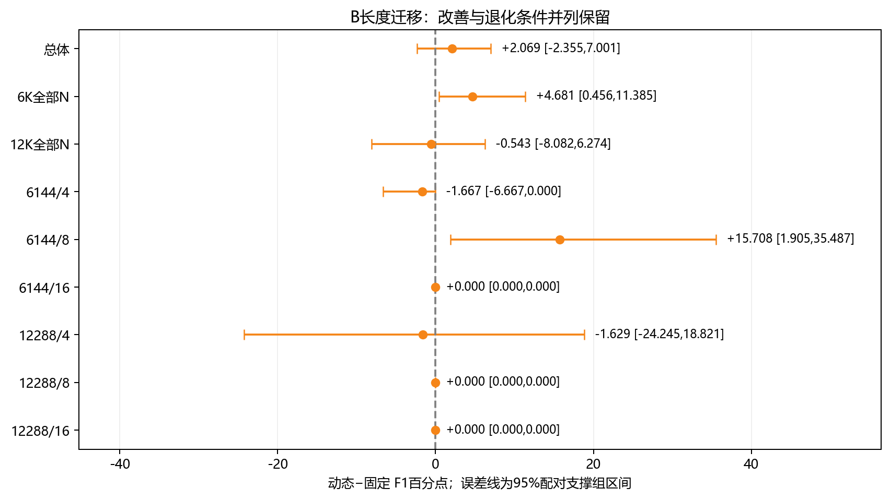
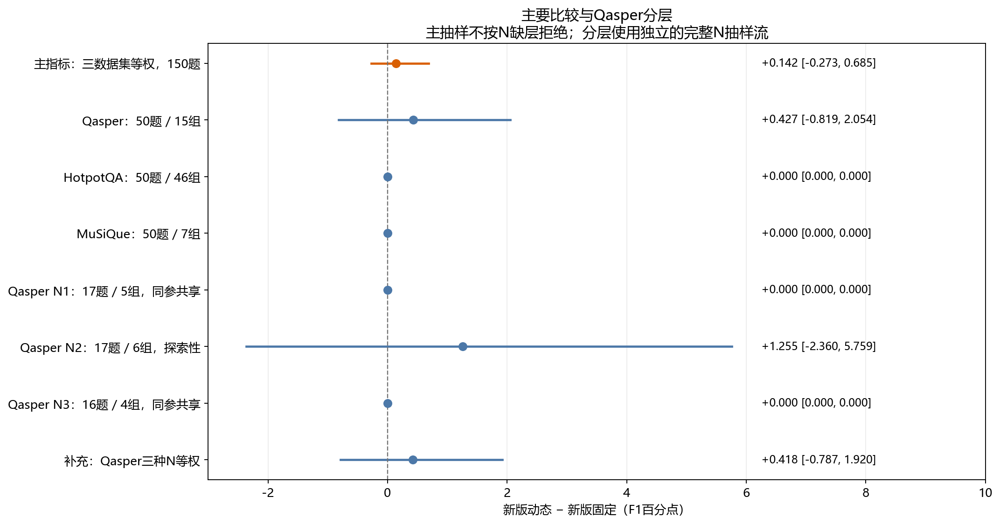
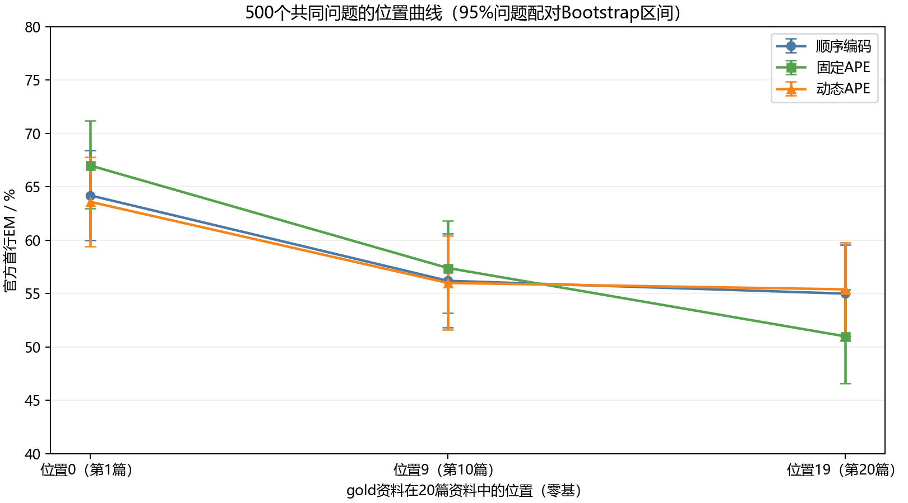
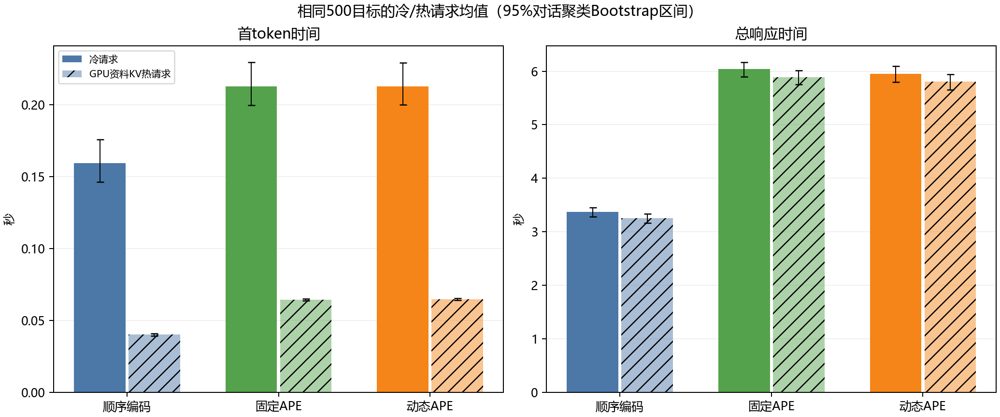

# 基于 APE 自适应并行编码技术的长文本高效处理与应用研究

结题报告草稿 · 2026年11月18日 · 待服务器端审核

统计依据为 SlveO/APE-Report 的 `analysis/main80-pc-results` 分支。服务器输入包版本为 `ab816f5`，PC分析发布版本为 `0b4f099`。下文结果均取自该 PC 版本的 MAIN80 和 FOLLOWUP2604 分析表。[服务器输入包](../followup2604-20261117/PC_TASK.md) · [PC 分析发布版本](https://github.com/SlveO/APE-Report/commit/0b4f099d94ec6198fc8603cc21cb8b638f89054f)

## 摘要

我们比较顺序编码、并行上下文窗口 PCW、固定 APE 和动态 APE，考察长文本问答质量与响应时间。在 LongBench 600 题基线中，顺序编码宏 F1 最高，为 45.43，PCW 平均总响应最短，为 1.635 秒。修正开发构造后，冻结九格规则在 6K 的差值为 +4.68 个百分点，在 12K 为 −0.54 个百分点。新版自然分块规则的主要验证覆盖三数据集共 150 题和 68 个支撑资料组件。新版动态相对新版固定的宏 F1 差为 +0.1422 个百分点，95% 置信区间为 [−0.2731，0.6848]。总体收益尚未确立，新版动态低于同批默认 APE 和历史固定规则。自然确认集的多块输入仅见于 Qasper。历史动态规则在 LITM 改善末位、降低首位和中间位置的得分，三位置平均接近持平。在 Doc2Dial 中，同一目标的资料 KV 热复用主要缩短首 token 等待，冷热答案一致。

**关键词**　自适应并行编码、长文本问答、动态选参、资料 KV 缓存

## 1 本机基线

### 1.1 方法与评价

顺序编码按完整序列处理输入。PCW 独立编码局部窗口并在生成阶段读取合并的缓存。APE 共享前缀并独立编码文档块，在查询和生成阶段用温度 T 调节文档注意力分布，用尺度 S 参与文档与其他分支的权重分配。实验采用 Llama-3.1-8B-Instruct、BF16、贪心生成和 batch=1。本节的“本机基线”指本项目统一配置下在实验服务器实测的基线。服务器实现逐块调用并合并 KV，响应时间同时受该实现、输出长度及缓存状态影响。当前运行记录缺设备型号、总显存和驱动遥测。[APE 原论文](https://arxiv.org/abs/2502.05431) · [原实验方案](../files/docs/EXPERIMENT_PLAN.md) · [MAIN80 前置审核](../pc-analysis-output/stages/01_audit/reports/AUDIT.md) · [FOLLOWUP2604 环境](../pc-analysis-followup-output/environment.json)

LongBench 用英文 token F1，正文按 0–100 展示。正式测试的宏 F1 先算各数据集的题均值，再对数据集等权平均。LITM 按官方入口计算答案首行 EM。Doc2Dial 汇总全语料的 n-gram 计数计算 corpus BLEU。差值为比较方法减参照方法。同一比较保留相同题目或目标轮次。区间采用配对 Bootstrap 的 2.5% 和 97.5% 分位数，5,000 次，随机种子 20261116。唯一题数、支撑资料组数、统计抽样单位及组件数单列，重复长度、位置、冷热条件和共享生成均按各实验的原有抽样单位保留。[统一结果表](统一结果表.csv) · [LongBench 论文](https://aclanthology.org/2024.acl-long.172/) · [实验来源与评分](../files/APE/main80/SOURCES.md)

### 1.2 LongBench 600 题质量与耗时

基线三数据集各 200 题，按原始论文或完整证据组抽样，Qasper／HotpotQA／MuSiQue 分别为 142／200／194 组，共 536 组。顺序编码宏 F1 最高，PCW 平均总响应最短。相对顺序编码，PCW 的宏 F1 差为 −2.094 个百分点，95% 置信区间为 [−4.624，0.353]，平均总响应缩短 0.177 秒。默认 APE 的宏 F1 差为 −2.106 个百分点，95% 置信区间为 [−4.237，−0.001]，首 token 平均更早到达，完整响应平均增加 0.166 秒。PCW 输出均值为 8.905 token，顺序为 11.075 token，生成长度也是总响应差的组成部分。[基线分析](../pc-analysis-output/stages/01_longbench_baseline/reports/BASELINE_REPORT.md) · [质量配对](../pc-analysis-output/stages/01_longbench_baseline/tables/baseline_quality_paired.csv)

| 方法 | Qasper | HotpotQA | MuSiQue | 等权宏 F1 | 平均首 token / 秒 | 平均总响应 / 秒 |
|---|---:|---:|---:|---:|---:|---:|
| 顺序编码 | 46.31 | 58.03 | 31.96 | 45.43 | 1.509 | 1.813 |
| PCW | 45.37 | 54.09 | 30.56 | 43.34 | 1.389 | 1.635 |
| 默认 APE | 46.09 | 53.01 | 30.87 | 43.33 | 1.452 | 1.978 |

同型号模型在 APE 论文表 2 的对应三任务宏 F1 为顺序 43.00、PCW 37.41、APE 41.77。本研究基线使用 LongBench 扩展文本和每块最多 7,500 token 的实际分块，论文相应 PCW／APE 行使用检索文本块。两套输入、样本筛选和参数设置的差异见配置对照。[APE 论文表 2](https://arxiv.org/html/2502.05431v1#S5.T2) · [公开成绩对照](../pc-analysis-output/stages/01_longbench_baseline/tables/official_comparison.csv) · [设置差异](../pc-analysis-output/stages/01_longbench_baseline/tables/official_setting_comparison.csv)

## 2 参数探索与动态规则

### 2.1 原九格探索和冻结

原探索用 4K／8K／16K 文档长度与 4／8／16 实际编码块数构成九格，每格评价 16 组 T/S。实际覆盖全部 144 种配置和 6,672 条生成。按数据集和九格等权，全局候选 0.7／1.0 的 F1 为 41.1629，默认 0.9／0.9 为 40.1588。40 题验证后选 0.7／1.0 为固定参数，逐格候选仅在验证得分高于固定时采用。历史冻结规则（统一表记为 `main80-nine-cell-v1`）在这批验证题上比固定高 0.597 个百分点，95% 区间为 [−1.227，2.138]。[探索分析](../pc-analysis-output/stages/02_parameter_exploration/reports/PARAMETER_EXPLORATION.md) · [旧验证分析](../pc-analysis-output/stages/03_validation_rule/reports/VALIDATION_REPORT.md)

### 2.2 原 MAIN80 独立测试，510 题

Qasper、HotpotQA 和 MuSiQue 各 170 题，主区间对应原论文或完整证据组 116／170／164 组，共 450 组。五方法宏 F1 为顺序 46.2074、PCW 43.6749、默认 APE 43.8639、旧固定 43.0899、旧动态 42.8067。动态减固定为 −0.2832 个百分点，95% 区间为 [−1.6764，1.0921]，47 胜、415 平、48 负。实际 N 分布为 1 块 177 题、2 块 104 题、3 块 229 题，均映射到旧规则的 N=4 列。测试与开发共享单篇输入资料涉及 59 题，共享单篇支撑资料涉及 29 题。后者均为 MuSiQue，动态和固定得分全部持平。旧 510 题的输入为 LongBench 扩展文本。[旧 510 题结果](../pc-analysis-output/stages/06_longbench_final/reports/LONGBENCH_FINAL_REPORT.md) · [五方法配对](../pc-analysis-output/stages/06_longbench_final/tables/main_quality_paired.csv)

### 2.3 修正构造与 6K／12K 迁移

前置审核发现原冻结的 432 份开发构造中有 80 份未完整保留审核定位的标注或保守支撑范围，实际投入生成的 278 份中有 54 份受影响，关联 1,605 条生成。修正版按 token ID 和 ByteLevel 字节还原重新定位证据。适用构造从 432 份降为 359 份，73 份退出、98 份生成输入改变、261 份一致。73 份退出项对应的合并原因 `no_evidence_or_evidence_exceeds_target` 见服务器输入包内 `code/001/APE/main80/data.py` 的 `construct` 函数。“无证据”与“证据超过目标长度”的分项数量尚待区分。[原构造审核](../pc-analysis-output/reports/INTERNAL_BRIEFING_2026-11-17.md) · [构造计数](../pc-analysis-followup-output/tables/a_input_counts.csv) · [修正输入与配对](../pc-analysis-followup-output/reports/A_CORRECTION.md)

按同一 T/S=0.7／1.0 比较，旧全量探索 F1 为 41.1629，限定修正后仍适用的样本后为 42.1221，替换为修正输入后为 42.0641。同参数输入差为 −0.0580 个百分点，95% 区间为 [−1.6027，1.5288]。这一比较保留 48 个唯一问题，按 14／17／16 个冻结支撑资料组抽样。跨版本总均值还受适用样本构成变化影响。[探索配对原表](../pc-analysis-followup-output/tables/a_exploration_frozen_parameter_pairs.csv)

修正探索的全局候选变为 0.5／1.0，4/9 格提名改变。A 阶段验证覆盖 40 个唯一问题、300 个题长块条件，抽样使用 10／13／14 个冻结支撑资料组。最终固定参数为 0.5／1.0，修正版 `corrected-nine-cell-v1` 改变 6/9 格。固定和动态 F1 分别为 42.4017 和 43.1724，差 +0.7706 个百分点，95% 区间为 [−0.9926，2.5739]。A 阶段参与参数选择。[冻结规则表](../pc-analysis-followup-output/tables/a_rule_changes.csv) · [验证配对](../pc-analysis-followup-output/tables/a_validation_paired.csv)

B 阶段将 10 个既有验证问题放到 6K／12K、N=4／8／16 条件中，形成 60 个配对条件。Qasper、HotpotQA 和 MuSiQue 分别为 4／3／3 题，各 3 个冻结支撑资料组，共 9 组。每次按组抽样时保留组内各题的全部长度、块数和策略。长度汇总在各数据集内对题与块数条件等权，再对三个数据集等权。6K 的提高主要来自 N=8，12K 的变动只出现在 N=4。长度和块数分层均为探索性结果。[迁移分层原表](../pc-analysis-followup-output/tables/b_quality.csv) · [修正长度迁移](../pc-analysis-followup-output/reports/B_LENGTH.md)

| 长度与块数 | 配对条件数 | 固定 F1 | 动态 F1 | 差值 / 百分点 | 95% 区间 | 胜／平／负 |
|---|---:|---:|---:|---:|---|---|
| 6K，三种 N | 30 | 31.2698 | 35.9503 | +4.6805 | [0.4558，11.3846] | 3／26／1 |
| 6K，N=4 | 10 | 43.757 | 42.090 | −1.6667 | [−6.6667，0.0000] | 0／9／1 |
| 6K，N=8 | 10 | 22.407 | 38.116 | +15.7082 | [1.9048，35.4872] | 3／7／0 |
| 6K，N=16 | 10 | 27.646 | 27.646 | 0.0000 | [0.0000，0.0000] | 0／10／0 |
| 12K，三种 N | 30 | 48.2657 | 47.7228 | −0.5429 | [−8.0817，6.2735] | 2／27／1 |
| 12K，N=4 | 10 | 42.522 | 40.893 | −1.6287 | [−24.2450，18.8205] | 2／7／1 |
| 12K，N=8 | 10 | 60.423 | 60.423 | 0.0000 | [0.0000，0.0000] | 0／10／0 |
| 12K，N=16 | 10 | 41.852 | 41.852 | 0.0000 | [0.0000，0.0000] | 0／10／0 |
| 两长度合计 | 60 | 39.7678 | 41.8366 | +2.0688 | [−2.3551，7.0006] | 5／53／2 |

旧长度检查的动态减固定为 −4.3959 个百分点，95% 区间为 [−8.6095，−0.9484]。两轮分别覆盖 10 题，其中 7 题共同。上述差值分别对应两轮的题目、输入版本及冻结参数。修正版局部退化的原因未确定，现有记录缺同题的参数与证据位置交叉对照。[历史迁移结果](../pc-analysis-output/stages/04_length_check/reports/LENGTH_CHECK_REPORT.md) · [跨版本逐条件连接](../pc-analysis-followup-output/tables/b_historical_pairs.csv)

### 2.4 动态规则的主要验证，自然分块 150 题

自然分块使用完整原始来源上下文，每块最多 7,500 token，实际 N 由文档长度决定。54 题用于探索，36 题用于验证，选定参数和规则后才执行 150 题独立确认。探索、验证和确认按共享支撑资料的连通组件隔离。新版 `natural-chunk-v2` 固定参数为 1.0／0.9，动态在 N=2 时使用 0.9／1.0，N=1 和 N=3 沿用固定。Qasper、HotpotQA 和 MuSiQue 各 50 个唯一问题，七方法 1,050 个逻辑结果来自 897 次实际生成。同参的逻辑标签共享同一次生成。[冻结与样本审核](../pc-analysis-followup-output/reports/PROTOCOL_AUDIT.md)

| 方法 | Qasper / 50 | HotpotQA / 50 | MuSiQue / 50 | 等权宏 F1 |
|---|---:|---:|---:|---:|
| 顺序编码 | 34.1818 | 58.2258 | 36.3939 | 42.9338 |
| PCW | 36.7821 | 58.9202 | 29.9380 | 41.8801 |
| 默认 APE | 34.9358 | 60.2258 | 42.3333 | 45.8316 |
| MAIN80 固定规则 | 34.4854 | 64.3968 | 39.3333 | 46.0719 |
| MAIN80 动态规则 | 35.7875 | 58.2258 | 38.0303 | 44.0145 |
| 新版自然固定 | 34.0096 | 54.2258 | 38.6970 | 42.3108 |
| 新版自然动态 | 34.4363 | 54.2258 | 38.6970 | 42.4530 |

**主比较为新版动态减新版固定，+0.1422 个百分点，95% 置信区间 [−0.2731，0.6848]，3 胜、146 平、1 负。** 统计抽样单位为数据集内的支撑资料连通组件，合计 68 个。Qasper、HotpotQA 和 MuSiQue 分别为 15／46／7 个组件。5,000 次配对 Bootstrap 使用 seed=20261116，保留每个抽中组件的全部题和方法，重算各数据集的题均值，再将三集等权合并。区间跨零，总体收益尚未确立。[主结果](../pc-analysis-followup-output/tables/headline_results.csv) · [七方法分数](../pc-analysis-followup-output/tables/c_quality.csv) · [统计配置](../pc-analysis-followup-output/STATISTICAL_CONFIG.json)

同一批 150 题的两个不利参照均采用上述组件抽样。新版动态相对默认 APE 的差值为 −3.3786 个百分点，95% 区间 [−6.7809，−0.4737]，7 胜、129 平、14 负。相对用相同输入重跑的历史固定规则，差值为 −3.6188 个百分点，95% 区间 [−8.4072，−0.2035]，13 胜、117 平、20 负。新版固定相对历史固定也低 3.7611 个百分点，95% 区间 [−8.5395，−0.3103]。以上为补充比较，区间逐项计算，未作多重比较校正。新版固定和动态的平均总响应分别为 1.2730 和 1.2550 秒，133 题共享生成，本批没有交错重复计时。[不利参照配对](../pc-analysis-followup-output/tables/c_adverse_reference_comparisons.csv) · [效率描述](../pc-analysis-followup-output/tables/c_efficiency_descriptive.csv)

**自然确认集的多块证据限于 Qasper。** Qasper 的 N=1／2／3 对应 17／17／16 题，各覆盖 5／6／4 个组件。N=1 和 N=3 同参持平。N=2 的差为 +1.2549 个百分点，95% 区间 [−2.3605，5.7588]，四个非零差题来自三个组件。这是探索性分层结果。分层从 Qasper 全部 15 个组件联合抽样，缺层重抽 69 次，获得 5,000 次有效抽样。主比较使用单独的抽样序列，保留数据集内的题数权重。HotpotQA 和 MuSiQue 各 50 题，全部 N=1，同参共享答案。Qasper 三种 N 等权结果作为补充。[确认集分层](../pc-analysis-followup-output/tables/c_paired.csv) · [抽样诊断](../pc-analysis-followup-output/tables/c_bootstrap_diagnostics.csv)

**旧 510 题与新 150 题分别报告。** 两批题目与输入分布均不同。510 题使用 LongBench 扩展文本，150 题使用原始来源上下文。跨规则比较以同一 150 题上同时运行的参照方法为准，动态规则的主要验证以上述 +0.1422 个百分点的配对结果为准。[旧 510 题报告](../pc-analysis-output/stages/06_longbench_final/reports/LONGBENCH_FINAL_REPORT.md) · [新 150 题报告](../pc-analysis-followup-output/reports/C_CONFIRMATION.md)

## 3 长文本证据位置

### 3.1 注意力诊断

我们在三道题的两种输入条件下比较 APE 默认值和探索候选，共六组配对。采集层为 0／15／31，注意力头为 0／8／16／24，包含请求末 token 和实际生成步骤。统计的是文档分支和其他分支融合后的 token 权重。4K／4 下候选使采样层的文档总权重上升，Qasper 示例 F1 从 30.77 升至 80.00，HotpotQA 保持 100，MuSiQue 保持 0。16K／16 下三题文档权重下降，F1 均持平。生成历史分歧后的权重随参数和已生成内容共同变化。当前采集支持案例分析，顺序与并行编码的逐层逐头对照仍待补充。[注意力与答案对应](../pc-analysis-output/stages/05_attention/reports/ATTENTION_REPORT.md)

### 3.2 LITM 三位置问答

LITM 使用历史 `main80-nine-cell-v1` 规则。我们使用原作者的 20 文档版本，将同一题的证据文档移动到位置 0／9／19，共 500 个唯一问题。实际编码块数均为 N=1，固定 T/S 为 0.7／1.0，动态均映射为 1.0／1.0。按官方入口取回答首行再算 `best_subspan_em`，4,500 条结果中 501 条的正确／错误标签改变。下表使用首行重评分结果。统计抽样单位为问题，共 500 个单位，每次共同保留该题三个位置和三种方法。[LITM 论文](https://aclanthology.org/2024.tacl-1.9/) · [官方评分入口](https://github.com/nelson-liu/lost-in-the-middle/blob/main/scripts/evaluate_qa_responses.py) · [评分及位置分析](../pc-analysis-output/stages/07_litm/reports/LITM_REPORT.md)

| 证据位置 | 顺序 EM / % | 历史固定 EM / % | 历史动态 EM / % | 动态−固定 / 百分点 | 95% 区间 |
|---|---:|---:|---:|---:|---|
| 0 | 64.20 | 67.00 | 63.60 | −3.40 | [−6.80，0.00] |
| 9 | 56.20 | 57.40 | 56.00 | −1.40 | [−4.60，1.80] |
| 19 | 55.00 | 51.00 | 55.40 | +4.40 | [0.60，8.20] |
| 三位置等权 | 58.47 | 58.47 | 58.33 | −0.13 | [−2.40，2.20] |

三种方法的最低点均在末位。历史动态缩小首末得分落差，同时使位置 9 相对两端平均的缺口从 1.6 扩大到 3.5 个百分点。顺序、历史固定、历史动态平均总响应分别为 2.441、4.252、4.122 秒。1,465 条生成达到上限，其中 1,391 条此前已有换行，首行评价和完整生成计时因此对应不同的输出范围。[位置配对区间](../pc-analysis-output/stages/07_litm/tables/main_quality_paired.csv) · [长度和计时](../pc-analysis-output/stages/07_litm/reports/LITM_REPORT.md)

## 4 Doc2Dial 问答与资料缓存

样本从 Doc2Dial 官方原始 validation 文件 `doc2dial_dial_validation.json` 冻结抽取，涵盖 500 个唯一目标轮次、366 个对话和 172 篇资料。历史 `main80-nine-cell-v1` 固定 T/S 为 0.7／1.0。历史动态在 493 个 N=1 目标用 1.0／1.0，在 7 个 N=2 目标用 0.7／0.7，后者均来自同一篇资料。早期方案登记的 ChatRAG-Bench 测试集属于原计划。[Doc2Dial 论文](https://aclanthology.org/2020.emnlp-main.652/) · [实际数据源审核](../pc-analysis-output/stages/01_audit/reports/STAGE1_SCORING.md#7-官方来源与本地定位) · [运行配置](../pc-analysis-output/stages/08_doc2dial/reports/DOC2DIAL_REPORT.md)

顺序、历史固定和历史动态的 corpus BLEU 分别为 3.360、3.251、3.418。动态减固定为 +0.167 BLEU，主抽样单位为对话，共 366 个簇，95% 区间 [−0.205，0.562]。按 172 篇资料聚类的敏感性区间为 [−0.192，0.514]。三方法输出均值约 113–116 token，70%–76.2% 达到 128-token 上限，生成文本约为参考长度的 5.6 倍。语料级 BLEU 同时受输出长度和词面匹配精度影响。评分与 SacreBLEU 2.4.3 的 13a、mixed case、exp 平滑和单参考设置一致。[主配对表](../pc-analysis-output/stages/08_doc2dial/tables/main_quality_paired.csv) · [资料簇敏感性表](../pc-analysis-output/stages/08_doc2dial/tables/main_quality_paired_document_sensitivity.csv)

三方法共同将资料前置。热请求复用同进程资料 GPU KV，完整对话历史和当前请求重新进入模型。1,500 对同一目标的冷热请求中，热端全部命中资料缓存并重新生成，答案逐 token 一致。首 token 的冷／热平均耗时比为 3.29–3.97，总响应的冷／热平均耗时比为 1.025–1.037。热端省下的主要是生成前的资料编码。当前测量条件为同一目标再次提交。[冷／热时延与区间](../pc-analysis-output/stages/08_doc2dial/tables/cache_effects.csv) · [热请求生成证据](../pc-analysis-output/stages/08_doc2dial/tables/hot_generation_evidence.csv)

| 方法 | 冷 TTFT / 秒 | 热 TTFT / 秒 | 冷总响应 / 秒 | 热总响应 / 秒 |
|---|---:|---:|---:|---:|
| 顺序编码 | 0.1592 | 0.0401 | 3.3714 | 3.2516 |
| 历史固定 | 0.2128 | 0.0643 | 6.0380 | 5.8887 |
| 历史动态 | 0.2128 | 0.0647 | 5.9492 | 5.8056 |

## 5 项目完成情况

我们按《APE项目申报书》的“主要研究内容”“项目研究的目的和基本思路”“项目研究的未来工作安排”和“拟解决关键问题与预期成果”核对完成情况。申报材料留存在项目目录，实验材料见表中来源。

| 申报目标 | 实际完成情况 | 待补充的工作或凭据 |
|---|---|---|
| 收集与整理长文本任务数据，开展对照评估 | 整理并冻结 LongBench、LITM 和 Doc2Dial，保存输入、参考答案、逐题结果及统计。见正文第 1 至 4 节。 | — |
| 优化并行编码，研究基于上下文长度的超参数动态调整 | 实现 T/S 九格搜索、构造修正和自然分块规则，完成冻结后 150 题确认。新版动态相对新版固定宏 F1 差 +0.1422 个百分点，区间跨零，同题表现低于默认 APE 和历史固定。 | 动态收益仍待在更多支撑资料组及多块任务中确认。 |
| 量化顺序与并行编码的注意力差异，研究动态对齐 | 完成默认与候选 APE 参数的逐层、逐头注意力诊断和答案联查，将 T/S 用于冻结动态规则。见第 3.1 节。 | 顺序与并行编码在相同输入上的直接注意力量化，以及独立新对齐算子的实现和验证。 |
| 处理长文本并缓解中间信息丢失 | 完成 LongBench 问答和 LITM 首、中、末位置对照。历史动态在 LITM 末位提高 4.4 个百分点，中间位置下降 1.4 个百分点。 | 新版自然分块规则的证据位置验证。 |
| 探索教育、金融、医疗等应用以及实时问答、文章总结 | 完成 Doc2Dial 公共服务多轮问答和资料缓存评估，其中包含 98 个学生资助目标轮次。同目标热复用主要减少首 token 等待。 | 教育、金融、医疗专项、跨目标或连续轮次缓存和文章总结评测。 |
| 构建或训练国产大模型，探索多模态融合与统一表示 | 当前完成的是预训练 Llama-3.1-8B-Instruct 上的文本任务与推理评估。 | 国产模型架构适配或训练、多模态输入及统一表示的实验记录。 |
| 申请发明专利一项、投稿核心论文一篇 | 已整理实验分析和结题报告草稿。 | 发明专利申请回执、核心论文投稿凭据。 |

## 6 结论与复核

输入修正改变了九格全局固定参数及六格冻结参数。修正版在既有验证题上迁移到 6K 时点估计上升，迁移到 12K 时点估计下降。新版自然规则的主要验证为冻结后的 150 题：动态相对固定的宏 F1 差为 +0.1422 个百分点，区间跨零，同批分数低于默认 APE 和历史固定。下一步优先扩大自然多块确认样本，并保持默认 APE 与历史固定的同题参照。[FOLLOWUP2604 分析总结](../pc-analysis-followup-output/reports/FOLLOWUP_REPORT.md)

LITM 与 Doc2Dial 均采用历史规则。LITM 三位置平均接近持平，末位改善伴随首位和中间位置退化。Doc2Dial 上历史动态的 BLEU 点估计略高于历史固定，区间跨零。同目标热复用主要缩短首 token 等待。新版规则在两个任务上的结果待补充。[原 MAIN80 汇报](../pc-analysis-output/reports/INTERNAL_BRIEFING_2026-11-17.md)

在仓库根目录运行 `python -B final-report/build_unified_results.py` 可用已发布的 CSV 重新生成统一结果表。表中单列唯一题数、支撑资料组数、抽样单位、抽样组件数、差值、区间和来源。原表只给点估计的公开对照、探索或诊断行在抽样说明中注明。源表记录序号从表头后的首条数据计起。本稿提交 PLANNER 终审，审核意见返回后再修订结论。[统一结果表](统一结果表.csv) · [汇总脚本](build_unified_results.py) · [服务器交付任务](../followup2604-20261117/PC_TASK.md)
