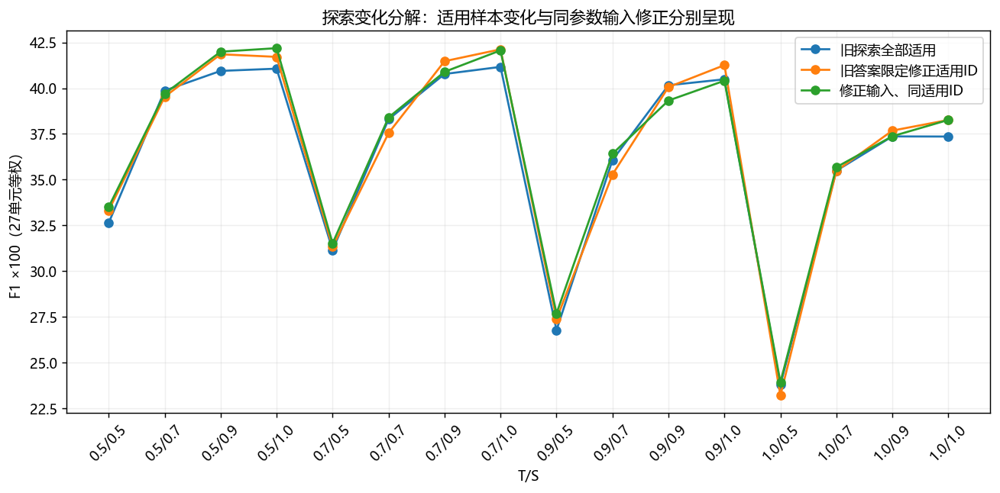
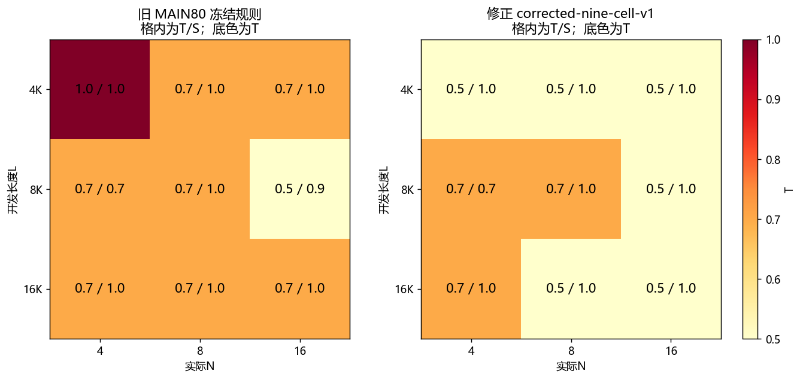
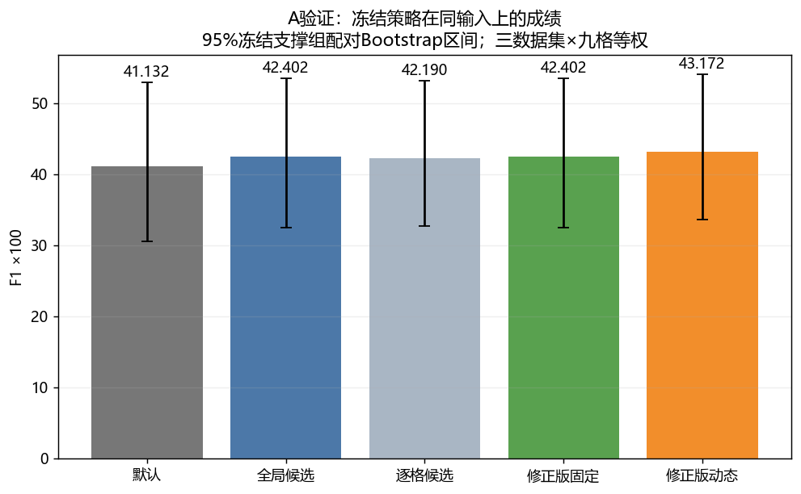
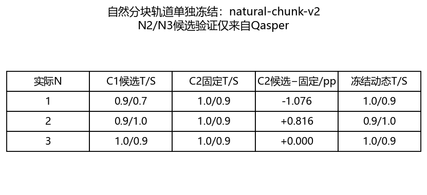

# A阶段：修正探索、验证与冻结规则核对

我们仅连接已有回答和保存候选/冻结规则，未重新选参。旧探索6672条、修正探索5328条；A验证839个实际回答对应900个逻辑候选视图，包含462个新回答和377个历史复用。复用视图保留同一物理源行，未增加独立样本或计时。

## 1 输入修复与适用样本变化

冻结开发构造由432份变为359份：73份退出适用清单，98份生成输入改变，261份生成输入相同。直接比较document_tokens、prefix、suffix、answers、max_new_tokens、scorer。修正冻结文件明确将token IDs与ByteLevel token bytes直接映射到原文UTF-8 bytes，弃用native tokenizers0.19.1 offset_mapping。一般构造原则为保留已验证证据、缺负证据补充审定则不适用；旧/修正开发文件只有适用构造，73份退出项的逐题原因字段未随包保存，逐ID清单保留于a_input_conditions.csv。

上述一般政策与字符映射的准确来源为包内inputs/datasets/frozen-main80-corrected-v1/frozen.json的construction_policy、character_mapping字段；逐ID存在性与输入比较来源为同目录development.json和inputs/datasets/frozen-main80/development.json。

实际探索由139题长缩至111，4K/8K/16K为32/35/44，覆盖48题（Qasper15、HotpotQA17、MuSiQue16）；A验证由119题长缩至100，分别27/34/39，仍覆盖40题。新旧沿用原50/40开发问题的冻结名册。跨版本分数分开呈现全部旧样本、旧答案限定共同适用ID及修正输入共同ID；这些差包含输入与样本构成变化。

修正探索5328条=1248条此前修正campaign产生的回答+4080条严格同输入MAIN80历史回答，全部16组参数配对。这1248条作为provenance带入，未计入FOLLOWUP2604新增2430。a_exploration_scores.csv逐参数列出样本退出的均值变化及同样本/同参数输入修正对应变化；a_exploration_frozen_parameter_pairs.csv另给两个已冻结全局参数的配对组Bootstrap区间。

以旧全局0.7/1.0为固定参照：旧全量F1=41.1629，限定修正适用ID后的旧答案=42.1221，修正输入同参数=42.0641，最后改用保存新版全局0.5/1.0为42.1856。三段变化分别约+0.9592、-0.0580、+0.1215个百分点。同参数修正输入差-0.0580的95%区间为[-1.6027,1.5288]。新旧总均值变化据此分为样本适用性、输入和参数变化，保留其中不利的一段。A新增462条进一步分为240条输入变化和222条同输入新增候选键，a_generation_origin_counts.csv保存计数。

## 2 已冻结的参数变化

探索全局候选由0.7/1.0改为0.5/1.0，逐格提名4/9格改变。A按预定默认/全局候选比较冻结固定0.5/1.0；九格最终6/9格改变。旧MAIN80、corrected-nine-cell-v1、natural-chunk-v2分别保存。

A默认F1=41.1316，修正版固定=42.4017，修正版动态=43.1724。固定−默认=+1.2701个百分点，95%CI[-3.1039,5.9196]；动态−固定=+0.7706个百分点，95%CI[-0.9926,2.5739]。这些是冻结策略在选择用验证集上的评价；B迁移与C独立确认分别承担后续评价。

## 3 自然分块轨道的保存选择

C1为54题×16参数=864回答；C2为36题、104个物理回答及108逻辑视图。保存全局候选/固定为1.0/0.9，动态N1/N3回退固定，N2取0.9/1.0。C1/C2全局权重为数据集等权、Qasper内N等权；N1候选三数据集等权，N2/N3仅Qasper。C3主指标仍按每数据集题均值后等权汇总。

## 4 统计和证据

A冻结支撑组数Qasper/HotpotQA/MuSiQue为10/13/14，同一组全部题、长度、块数和策略共同抽入。seed=20261116，5000次有效配对组Bootstrap；每次先计算各数据集×九格均值再等权。缺失格的该数据集抽样重抽，次数在a_bootstrap_diagnostics.csv；抽样中参数与规则固定。胜/平/负按输入条件计数，独立来源数另列。

三个独立随机流的scope为：110是探索同参数旧/修正输入比较（固定0.7/1.0与0.5/1.0），各数据集5000提出/5000有效、重抽0；111是A验证五个冻结策略主分析，MuSiQue5002提出、重抽2、5000有效；112是默认0.9/0.9不变、限定修正适用ID的旧/修正验证输入比较，MuSiQue5003提出、重抽3、5000有效。111/112其余数据集均重抽0。不同scope区间分别对应各自明确的比较，使用各自SeedSequence，全部诊断均保留。

数据来源为包内provenance/corrected-exploration-for-candidate-reconstruction.jsonl、server/corrected-validation-results.jsonl、inputs/冻结构造与候选、server/corrected-rule.json，以及原MAIN80 attempts.jsonl。所有服务器绝对路径仅作原始文字，实际读取包内相对路径。源行、原答案、参考、输入类别、物理生成及逻辑视图均在a_前缀CSV。修改输入后的得分变化与改用参数的同输入差分别报告，保留退化及跨零区间。
