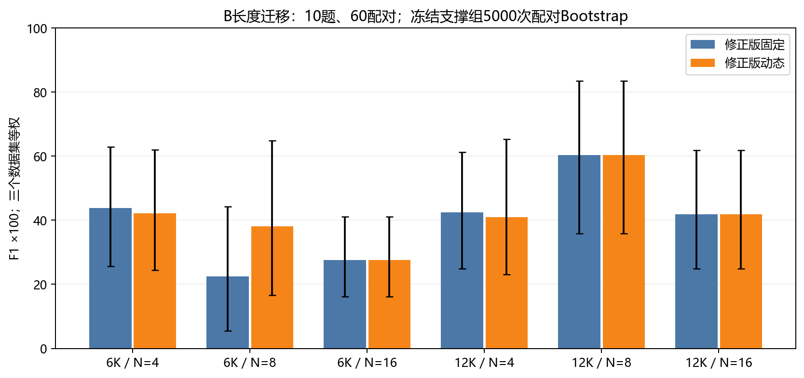
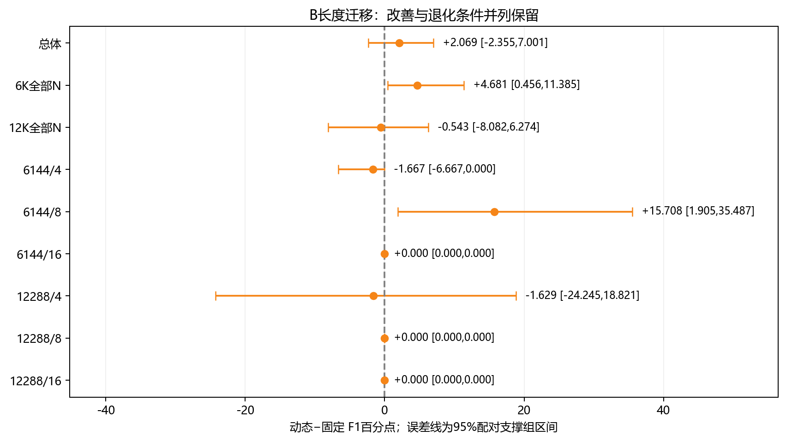
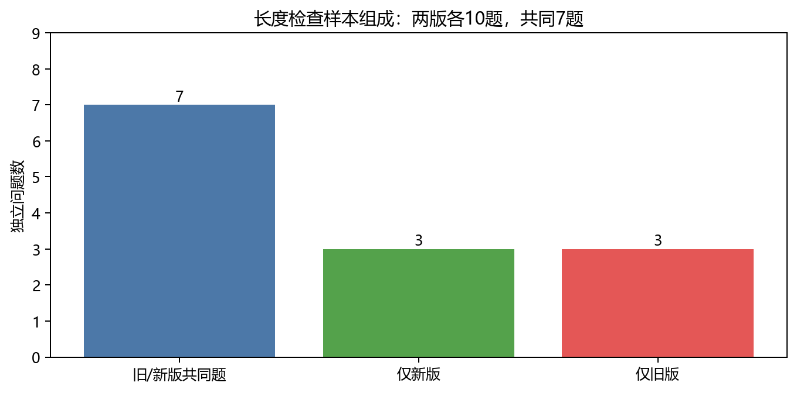

# B阶段：修正版6K/12K长度迁移

修正版动态宏F1为41.8366，固定为39.7678，差+2.0688个百分点，95%支撑组配对区间[-2.3551,7.0006]。60条件中5胜、53平、2负。区间跨0，当前样本中正负方向均在区间内。

## 材料与分母

120逻辑结果来自103次新生成和17次历史精确复用，独立问题10个，Qasper/HotpotQA/MuSiQue为4/3/3。每题两长度、三块数、两方法共同保留；各数据集冻结支撑组均为3个，Qasper其中一组含2题。没有使用自然确认集的组件或把60条件当60题。固定参数0.5/1.0，动态读取corrected-nine-cell-v1，不重新选参。

主指标先对同数据集问题及所列长度/块数条件等权平均，再对三个数据集等权；5000次、seed20261116，在各数据集抽同数冻结组，保留组内题数和全部条件。同一组抽中多次按该次数加权，每次以抽到题数归一。所有题六条件齐全，空分层重抽为0。区间描述这9个来源组的构成变化，小组数下对新来源的推断仍需更多资料。

| 范围 | 固定F1 | 动态F1 | 差/百分点 | 95%区间 | 胜/平/负 |
|---|---:|---:|---:|---|---|
| ALL | 39.768 | 41.837 | +2.069 | [-2.355,7.001] | 5/53/2 |
| 6144/4 | 43.757 | 42.090 | -1.667 | [-6.667,0.000] | 0/9/1 |
| 6144/8 | 22.407 | 38.116 | +15.708 | [1.905,35.487] | 3/7/0 |
| 6144/16 | 27.646 | 27.646 | +0.000 | [0.000,0.000] | 0/10/0 |
| 12288/4 | 42.522 | 40.893 | -1.629 | [-24.245,18.821] | 2/7/1 |
| 12288/8 | 60.423 | 60.423 | +0.000 | [0.000,0.000] | 0/10/0 |
| 12288/16 | 41.852 | 41.852 | +0.000 | [0.000,0.000] | 0/10/0 |

验收表以60输入条件直接混合，固定41.5251、动态43.5730、差+2.0478；与主表数据集等权的差异来自Q/H/M=4/3/3题数权重。两口径分别保存。六格及数据集完整值见b_quality.csv。

## 与旧版的关系

旧/新版长度检查各10题，只有7题共同，另3题发生变化；因此旧版−4.396个百分点与新版总体差并列作为各自范围结果。共同42个题长块条件按方法形成84项跨版连接，b_historical_pairs.csv分别标记实际token/prefix/suffix/上限/参考是否相同、T/S是否相同。输入变化、参数变化和样本变化分别保存，不将其混合命名为算法提升。历史复用17行只用于质量，timing空白，未复制旧计时为新请求。

## 效率、案例与解释

固定60、动态43条新生成具备本批计时；17条复用缺新计时。描述效率按这两个实际分母列均值、中位数和P90，另列43组两方法都新生成的相同输入配对。缺随机交错重复运行和阶段算子分解，因此本轮保留描述性时延结果。

- improvement：`hotpotqa:1fd7df3ba224e985f87e976c7a4a67ddc1012a249a542bea`，L=6144、N=8，差+100.000个百分点；固定：redhead and canvasback；动态：duck；参考：["duck"]。
- degradation：`musique:c6fe007044674795d280bb474e2adc9dc8bacd8853a9cef5`，L=12288、N=4，差-88.889个百分点；固定：Ko Phi Phi Le, Thailand.；动态：Thailand；参考：["Ko Phi Phi Leh", "Ko Phi Phi Le"]。
- tie：`hotpotqa:1fd7df3ba224e985f87e976c7a4a67ddc1012a249a542bea`，L=6144、N=4，差+0.000个百分点；固定：duck；动态：duck；参考：["duck"]。

本版6K/8出现改善，6K/4及12K/4有退化，N16两长度和12K/8同参持平。6K/8及6K整体区间在本次样本中为正，这些局部分层作为探索性结果保留；总体区间仍跨0。具体答错机制原因未确定，缺参数与证据位置的控制诊断。结果只评价已冻结修正版九格在这10个既有验证问题上的长度迁移；自然确认集使用另一套冻结自然规则，分别报告。研究状态SUBMITTED。

## 复现与来源

运行`python -s -B pc-analysis-followup-output/scripts/analyze_b_length.py`。输入为已恢复包内server/corrected-length-results.jsonl、corrected-length-plan.json、corrected-rule.json及inputs两版development.json；历史结果连接原pc-analysis-output/stages/04_length_check/tables/paired_records.csv。源行、原答案和参数见b_records.csv/b_paired.csv；抽样规则见logs/b_analysis_config.json与b_bootstrap_diagnostics.csv。仅执行自编CPU脚本，未执行包内历史脚本、模型、选参或摘要计算。
