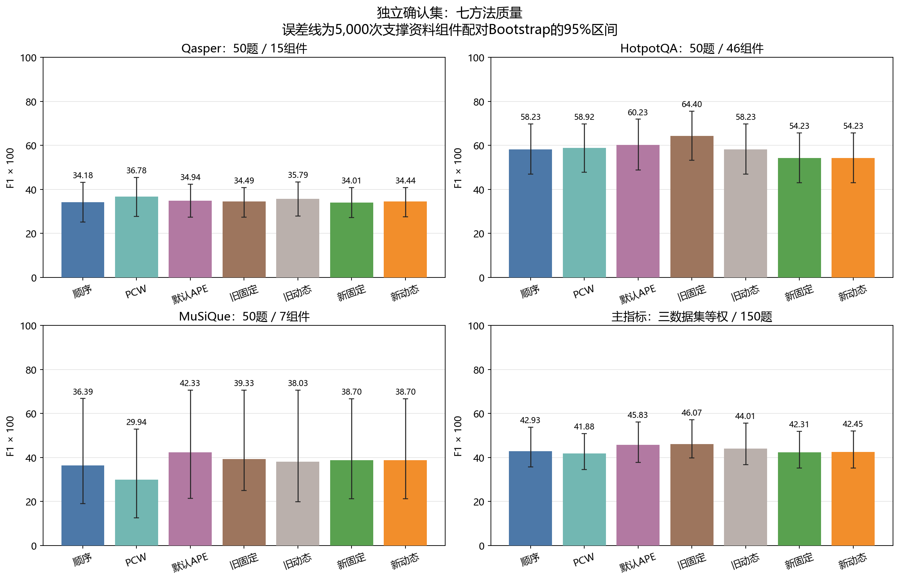
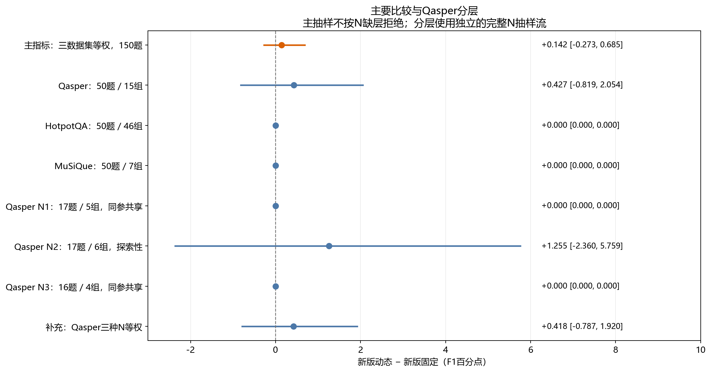
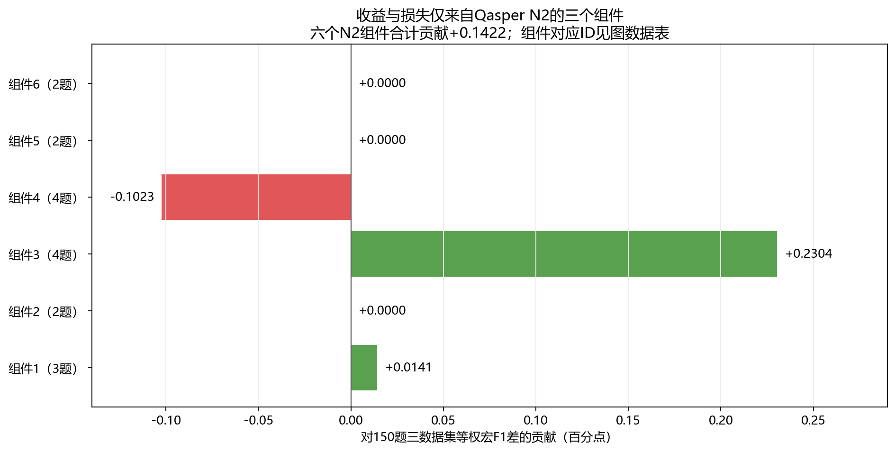

# C阶段独立确认与统计

## 4 新版动态是否有可靠独立收益

确认集各数据集50题，共150题，七方法1050逻辑结果来自897次实际生成。新版固定42.3108、新版动态42.4530，主差+0.1422，95%区间[-0.2731,0.6848]。同一批抽样共同保留所有方法，3胜146平1负。

| 方法 | Qasper/50 | HotpotQA/50 | MuSiQue/50 | 等权宏F1 | 宏F1的95%区间 |
|---|---|---|---|---|---|
| 顺序编码 | 34.1818 | 58.2258 | 36.3939 | 42.9338 | [35.6759, 53.8426] |
| PCW | 36.7821 | 58.9202 | 29.9380 | 41.8801 | [34.4598, 50.8104] |
| 默认APE | 34.9358 | 60.2258 | 42.3333 | 45.8316 | [37.8347, 56.2024] |
| MAIN80固定规则 | 34.4854 | 64.3968 | 39.3333 | 46.0719 | [39.7890, 57.2217] |
| MAIN80动态规则 | 35.7875 | 58.2258 | 38.0303 | 44.0145 | [36.6609, 55.6040] |
| 新版自然固定 | 34.0096 | 54.2258 | 38.6970 | 42.3108 | [35.1195, 51.9026] |
| 新版自然动态 | 34.4363 | 54.2258 | 38.6970 | 42.4530 | [35.2636, 52.0641] |

MAIN80两行是在本次150题上应用旧规则所得的服务器回答。与新版的差使用同样本配对，区别于旧510题的历史均值。

| 比较−参照 | 宏F1差/百分点 | 95%区间 |
|---|---|---|
| 新版自然动态 − 默认APE | -3.3786 | [-6.7809, -0.4737] |
| 新版自然动态 − MAIN80固定规则 | -3.6188 | [-8.4072, -0.2035] |
| 新版自然固定 − MAIN80固定规则 | -3.7611 | [-8.5395, -0.3103] |

上述不利参照比较属于七方法逐比较区间，未做21对的多重校正；主要检验仍为预定的新版动态−新版固定。新版固定与新版动态在确认集均低于默认和MAIN80固定的点估计，验证优势未在这批独立确认中保留。具体哪些输入属性或参数机制导致该变化，原因未确定，缺独立机制对照；本次保留原冻结决策。

### Qasper分层与差异集中度

| N | 题数 | 组件 | 固定F1 | 动态F1 | 差/百分点 | 95%区间 | 胜/平/负 |
|---|---|---|---|---|---|---|---|
| 1 | 17 | 5 | 43.5584 | 43.5584 | +0.0000 | [0.0000, 0.0000] | 0/17/0 |
| 2 | 17 | 6 | 31.8528 | 33.1077 | +1.2549 | [-2.3605, 5.7588] | 3/13/1 |
| 3 | 16 | 4 | 26.1557 | 26.1557 | +0.0000 | [0.0000, 0.0000] | 0/16/0 |

Qasper整体差+0.4267，区间[-0.8193,2.0543]。N2局部差+1.2549，区间[-2.3605,5.7588]；仅6个组件，4个非零差题集中于3个组件，标为探索性。N1/N3及全部HotpotQA/MuSiQue的新版参数相同，共133题共享一次实际生成，质量逐token相同，零差来自这个执行事实。

Qasper N等权补充差+0.4183，区间[-0.7868,1.9196]，单独保存；主结果继续按Qasper50题的17/17/16题数权重。多块材料仅来自Qasper，未取得HotpotQA/MuSiQue新版多块结果。完整原始来源上下文与旧LongBench扩展文本分别报告。

## 5 统计做法与推断范围

固定seed20261116、5000次有效配对聚类Bootstrap，百分位2.5%/97.5%，F1展示乘100，差值为百分点。

- A主验证按冻结支撑组Q/H/M=10/13/14抽样，保留同组全部题、L/N和策略，数据集×九格等权。主验证MuSiQue空单元重抽2次；同默认参数的跨版验证输入比较重抽3次，探索输入比较重抽0，各分析有效5000。scope110/111/112及其随机流分别保存在a_bootstrap_diagnostics.csv。
- B按自身冻结支撑组3/3/3抽样，全部六条件和两方法共同保留，按抽到题数归一，分层完整、重抽0。
- C在每数据集抽15/46/7个support_component，组件全部题和七方法共同纳入，每次先算数据集题均值，再对三数据集等权。主5000次不因Qasper缺N分层而拒绝。
- Qasper分层使用独立抽样流SeedSequence([20261116,1])，从其15组件整体抽取；缺任一N则重抽，提出5069、拒绝69、有效5000。该条件分布不替换总体主区间。

MuSiQue最大组件25/50题，Qasper N3仅4组件、N2仅6组件；绝对成绩及参照差的区间应随来源数阅读。新版动态−固定在HotpotQA/MuSiQue差恒0，主差的不确定性实际来自Qasper组件。区间反映这批冻结来源的组成变化，未包括重新选参、模型变化和重复运行的随机性；等效结论需要预先界定等效范围及相应设计。

## 6 效率和案例

效率仅描述现有物理生成。C的新版固定/动态平均总响应为1.2730/1.2550秒，平均输出11.873/11.533 token；133题共享同一次生成。每方法单一连续worker时段，当前资料缺交错重复运行。B只有固定60和动态43条新计时、43组成对新计时；17历史复用未补填时间。所有计时来源均可追溯物理键。

C全部逻辑结果均EOS结束，生成上限命中0/1050；对应897次物理生成。新版在这批确认材料上的不利质量结果伴随完整EOS结束，当前记录未显示上限截断。

典型C案例按主差最大改善、最大退化、零差最小ID选择，原答案/参考/配置/源行保存在c_cases.csv：

- **improvement**：`natural:qasper:c2cbc2637761a2c2cf50f5f8caa248814277430e`，N=2，F1 48.780→83.333。问题：What are the different methods used for different corpora?

  固定：Support Vector Machine, Logistic regression, Random Forest, and gradient boosting are used for SarcasmCorpus, IAC-Sarcastic, and Irony-context, while Traditional LSA and Statistical LSA are used for IAC-Sarcastic-v2.

  动态：Support Vector Machine, Logistic regression, Random Forest, and gradient boosting.

  参考：["Support Vector Machine (SVM), Logistic regression (Log.Reg), Random Forest (RF) and gradient boosting (XGB)"]

- **degradation**：`natural:qasper:5758ebff49807a51d080b0ce10ba3f86dcf71925`，N=2，F1 20.000→0.000。问题：What do they constrain using integer linear programming?

  固定：The length of the selected summary sentences.

  动态：The summary length.

  参考：["low-rank approximation of the co-occurrence matrix"]

- **unchanged**：`natural:hotpotqa:5a712fca5542994082a3e641`，N=1，F1 66.667→66.667。问题：Renáta Tomanová and Larisa Neiland are former professional athletes for what sport?

  固定：tennis

  动态：tennis

  参考：["professional tennis"]

改善例中动态删除了参考未列出的额外方法和语料描述，token F1上升。退化例两份答案都未回答参考的“co-occurrence matrix低秩近似”；固定20分中的重合包含功能词，动态0分。我们保留该词面指标的真实分数，并连同原答案解释。

