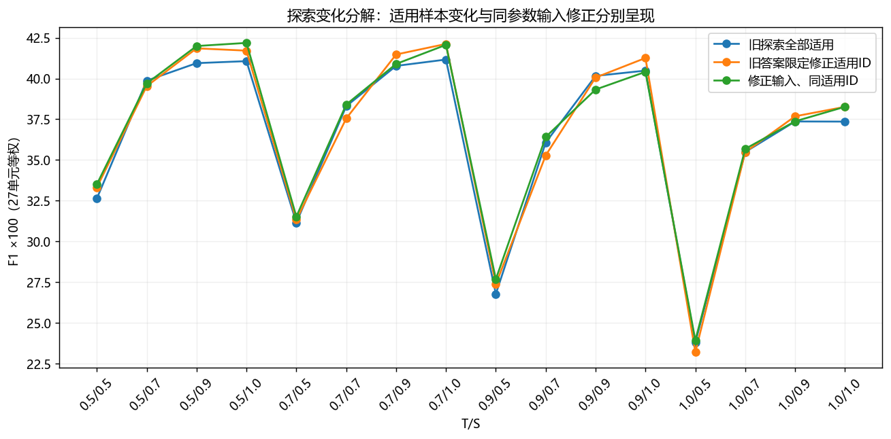
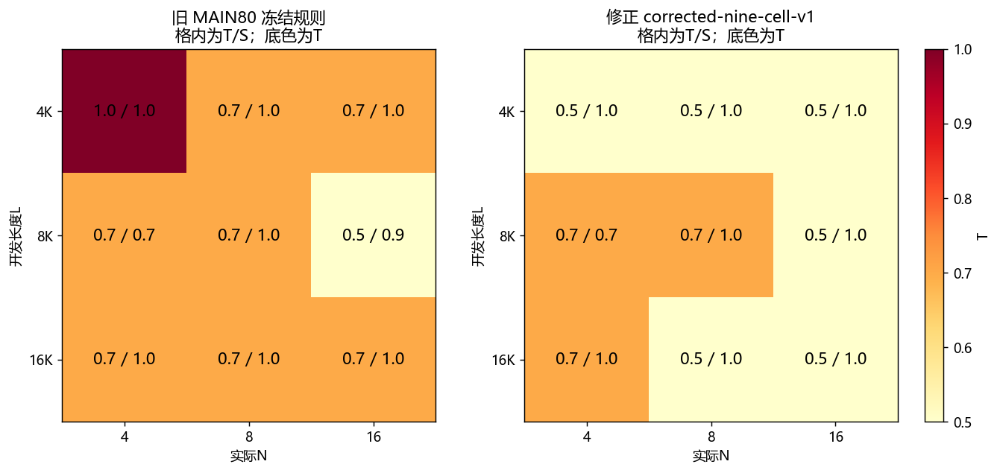
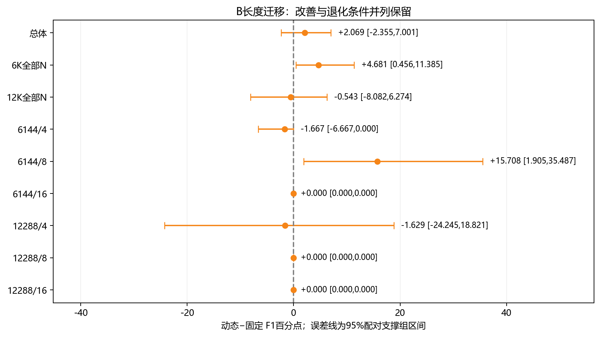
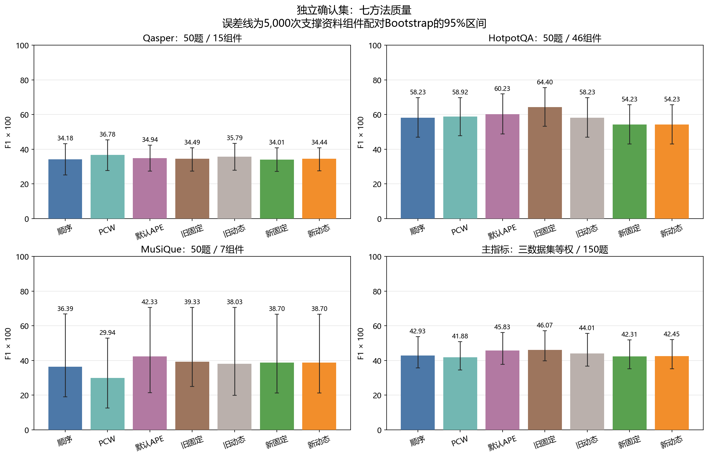
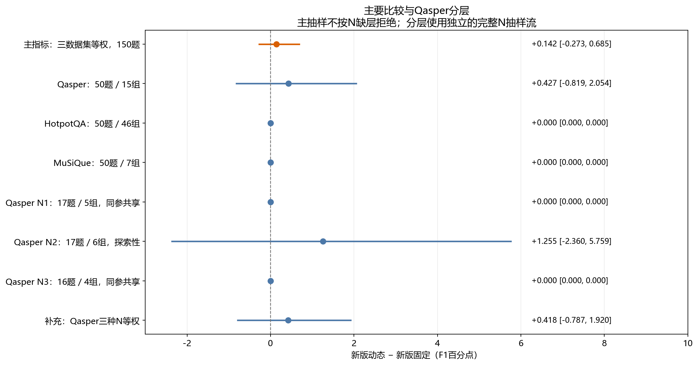
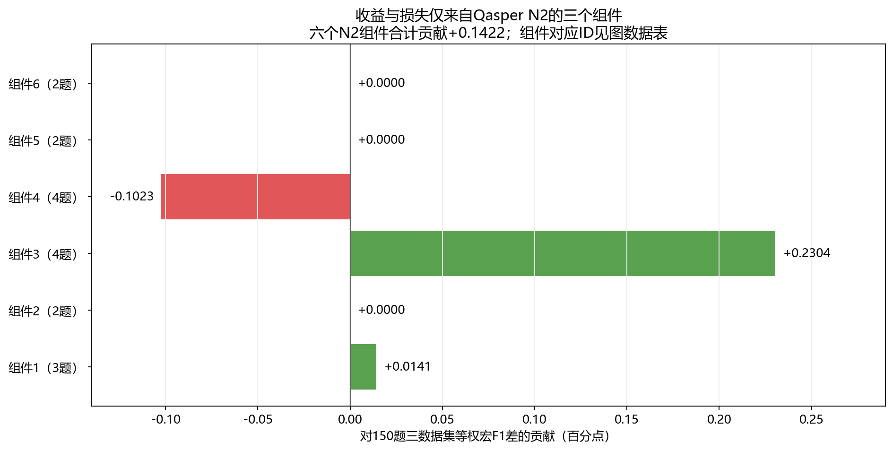

# FOLLOWUP2604 中文分析总结（供服务器端复核）

## 本次结论

我们已完成验收包恢复、修正选参核对、6K/12K迁移和150题独立确认的CPU分析。修正输入后，九格轨道固定参数从0.7/1.0变为0.5/1.0，最终九格6/9改变；自然轨道另冻结固定1.0/0.9，只有N2采用动态0.9/1.0。

长度迁移主差为+2.0688个F1百分点，95%区间[-2.3551,7.0006]，仍有退化条件。独立确认主差为+0.1422个百分点，区间[-0.2731,0.6848]，3胜146平1负。现有结果是小幅正向点估计，总体可靠收益尚未确立，跨零区间也未构成等效结论。

需要保留的不利结果：在同一150题上，新版自然动态比默认APE低3.3786个百分点、比MAIN80固定规则低3.6188个百分点，两项逐比较区间均为负。修复与重新冻结改变了参数，未带来全面优于参照方法的确认结果。

## 1 材料、规则与分母

本次分析使用服务器交付版本 `ab816f5`（`analysis/main80-pc-results`）。166项验收文件按清单恢复到 `restored/followup2604/FOLLOWUP2604_ACCEPTED/`。服务器计算与数据交付状态为 ACCEPTED，35 项检查全部通过。原始运行状态为 SUBMITTED，包内 MAIN80 整体状态为 REVISION_REQUIRED。

本轮FOLLOWUP物理来源2824项=2430新增+394历史复用。完全展开共有3042逻辑视图，额外标签218=A61+C2 4+C3 153。验收记录的157覆盖C2+C3；A的61个额外候选标签另在其839个容器的logical_labels内。同参标签共享一次生成，样本和计时均按物理源连接。更早修正探索的1248条新回答由provenance带入，未计入FOLLOWUP新增2430。

三套规则分别为旧main80-nine-cell-v1、修正corrected-nine-cell-v1、自然natural-chunk-v2。A/B评价修正九格，C评价自然规则，并在同一确认集重新执行旧规则作参照。旧510题均值及旧LITM/Doc2Dial结果保留为历史范围。

| 范围 | 独立题数 | 输入配对数 | 固定F1 | 动态F1 | 差/百分点 | 95%区间 | 胜/平/负 |
|---|---|---|---|---|---|---|---|
| A corrected validation | 40 | 300 | 42.4017 | 43.1724 | +0.7706 | [-0.9926, 2.5739] | 14/273/13 |
| B length transfer | 10 | 60 | 39.7678 | 41.8366 | +2.0688 | [-2.3551, 7.0006] | 5/53/2 |
| C independent confirmation | 150 | 150 | 42.3108 | 42.4530 | +0.1422 | [-0.2731, 0.6848] | 3/146/1 |

A为选参所用验证集，B使用固定验证题的新长度，C为独立确认。三行分别评价不同范围，分数差只在各自行内配对。

## 2 修正是否改变选参

冻结开发构造432→359：73份退出适用清单、98份实际生成输入变化、261份输入一致。实际探索139→111题长，验证119→100题长。修正字符定位改为token ID与ByteLevel字节还原后连接原UTF-8字节，替代原native offset定位；构造按已核实证据和负证据背景审核条件判断适用。退出项逐ID清单已保存，但逐项退出原因字段缺失；73份各自属于哪种退出原因仍待服务器补字段。

我们读取保存候选与规则，未重选参数。探索提名4/9改变，固定0.7/1.0→0.5/1.0，最终九格6/9改变。为分开样本、输入和参数变化，固定旧全局参数0.7/1.0的探索得分依次为：旧全量41.1629；限定修正适用共同ID42.1221；修正输入同参数42.0641。前一变化来自适用样本构成，后一同参数输入差为-0.0580个百分点，95%区间[-1.6027,1.5288]。在同一修正输入改用已保存新候选0.5/1.0后为42.1856，点估计比0.7/1.0高0.1215。

因此，跨版总体分数变化同时包含样本退出、输入变化和参数变化。修正后的参数选择确有变化；把版本均值差全部计为算法收益会混入前两项。

| L | N | 旧冻结T/S | 修正冻结T/S |
|---|---|---|---|
| 4096 | 4 | [1.0, 1.0] | [0.5, 1.0] |
| 4096 | 8 | [0.7, 1.0] | [0.5, 1.0] |
| 4096 | 16 | [0.7, 1.0] | [0.5, 1.0] |
| 8192 | 4 | [0.7, 0.7] | [0.7, 0.7] |
| 8192 | 8 | [0.7, 1.0] | [0.7, 1.0] |
| 8192 | 16 | [0.5, 0.9] | [0.5, 1.0] |
| 16384 | 4 | [0.7, 1.0] | [0.7, 1.0] |
| 16384 | 8 | [0.7, 1.0] | [0.5, 1.0] |
| 16384 | 16 | [0.7, 1.0] | [0.5, 1.0] |

A验证覆盖40题/300条件，固定42.4017、动态43.1724，差+0.7706，区间[-0.9926,2.5739]。这些记录参加了冻结选择，区间对应固定策略下来源构成变化。自然开发另用54探索题/864回答、36验证题/104物理回答；固定1.0/0.9，N1/N3回退固定，N2候选0.9/1.0在4个验证题上高0.8164个百分点。该保存选择早于C3生成。

## 3 长度迁移是否仍退化

新版B：10题，Qasper/HotpotQA/MuSiQue=4/3/3，各3个冻结支撑组；60个题长块条件形成120逻辑结果，103新增、17历史精确复用。主指标对数据集及六条件等权，固定39.7678、动态41.8366，差+2.0688，区间[-2.3551,7.0006]。

| L/N | 固定F1 | 动态F1 | 差/百分点 | 95%区间 | 胜/平/负 |
|---|---|---|---|---|---|
| L6144 | 31.270 | 35.950 | +4.681 | [0.456, 11.385] | 3/26/1 |
| L12288 | 48.266 | 47.723 | -0.543 | [-8.082, 6.274] | 2/27/1 |
| N4 | 43.139 | 41.492 | -1.648 | [-13.789, 8.333] | 2/16/2 |
| N8 | 41.415 | 49.269 | +7.854 | [0.952, 17.744] | 3/17/0 |
| N16 | 34.749 | 34.749 | +0.000 | [0.000, 0.000] | 0/20/0 |
| 6144/4 | 43.757 | 42.090 | -1.667 | [-6.667, 0.000] | 0/9/1 |
| 6144/8 | 22.407 | 38.116 | +15.708 | [1.905, 35.487] | 3/7/0 |
| 6144/16 | 27.646 | 27.646 | +0.000 | [0.000, 0.000] | 0/10/0 |
| 12288/4 | 42.522 | 40.893 | -1.629 | [-24.245, 18.821] | 2/7/1 |
| 12288/8 | 60.423 | 60.423 | +0.000 | [0.000, 0.000] | 0/10/0 |
| 12288/16 | 41.852 | 41.852 | +0.000 | [0.000, 0.000] | 0/10/0 |

6K/8有明显局部改善，6K/4及12K/4下降；两种长度的N16及12K/8同参持平。六格属于探索性分层，逐格95%区间未做多重比较校正。总体可靠改善尚未确立。

验收描述按60输入条件直接混合为固定41.5251、动态43.5730、差+2.0478；与主口径差别来自4/3/3题数权重，两个口径分别保存。旧长度检查与本次各10题，仅7题共同；旧-4.3959与新+2.0688分别属于各自样本和规则。共同7题/42条件已按输入与参数身份连接，17条同输入同参数复用分数完全相同；其余按改输入、改参数单列。新旧总均值差未记为修复的配对提升。

## 4 新版动态是否有可靠独立收益

确认集各数据集50题，共150题，七方法1050逻辑结果来自897次实际生成。新版固定42.3108、新版动态42.4530，主差+0.1422，95%区间[-0.2731,0.6848]。同一批抽样共同保留所有方法，3胜146平1负。

| 方法 | Qasper/50 | HotpotQA/50 | MuSiQue/50 | 等权宏F1 | 宏F1的95%区间 |
|---|---|---|---|---|---|
| 顺序编码 | 34.1818 | 58.2258 | 36.3939 | 42.9338 | [35.6759, 53.8426] |
| PCW | 36.7821 | 58.9202 | 29.9380 | 41.8801 | [34.4598, 50.8104] |
| 默认APE | 34.9358 | 60.2258 | 42.3333 | 45.8316 | [37.8347, 56.2024] |
| MAIN80固定规则 | 34.4854 | 64.3968 | 39.3333 | 46.0719 | [39.7890, 57.2217] |
| MAIN80动态规则 | 35.7875 | 58.2258 | 38.0303 | 44.0145 | [36.6609, 55.6040] |
| 新版自然固定 | 34.0096 | 54.2258 | 38.6970 | 42.3108 | [35.1195, 51.9026] |
| 新版自然动态 | 34.4363 | 54.2258 | 38.6970 | 42.4530 | [35.2636, 52.0641] |

MAIN80两行是在本次150题上应用旧规则所得的服务器回答。与新版的差使用同样本配对，区别于旧510题的历史均值。

| 比较−参照 | 宏F1差/百分点 | 95%区间 |
|---|---|---|
| 新版自然动态 − 默认APE | -3.3786 | [-6.7809, -0.4737] |
| 新版自然动态 − MAIN80固定规则 | -3.6188 | [-8.4072, -0.2035] |
| 新版自然固定 − MAIN80固定规则 | -3.7611 | [-8.5395, -0.3103] |

上述不利参照比较属于七方法逐比较区间，未做21对的多重校正；主要检验仍为预定的新版动态−新版固定。新版固定与新版动态在确认集均低于默认和MAIN80固定的点估计，验证优势未在这批独立确认中保留。具体哪些输入属性或参数机制导致该变化，原因未确定，缺独立机制对照；本次保留原冻结决策。

### Qasper分层与差异集中度

| N | 题数 | 组件 | 固定F1 | 动态F1 | 差/百分点 | 95%区间 | 胜/平/负 |
|---|---|---|---|---|---|---|---|
| 1 | 17 | 5 | 43.5584 | 43.5584 | +0.0000 | [0.0000, 0.0000] | 0/17/0 |
| 2 | 17 | 6 | 31.8528 | 33.1077 | +1.2549 | [-2.3605, 5.7588] | 3/13/1 |
| 3 | 16 | 4 | 26.1557 | 26.1557 | +0.0000 | [0.0000, 0.0000] | 0/16/0 |

Qasper整体差+0.4267，区间[-0.8193,2.0543]。N2局部差+1.2549，区间[-2.3605,5.7588]；仅6个组件，4个非零差题集中于3个组件，标为探索性。N1/N3及全部HotpotQA/MuSiQue的新版参数相同，共133题共享一次实际生成，质量逐token相同，零差来自这个执行事实。

Qasper N等权补充差+0.4183，区间[-0.7868,1.9196]，单独保存；主结果继续按Qasper50题的17/17/16题数权重。多块材料仅来自Qasper，未取得HotpotQA/MuSiQue新版多块结果。完整原始来源上下文与旧LongBench扩展文本分别报告。

## 5 统计做法与推断范围

固定seed20261116、5000次有效配对聚类Bootstrap，百分位2.5%/97.5%，F1展示乘100，差值为百分点。

- A主验证按冻结支撑组Q/H/M=10/13/14抽样，保留同组全部题、L/N和策略，数据集×九格等权。主验证MuSiQue空单元重抽2次；同默认参数的跨版验证输入比较重抽3次，探索输入比较重抽0，各分析有效5000。scope110/111/112及其随机流分别保存在a_bootstrap_diagnostics.csv。
- B按自身冻结支撑组3/3/3抽样，全部六条件和两方法共同保留，按抽到题数归一，分层完整、重抽0。
- C在每数据集抽15/46/7个support_component，组件全部题和七方法共同纳入，每次先算数据集题均值，再对三数据集等权。主5000次不因Qasper缺N分层而拒绝。
- Qasper分层使用独立抽样流SeedSequence([20261116,1])，从其15组件整体抽取；缺任一N则重抽，提出5069、拒绝69、有效5000。该条件分布不替换总体主区间。

MuSiQue最大组件25/50题，Qasper N3仅4组件、N2仅6组件；绝对成绩及参照差的区间应随来源数阅读。新版动态−固定在HotpotQA/MuSiQue差恒0，主差的不确定性实际来自Qasper组件。区间反映这批冻结来源的组成变化，未包括重新选参、模型变化和重复运行的随机性；等效结论需要预先界定等效范围及相应设计。

## 6 效率和案例

效率仅描述现有物理生成。C的新版固定/动态平均总响应为1.2730/1.2550秒，平均输出11.873/11.533 token；133题共享同一次生成。每方法单一连续worker时段，当前资料缺交错重复运行。B只有固定60和动态43条新计时、43组成对新计时；17历史复用未补填时间。所有计时来源均可追溯物理键。

C全部逻辑结果均EOS结束，生成上限命中0/1050；对应897次物理生成。新版在这批确认材料上的不利质量结果伴随完整EOS结束，当前记录未显示上限截断。

典型C案例按主差最大改善、最大退化、零差最小ID选择，原答案/参考/配置/源行保存在c_cases.csv：

- **improvement**：`natural:qasper:c2cbc2637761a2c2cf50f5f8caa248814277430e`，N=2，F1 48.780→83.333。问题：What are the different methods used for different corpora?

  固定：Support Vector Machine, Logistic regression, Random Forest, and gradient boosting are used for SarcasmCorpus, IAC-Sarcastic, and Irony-context, while Traditional LSA and Statistical LSA are used for IAC-Sarcastic-v2.

  动态：Support Vector Machine, Logistic regression, Random Forest, and gradient boosting.

  参考：["Support Vector Machine (SVM), Logistic regression (Log.Reg), Random Forest (RF) and gradient boosting (XGB)"]

- **degradation**：`natural:qasper:5758ebff49807a51d080b0ce10ba3f86dcf71925`，N=2，F1 20.000→0.000。问题：What do they constrain using integer linear programming?

  固定：The length of the selected summary sentences.

  动态：The summary length.

  参考：["low-rank approximation of the co-occurrence matrix"]

- **unchanged**：`natural:hotpotqa:5a712fca5542994082a3e641`，N=1，F1 66.667→66.667。问题：Renáta Tomanová and Larisa Neiland are former professional athletes for what sport?

  固定：tennis

  动态：tennis

  参考：["professional tennis"]

改善例中动态删除了参考未列出的额外方法和语料描述，token F1上升。退化例两份答案都未回答参考的“co-occurrence matrix低秩近似”；固定20分中的重合包含功能词，动态0分。我们保留该词面指标的真实分数，并连同原答案解释。

## 7 适合写入结题报告的结论

可以写：我们修正开发输入并补齐冻结候选验证，原全局/固定参数及六格规则发生改变；完整自然来源按实际N=1/2/3建立了独立开发与确认；新版动态在150题上相对新版固定点估计+0.1422个百分点，区间跨0，收益未达到可靠确认；同确认集上的默认APE和MAIN80固定规则表现更高，保留该不利结果。

长度迁移可以写：本次修正版本总体点估计转正，6K/8改善，6K/4和12K/4仍有退化；新旧题目和规则同时变化，分别报告其范围。A验证与B迁移的组件数、C的Qasper专属多块范围一起记录。

原MAIN80的开发证据问题已通过修正输入/退出不适用条件进入新分析，旧任务、原答案及旧冻结规则保留。旧LITM/Doc2Dial继续作为旧规则结果，新版在这两项任务的质量和热复用数据缺失。本批效率保留描述，稳定加速缺少重复计时证据。若继续研究，优先增加独立多块支撑资料、跨任务新版评价和交错重复运行；本次仅使用现有回答，未为正向结论追加生成或改规则。

## 8 复现与交付

复现命令和数据入口见[README](../README.md)。主表与分层表记录分母、单位、置信区间、种子与来源，可按阶段报告和独立复核记录追溯。[修正分析](A_CORRECTION.md) · [长度迁移](B_LENGTH.md) · [协议审核](PROTOCOL_AUDIT.md)
