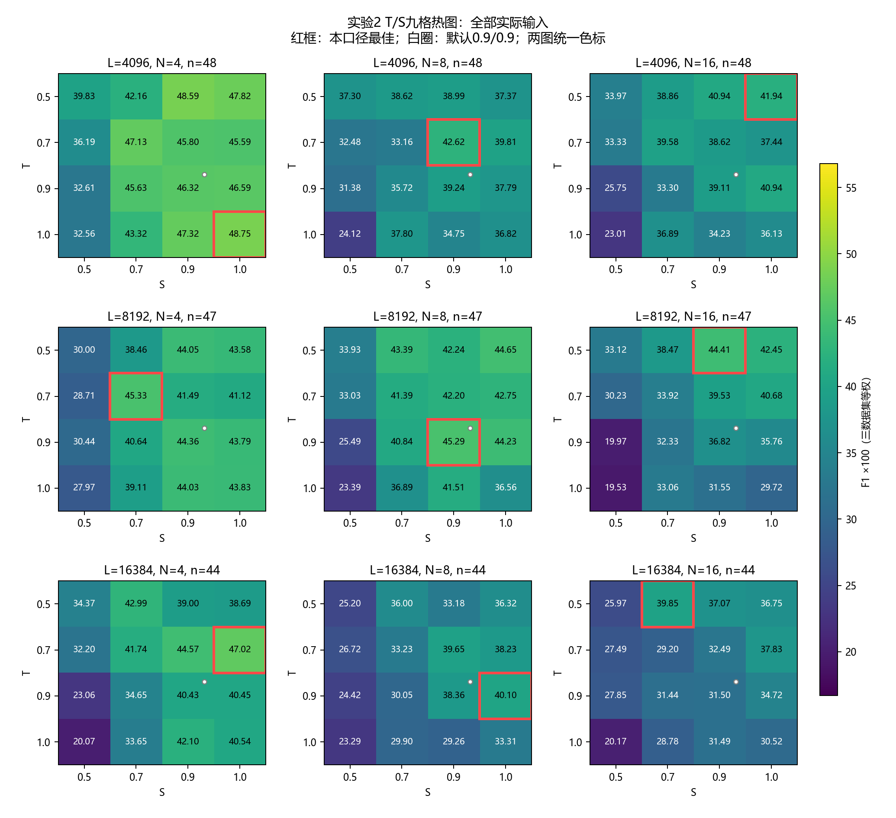
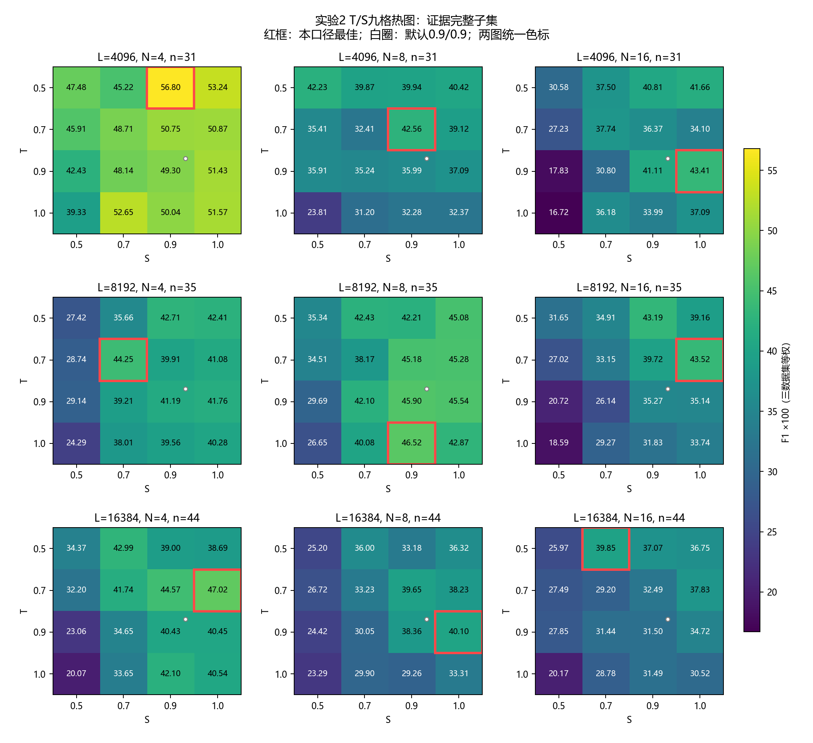

# 实验第二阶段：九格参数探索

## 1 本阶段分析什么

我们直接使用已审核的explore阶段6,672条保存score，按L=4096/8192/16384、N=4/8/16及16组T/S汇总。全部144种配置覆盖完整；每个数据集×L×N中，16组参数使用相同ID。本阶段评分重算次数为0，也未使用验证或正式测试成绩。

单格分数=三个数据集各自题目平均F1的等权平均；全局分数=九格单格分数的等权平均，即27个数据集×格点单元等权。展示为F1×100。平分时依次按距0.9/0.9最近、T升序、S升序处理。

| 文档长度 | 有效题长 | 证据完整 | 证据缺失 | 实际生成 |
|---|---|---|---|---|
| 4096 | 48 | 31 | 17 | 2304 |
| 8192 | 47 | 35 | 12 | 2256 |
| 16384 | 44 | 44 | 0 | 2112 |

合计139个有效题长输入，乘3种N和16组参数得到6,672次生成。证据完整110个题长/5,280次生成，证据缺失29个题长/1,392次生成。完整性依据前置审核的n_missing_required_tokens=0，按源字符证据及保守支撑文档范围定位；证据位置元数据差异单独保留。

## 2 原探索候选：全局0.7/1.0，九格排序与原产物一致

全局第一为T=0.7、S=1.0，F1=41.1629；默认为40.1588，相差1.0041个百分点。第二名T=0.5、S=1.0为41.0653，与第一名相差0.0976个百分点。全局及九格候选均吻合保存的candidates.json。

| L | N | 最佳T/S | 候选F1 | 默认F1 | 候选−默认（百分点） | 与第二名差距 | 题数 |
|---|---|---|---|---|---|---|---|
| 4096 | 4 | 1.0/1.0 | 48.752 | 46.320 | +2.432 | 0.157 | 48 |
| 4096 | 8 | 0.7/0.9 | 42.616 | 39.245 | +3.371 | 2.811 | 48 |
| 4096 | 16 | 0.5/1.0 | 41.944 | 39.106 | +2.838 | 0.999 | 48 |
| 8192 | 4 | 0.7/0.7 | 45.335 | 44.360 | +0.975 | 0.975 | 47 |
| 8192 | 8 | 0.9/0.9 | 45.294 | 45.294 | +0.000 | 0.644 | 47 |
| 8192 | 16 | 0.5/0.9 | 44.413 | 36.825 | +7.588 | 1.959 | 47 |
| 16384 | 4 | 0.7/1.0 | 47.018 | 40.427 | +6.591 | 2.446 | 44 |
| 16384 | 8 | 0.9/1.0 | 40.101 | 38.355 | +1.746 | 0.451 | 44 |
| 16384 | 16 | 0.5/0.7 | 39.853 | 31.497 | +8.356 | 2.021 | 44 |

逐格分别选参后，这批探索输入的等权均值为43.925，较统一全局参数高2.762个百分点。该值由同一批探索样本选参并评价，下一阶段按既定验证集评估这些候选。

原始探索的N=16三格均选择T=0.5；N=4/8的T随L和N变化。逐格候选与默认的差异、同题胜平负见candidate_vs_default_paired.csv。这里的候选由同批探索分数选出，后续验证阶段评价其表现并决定回退。

## 3 证据完整性是否改变排名

完整子集保持全部27个单元，全局第一仍为0.7/1.0，F1=41.8929；默认为39.8930。九格最佳有4/9格变化。

| L | N | 原候选 | 完整子集候选 | 改变 |
|---|---|---|---|---|
| 4096 | 4 | 1.0/1.0 | 0.5/0.9 | 是 |
| 4096 | 8 | 0.7/0.9 | 0.7/0.9 | 否 |
| 4096 | 16 | 0.5/1.0 | 0.9/1.0 | 是 |
| 8192 | 4 | 0.7/0.7 | 0.7/0.7 | 否 |
| 8192 | 8 | 0.9/0.9 | 1.0/0.9 | 是 |
| 8192 | 16 | 0.5/0.9 | 0.7/1.0 | 是 |
| 16384 | 4 | 0.7/1.0 | 0.7/1.0 | 否 |
| 16384 | 8 | 0.9/1.0 | 0.9/1.0 | 否 |
| 16384 | 16 | 0.5/0.7 | 0.5/0.7 | 否 |

4K下，原最优T随N=4/8/16依次为[1.0, 0.7, 0.5]，完整子集则为[0.5, 0.7, 0.9]。温度随块数的走势在两类输入口径中发生反转，逐格选参对输入完整性及题目构成敏感。

证据缺失组只存在于4K/8K。为对齐格点范围，我们另外把全部输入和完整子集都限制到这两个长度，三者均按18个数据集×格点单元等权。

| 口径 | 单元数 | 最佳T/S | 最佳F1 | 默认F1 | 每参数生成数 |
|---|---|---|---|---|---|
| 全部实际输入，27层 | 27 | 0.7/1.0 | 41.1629 | 40.1588 | 417 |
| 证据完整子集，27层 | 27 | 0.7/1.0 | 41.8929 | 39.8930 | 330 |
| 全部输入，仅4K/8K共同18层 | 18 | 0.5/0.9 | 43.2049 | 41.8582 | 285 |
| 证据完整，仅4K/8K共同18层 | 18 | 0.5/0.9 | 44.2769 | 41.4596 | 198 |
| 证据缺失，仅4K/8K共同18层 | 18 | 0.5/0.9 | 32.6911 | 31.4433 | 87 |
| 三长度共同完整ID，27层 | 27 | 0.7/1.0 | 41.9015 | 40.1411 | 243 |

完整组与缺失组在共同18单元下的最佳均为0.5/0.9。比较完整27层和缺失18层会同时改变长度构成；这项共同范围比较表明，直接把两种口径的最佳参数变化归到证据缺失会混入长度权重变化。完整/缺失组仍来自不同题目子集，分数差描述它们各自的表现。修复输入后的收益需另用修正输入的生成结果评价。

我们还固定三长度均适用且证据完整的共同ID：{'qasper': 10, 'hotpotqa': 10, 'musique': 7}，共27题；同一批题跨九格比较，继续对三个数据集和九格等权。其全局最佳为0.7/1.0，F1=41.9015。完整ID清单和按L/N的参数表现分别保存在common_complete_ids.csv、marginal_effects.csv，用于检查长度与块数走势是否伴随样本构成变化。

## 4 参数变化的具体规律

先对另一个参数的四个取值等权平均，再对数据集和格点等权，得到以下边际表现。

| 参数取值 | T取该值（全部输入） | S取该值（全部输入） | T取该值（共同完整ID） | S取该值（共同完整ID） |
|---|---|---|---|---|
| 0.5 | 38.627 | 28.588 | 38.930 | 30.856 |
| 0.7 | 37.847 | 37.430 | 38.892 | 37.890 |
| 0.9 | 35.871 | 39.809 | 36.965 | 39.890 |
| 1.0 | 33.498 | 40.017 | 34.176 | 40.329 |

在本取值网格内，较小S=0.5的平均表现较低，S=0.9/1.0较高。单独平均S时T=0.5的边际均值最高，而最佳联合配置为T=0.7/S=1.0，体现T与S的联合作用，候选应按组合比较。

| 实际块数N | 共同完整27题、固定0.7/1.0的F1 |
|---|---|
| 4 | 46.907 |
| 8 | 41.351 |
| 16 | 37.446 |

同一批完整问题、相同长度集合和固定参数下，N增大时分数下降。每块变短会缩小资料独立编码时可见的范围，后续按输入条件选参需同时考虑这种分块影响。共同ID的L=4K/8K/16K对应F1约41.04/43.77/40.89，长度走势也未呈单调增加。各项均按实际构造和固定参数统计。

## 5 本阶段得到的结论

1. 原探索候选已解释并核对：全局0.7/1.0较默认高1.004个百分点，领先第二名0.098个百分点。
2. 完整子集全局最佳仍为0.7/1.0，逐格最佳变化4格；格点规则对输入完整性的敏感性需要进入验证解释。
3. 完整/缺失组的参数排序应在共同4K/8K范围比较，同时列出每层题数；三长度共同ID分析另外控制跨长度的样本变化。
4. 原候选文件保持冻结版本，敏感性候选单独保存在本阶段表格，交下一阶段验证及补正讨论。

## 6 材料与复现

本阶段仅汇总已有score，未重新评分、生成答案、运行GPU、安装依赖或改动原始证据及冻结规则。脚本为pc-analysis-output/scripts/analyze_exploration.py；所有CSV包含口径、分母、单位或来源行号。研究状态保留SUBMITTED，当前停在参数探索阶段。
