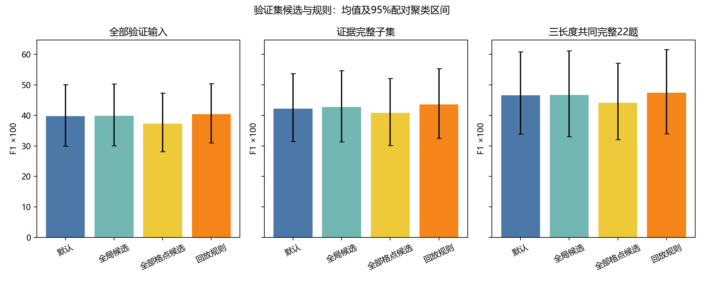
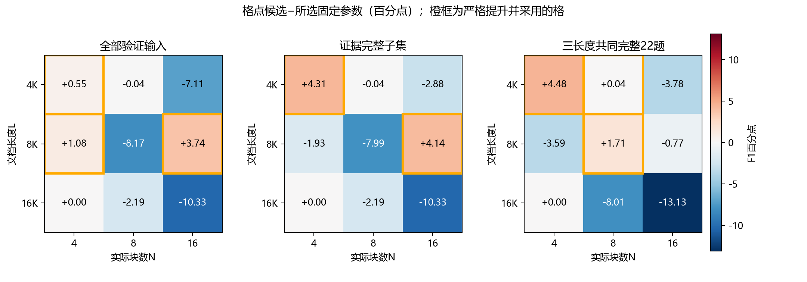

# 实验第三阶段：验证候选参数与冻结规则

## 1 数据与比较方法

我们直接引用validation阶段992条已核对score，覆盖40题、119个题长输入、357个L/N输入条件。三类候选为默认0.9/0.9、探索全局0.7/1.0和探索各格最佳；logical_labels共1071次逻辑评价，各类357次。40次default/cell、39次global/cell共享生成，共节省79次。所有候选在同一数据集/格点使用相同ID。评分重算次数为0。

先在每个数据集/格点内平均，再对三个数据集及九格等权。文中F1按0–100展示，差值单位为百分点。固定参数从默认与探索全局候选中选均值较高者；平分按距默认、T和S排序。格点候选严格高于固定参数时采用，其余回退。置信区间描述样本/证据组组成变化，选择准则沿用预定的均值比较。

| 口径 | 实际生成 | 逻辑评价 | 题长输入 | 独立题 | Qasper/HotpotQA/MuSiQue题数 |
|---|---|---|---|---|---|
| 全部验证输入 | 992 | 1071 | 119 | 40 | 13/13/14 |
| 证据完整子集 | 791 | 864 | 96 | 40 | 13/13/14 |
| 三长度共同完整22题 | 550 | 594 | 66 | 22 | 11/8/3 |

证据完整子集按前置审核的源证据缺失token数为0筛选。筛选单位为题目×长度，同一问题在不同长度的完整状态可不同，因此完整记录仍覆盖40题，可用题长从119减为96。三长度共同完整口径固定22题，MuSiQue仅3题；三种口径均保持27个数据集/格点单元等权，各单元分母见candidate_pairing_coverage.csv。

## 2 固定参数验证结果

| 口径 | 默认F1 | 全局候选F1 | 候选−默认/百分点 | 95%配对区间 | 所选固定T/S |
|---|---|---|---|---|---|
| 全部验证输入 | 39.7466 | 39.8303 | +0.0837 | [-3.098, 3.453] | 0.7/1.0 |
| 证据完整子集 | 42.2002 | 42.6886 | +0.4884 | [-2.964, 3.990] | 0.7/1.0 |
| 三长度共同完整22题 | 46.5973 | 46.7098 | +0.1124 | [-4.895, 6.146] | 0.7/1.0 |

全量验证中，全局候选较默认高0.0837个百分点，按原准则选用0.7/1.0。完整子集及共同完整ID口径的固定参数选择相同。

## 3 九格选择、回退与原规则核对

| L | N | 格点候选T/S | 候选F1 | 固定F1 | 候选−固定/百分点 | 95%配对区间 | 决定 | 最终T/S |
|---|---|---|---|---|---|---|---|---|
| 4096 | 4 | 1.0/1.0 | 38.926 | 38.378 | +0.548 | [-4.84, 6.00] | 采用格点候选 | 1.0/1.0 |
| 4096 | 8 | 0.7/0.9 | 37.088 | 37.124 | -0.036 | [-0.22, 0.09] | 回退固定 | 0.7/1.0 |
| 4096 | 16 | 0.5/1.0 | 36.434 | 43.544 | -7.110 | [-15.06, 0.03] | 回退固定 | 0.7/1.0 |
| 8192 | 4 | 0.7/0.7 | 38.955 | 37.874 | +1.080 | [-7.16, 9.90] | 采用格点候选 | 0.7/0.7 |
| 8192 | 8 | 0.9/0.9 | 37.505 | 45.675 | -8.170 | [-16.92, -1.08] | 回退固定 | 0.7/1.0 |
| 8192 | 16 | 0.5/0.9 | 37.233 | 33.489 | +3.745 | [-4.78, 12.13] | 采用格点候选 | 0.5/0.9 |
| 16384 | 4 | 0.7/1.0 | 41.454 | 41.454 | +0.000 | [0.00, 0.00] | 候选即固定 | 0.7/1.0 |
| 16384 | 8 | 0.9/1.0 | 35.714 | 37.908 | -2.194 | [-10.25, 5.36] | 回退固定 | 0.7/1.0 |
| 16384 | 16 | 0.5/0.7 | 32.694 | 43.027 | -10.334 | [-19.33, -2.28] | 回退固定 | 0.7/1.0 |

全量回放的固定参数、九格最终参数及18个候选/固定分数均与保存rule.json一致。严格提升并采用的三格为4K/4、8K/4、8K/16；16K/4的候选本来就是固定0.7/1.0。

| 验证口径 | 默认 | 统一固定 | 全部逐格候选 | 原冻结规则 | 本口径回放规则 |
|---|---|---|---|---|---|
| 全部验证输入 | 39.747 | 39.830 | 37.334 | 40.427 | 40.427 |
| 证据完整子集 | 42.200 | 42.689 | 40.810 | 43.413 | 43.628 |
| 三长度共同完整22题 | 46.597 | 46.710 | 44.149 | 46.724 | 47.402 |

全部逐格候选直接采用的验证均值低于统一固定参数；回退步骤保留有正提升的格点。规则选择和本表评价共用验证数据，正式测试阶段继续评价已冻结版本。

## 4 证据完整性与共同ID敏感性

| L | N | 原冻结T/S | 完整子集回放T/S | 共同22题回放T/S |
|---|---|---|---|---|
| 4096 | 4 | 1.0/1.0 | 1.0/1.0 | 1.0/1.0 |
| 4096 | 8 | 0.7/1.0 | 0.7/1.0 | 0.7/0.9 |
| 4096 | 16 | 0.7/1.0 | 0.7/1.0 | 0.7/1.0 |
| 8192 | 4 | 0.7/0.7 | 0.7/1.0 | 0.7/1.0 |
| 8192 | 8 | 0.7/1.0 | 0.7/1.0 | 0.9/0.9 |
| 8192 | 16 | 0.5/0.9 | 0.5/0.9 | 0.7/1.0 |
| 16384 | 4 | 0.7/1.0 | 0.7/1.0 | 0.7/1.0 |
| 16384 | 8 | 0.7/1.0 | 0.7/1.0 | 0.7/1.0 |
| 16384 | 16 | 0.7/1.0 | 0.7/1.0 | 0.7/1.0 |

完整子集仅8K/4改变：候选0.7/0.7相对固定的差从+1.080变为-1.933个百分点，因而回退0.7/1.0。共同22题口径有4格与原规则不同，其中4K/8的采用差仅约0.039个百分点。候选的点估计选择对样本构成有敏感性，具体分母与区间在表中一并报告。

这两项敏感性回放沿用原探索提名的候选；阶段2证据完整探索中新出现的候选另查验证覆盖。

| L | N | 阶段2完整子集候选 | 缺少验证生成/全量 | 缺少验证生成/完整子集 |
|---|---|---|---|---|
| 4096 | 4 | 0.5/0.9 | 40 | 23 |
| 4096 | 16 | 0.9/1.0 | 40 | 23 |
| 8192 | 8 | 1.0/0.9 | 40 | 34 |

上述三个新参数组合合计缺120次全量验证生成，限定已有完整输入则缺80次。若要验证这些新组合，需要另行授权生成；本次未补填或借用其他格点分数。敏感性规则只另存于本阶段，原候选和冻结规则保持原值。

## 5 冻结顺序、统计与交付

候选于北京时间2026-11-14 14:03:50冻结，随后验证worker于14:03:55启动；规则于14:17:49冻结，早于长度检查、注意力与正式测试worker启动。完整时间及源位置见freeze_timeline.csv。规则按log2文档长度、log2实际编码块数的最近格查表，平距选较小L/N。

置信区间采用seed20261116、5000次有效配对证据组Bootstrap。每数据集内有放回抽组，保留该组的全部长度、N和候选视图；共享生成使用同一源行和同一重采样权重。抽样时固定已选参数与规则，区间反映验证问题/证据组构成变化。每次按原27单元等权；抽样造成空单元时重新抽取并登记计数。完整子集MuSiQue的最少单格为3题，提出5180次抽样，其中180次产生空单元并重抽，得到5000次有效抽样；其他口径/数据集的空单元次数为0。详见bootstrap_diagnostics.csv。

本阶段结论：固定参数仍选0.7/1.0；原九格回退规则符合协议及保存分数；完整子集改变一格回退，共同完整ID口径改变四格；阶段2部分新敏感性候选尚缺对应验证生成。原记录、候选及规则均保留，研究状态SUBMITTED。当前停在实验第三阶段，后续长度检查等实验待用户审阅规划后授权执行。
