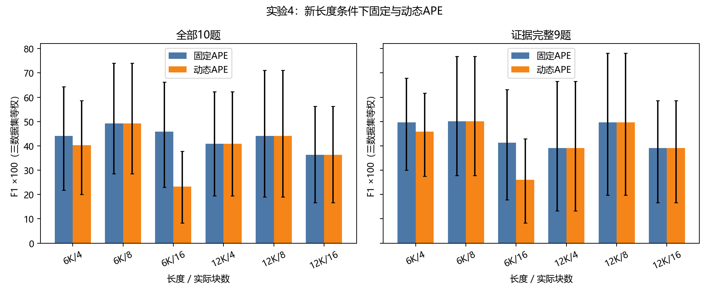
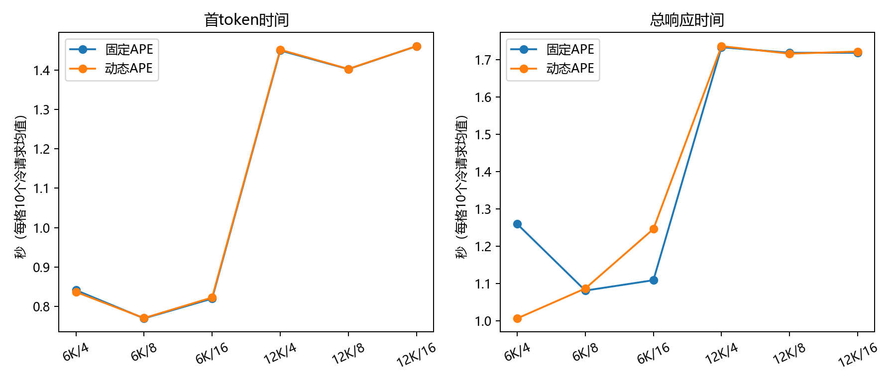

# 实验第四阶段：6K／12K长度检查

## 1 数据与分析方法

我们引用冻结顺序中的首10个验证问题，在6144和12288 document tokens、N=4/8/16下的120条保存记录。固定与动态APE形成60组同题/L/N配对；Qasper4题、HotpotQA3题、MuSiQue3题，每题六种输入条件。所有请求为冷请求且资料KV未命中。直接复用已有score和计时，评分重算次数为0。

这10题来自验证集，长度条件为冻结后新增的6K和12K。我们保持规则不变，检查新长度的映射与表现。F1按0–100展示，先对数据集内题目平均，再对三个数据集及六格等权；胜平负按输入配对计数。效率均值、中位数和P90采用实际请求分布；各数据集题数权重在重采样中保持原比例。

原始来源为restored/output/runs/main80-20261114T041503/attempts.jsonl；paired_records.csv保存source_file、两方法源行号、筛选后的sample_id/L/N、score、答案和各项计时。冻结规则与验证顺序取同次运行的rule.json和snapshot/datasets/frozen-main80/frozen.json；证据完整性标签及生成停止计数引用前置审核construction_checks.csv和runtime_generation_limits.csv。

## 2 实际参数映射与相同输出

| 输入长度 | N | 映射格 | 固定T/S | 动态T/S | 相同参数配对 | 相同token配对 |
|---|---|---|---|---|---|---|
| 6144 | 4 | 8192/4 | 0.7/1.0 | 0.7/0.7 | 0/10 | 6/10 |
| 6144 | 8 | 8192/8 | 0.7/1.0 | 0.7/1.0 | 10/10 | 10/10 |
| 6144 | 16 | 8192/16 | 0.7/1.0 | 0.5/0.9 | 0/10 | 4/10 |
| 12288 | 4 | 16384/4 | 0.7/1.0 | 0.7/1.0 | 10/10 | 10/10 |
| 12288 | 8 | 16384/8 | 0.7/1.0 | 0.7/1.0 | 10/10 | 10/10 |
| 12288 | 16 | 16384/16 | 0.7/1.0 | 0.7/1.0 | 10/10 | 10/10 |

规则在log2(L)、log2(N)空间取最近格，6144映射8192，12288映射16384。6K/4与6K/16采用不同于固定值的参数；6K/8与12K三格共40组配对的参数、答案及token序列相同。12K这一长度下动态规则全部沿用固定0.7/1.0。

## 3 质量结果与证据完整性

| 口径 | 配对数 | 固定F1 | 动态F1 | 动态−固定/百分点 | 95%配对区间 | 动态胜/平/负 |
|---|---|---|---|---|---|---|
| all10 | 60 | 43.4107 | 39.0147 | -4.3959 | [-8.609, -0.948] | 0/55/5 |
| evidence_complete9 | 54 | 44.7996 | 41.6382 | -3.1614 | [-6.667, -0.317] | 0/50/4 |

全量六格分别如下；每格为相同10题。

| L | N | 固定F1 | 动态F1 | 差/百分点 | 95%配对区间 | 动态胜/平/负 |
|---|---|---|---|---|---|---|
| 6144 | 4 | 44.048 | 40.238 | -3.810 | [-15.24, 0.00] | 0/9/1 |
| 6144 | 8 | 49.227 | 49.227 | +0.000 | [0.00, 0.00] | 0/10/0 |
| 6144 | 16 | 45.899 | 23.333 | -22.566 | [-43.60, -3.81] | 0/6/4 |
| 12288 | 4 | 40.893 | 40.893 | +0.000 | [0.00, 0.00] | 0/10/0 |
| 12288 | 8 | 44.048 | 44.048 | +0.000 | [0.00, 0.00] | 0/10/0 |
| 12288 | 16 | 36.349 | 36.349 | +0.000 | [0.00, 0.00] | 0/10/0 |

图中误差线为各方法宏F1的95%配对证据组Bootstrap区间；方法差值的区间见上表。

退化集中在6K/4与6K/16，12K及6K/8持平。证据缺失记录来自一个MuSiQue问题的两种长度、三种N和两方法，共12条生成。该问题仅在6K/16贡献一次损失（固定0.666667、动态0），另外五种条件持平。证据完整9题、54组配对中仍有四次损失、零次改善；该口径数据集分母为4/3/2，结果另表保留。

## 4 冷请求效率及输出长度

| 方法 | 请求数 | TTFT均值/秒 | 总响应均值/秒 | 总响应中位数/秒 | 总响应P90/秒 | 输出token均值 |
|---|---|---|---|---|---|---|
| ape_fixed | 60 | 1.1238 | 1.4362 | 1.5492 | 1.9863 | 7.017 |
| ape_dynamic | 60 | 1.1241 | 1.4185 | 1.5520 | 1.9978 | 6.617 |

| 指标 | 动态−固定/秒 | 95%配对区间 | 逐对加速比均值 | 均值耗时比 |
|---|---|---|---|---|
| ttft_seconds | +0.00024 | [-0.00168, 0.00257] | 0.9992 | 0.9998 |
| total_seconds | -0.01772 | [-0.04864, 0.00256] | 1.0299 | 1.0125 |

动态总响应均值减少17.72毫秒，95%配对区间为[-48.64, 2.56]毫秒；TTFT均值增加0.24毫秒。6K/4的平均输出由9.1降至4.2 token，总响应由1.259降至1.006秒；6K/16的平均输出由6.6增至9.1 token，总响应由1.108增至1.246秒。两个改参分支呈现相反的生成长度和时延变化。动态选参计时均值23.36微秒，固定参数分支为1.62微秒。

生成上限为Qasper 128 token、HotpotQA及MuSiQue 32 token；120条记录中119条以EOS结束，1条达到上限（0.83%）。唯一上限记录为6K/4的证据缺失MuSiQue问题，固定方法重复输出并达到32 token，动态方法输出6 token，两者F1均为0；总响应分别为2.316与1.010秒。该次配对节省1.306秒，全60组净节省1.063秒，其余59组动态合计慢0.243秒。记录见generation_cap_records.csv，分组计数见generation_limits.csv。输出token数包含实际生成的EOS。

按整个缺失证据问题移除六组条件后，完整9题的总响应均值仍由1.4131降至1.3949秒，差值-18.22毫秒，95%区间[-52.58, 3.37]毫秒，平均输出6.519降至6.130 token。该问题在6K/16还存在动态输出变长、耗时增加的反向变化。全量及完整子集均呈现小幅平均时间缩短，两个时间差区间均跨0，单题输出长度变化对均值贡献明显。

加速比定义为固定耗时/动态耗时，大于1表示动态更快。总响应随输出长度变化，参数一致的40组保留相同输出，可单独查看时间记录；其余20组对应不同T/S，生成长度与质量一并记录。缓存构建/获取、选参、输出长度及峰值allocated/reserved的均值、中位数、P90、均值CI保存在efficiency_descriptive.csv。显存单位GiB=bytes/2^30，包含模型和存活缓存；模型加载另列，排除于请求时间之外。

## 5 统计、案例与本阶段结论

使用seed20261116和5000次配对证据组Bootstrap，在每个数据集内抽原论文/证据组，保留同源问题的全部六种输入及两方法，参数与规则在抽样中固定。区间反映所选验证问题/证据组构成变化；独立单位数见bootstrap_units.csv。六十种输入条件来自十道题，各表明确配对数与独立问题数。

我们按最大正差、最大负差及零差最小ID/L/N选案例。本次改善类型为0，退化和持平案例保存原答案、参考、参数及源行号，见selected_cases.csv；全部60组原答案在paired_records.csv。

结论：冻结动态规则在本次新长度检查中没有出现质量提升的配对，全量宏F1较固定低4.396个百分点，证据完整子集低3.161个百分点。主要问题出在6K输入映射到8K格后采用的两个改参分支；12K映射到16K格后参数与固定相同，答案持平。后续独立测试继续使用原冻结规则并按实际结果报告，当前不据此改参。

后续补实验建议：修复所列MuSiQue问题的证据保留构造，按原冻结参数重跑两长度×三块数×两方法的12条记录，补齐完整10题口径；另在独立问题上增加6K/4和6K/16的固定/动态配对，检查两个退化分支的迁移表现。本轮仅登记建议。

研究状态保留SUBMITTED，本次停在实验第四阶段。后续阶段先给简短规划，待用户审阅后执行。未安装依赖、运行GPU、重新生成答案或修改原始证据。
