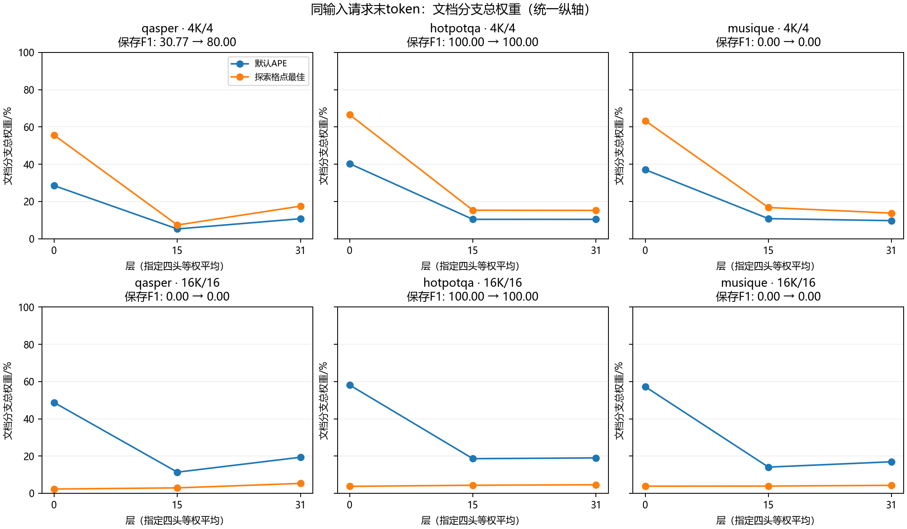
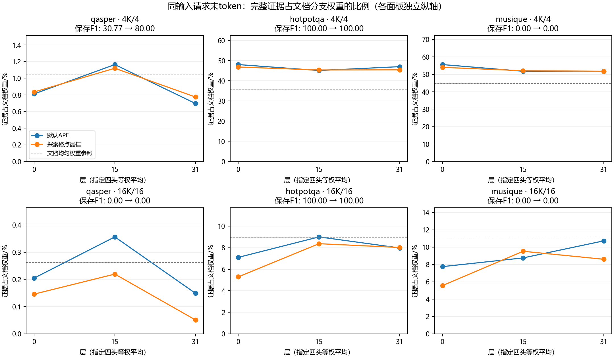
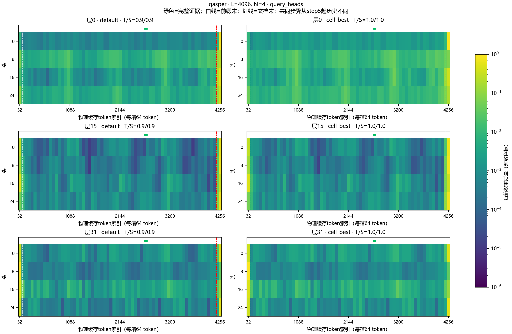
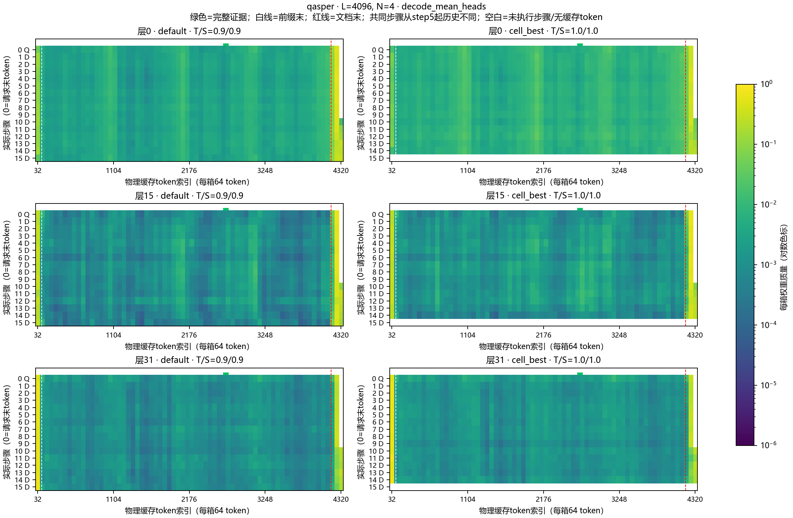
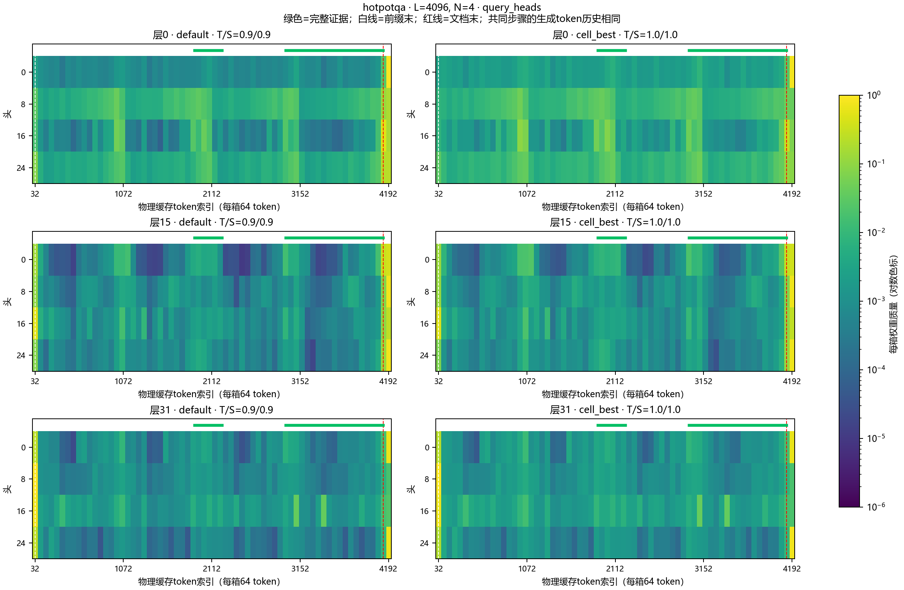
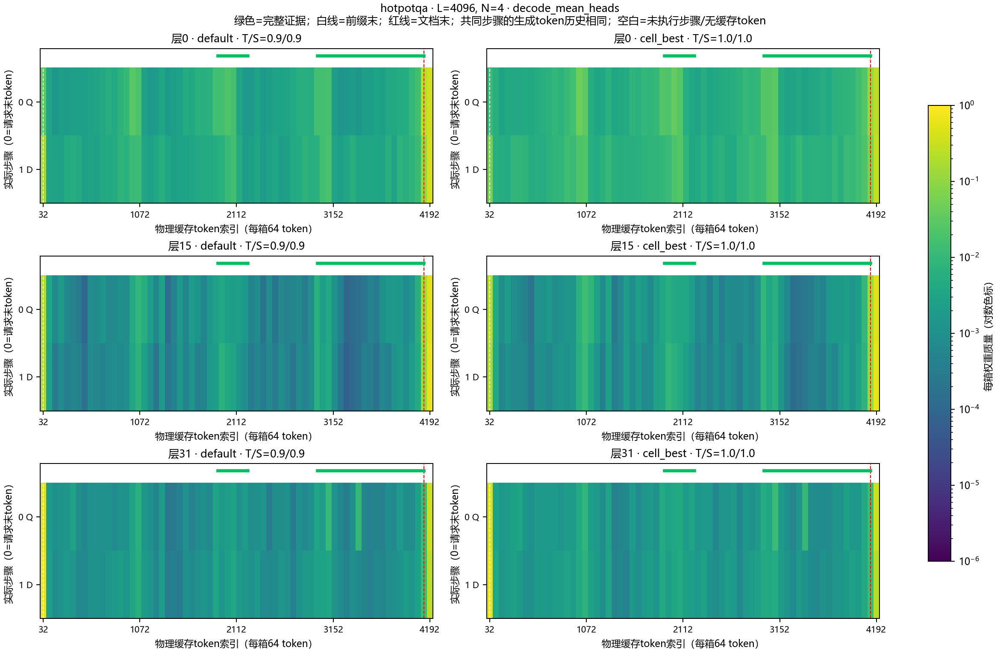

# 实验第五阶段：注意力诊断

## 1 研究问题与实际材料

我们检查T/S变化如何伴随文档、证据、背景和请求区域的注意力分配变化，并连接相同输入上的答案。材料来自main80-20261114T041503的12条attention生成及完整attention.jsonl。每数据集按冻结顺序取首个有效探索题，三道原始问题各构造4K/4块、16K/16块，形成六组参数配对。全部执行标签为ape_fixed，逻辑角色分别为default与exploration_cell_best。我们直接引用保存score，评分重算0次。

默认T/S=0.9/0.9；4K/4探索候选为1.0/1.0，16K/16为0.5/0.7。16K/16的冻结动态规则已回退到0.7/1.0，本阶段按原诊断任务解释探索候选。模型为Llama-3.1-8B-Instruct，采集使用BF16分支混合；正式时延运行关闭观察器，诊断运行保留逐步重建与JSON写出。原始文档数Qasper/HotpotQA/MuSiQue分别为1/10/17，实际编码块数为4或16。

## 2 采集定义、区域和数值审核

我们流式读取231条层级捕获、924条head-step数据。层为0/15/31，头为0/8/16/24；36项配置×层检查均覆盖step=0到output_tokens−1。step0取完整请求的最后token，step=s>0取前s个已生成token送回网络后的最后查询，用于预测下一token。终止EOS之后直接退出。物理缓存长度逐条等于prefix_tokens+L+request_tokens+step。

记文档token logits为zᶜᵢ=q·kᵢ/(√d·T)，其他token logits为zᵒⱼ=q·kⱼ/√d。文档分支LSE乘S×T后与其他分支LSE作softmax，得到实际BF16分支质量mᶜ/mᵒ。保存token权重为wᶜᵢ=mᶜ·softmax(zᶜ)ᵢ及wᵒⱼ=mᵒ·softmax(zᵒ)ⱼ。T同时改变文档内分布和分支分配，S通过LSE缩放改变分支分配。

保存的o_proj前指定头输出重建误差最大为0.006171465，最大误差/容差为0.112259，全部低于保存容差0.03+0.02×max|target|。PC逐条核对保存误差与容差，并检查token质量和分支质量；原始记录缺Q/K/V和target向量，weighted-V误差数值取服务器采集结果。token权重和偏离1最大0.001953317，文档/其他区域质量与对应分支质量的最大绝对差分别为8.76e-08/2.55e-07。原始质量保留BF16舍入，文档条件比例单独用E/C归一。

五个区域为共享前缀、完整证据、文档内其余背景、完整suffix请求、已生成历史。请求包含问题及模板标记。字符证据经本机既有tokenizers与运行快照tokenizer.json转换，再按retained_source_intervals投影到实际构造位置。三个问题的证据全部保留；六种构造的保存区间均偏稀疏，本次区域统计使用重建后的完整掩码。

| 数据集 | 完整证据token | 原保存标记token | 4K证据比例 | 16K证据比例 |
|---|---|---|---|---|
| qasper | 43 | 10 | 1.050% | 0.262% |
| hotpotqa | 1468 | 235 | 35.840% | 8.960% |
| musique | 1833 | 494 | 44.751% | 11.188% |

Qasper采用exact_evidence_with_whitespace_alignment标注；HotpotQA和MuSiQue采用whole_public_support_document_version_changed策略，证据范围覆盖指定公共支撑文档。表中证据粒度随数据来源保留。背景包含其余原文和构造补充token。

## 3 同输入请求末token与质量结果

F1原值为0–1，以下乘100展示；差值统一为探索候选−默认。证据占文档比例先在各头求Eh/Ch，再对四头等权平均。下表列第31层，全部三层及逐头值保存在query_region_pairs.csv和paired_head_steps.csv。

| 数据集/输入 | 默认F1 | 候选F1 | 差/百分点 | 文档质量 默认→候选 | 证据占文档% 默认→候选 |
|---|---|---|---|---|---|
| qasper 4K/4 | 30.77 | 80.00 | +49.23 | 0.1072→0.1747 | 0.697→0.775 |
| qasper 16K/16 | 0.00 | 0.00 | +0.00 | 0.1936→0.0532 | 0.149→0.051 |
| hotpotqa 4K/4 | 100.00 | 100.00 | +0.00 | 0.1037→0.1517 | 46.984→45.400 |
| hotpotqa 16K/16 | 100.00 | 100.00 | +0.00 | 0.1902→0.0460 | 7.977→8.025 |
| musique 4K/4 | 0.00 | 0.00 | +0.00 | 0.0967→0.1373 | 51.726→51.773 |
| musique 16K/16 | 0.00 | 0.00 | +0.00 | 0.1693→0.0428 | 10.733→8.609 |

4K/4从0.9/0.9改为1.0/1.0后，三题在三个采样层的文档总质量均上升；证据占文档比例按题、层变化。Qasper的F1由30.77升至80.00，HotpotQA保持100，MuSiQue保持0。16K/16改为0.5/0.7后，三题在三个采样层的文档总质量均下降；三题F1分别保持0、100、0。参数对分支总分配的变化在这些输入中更一致，证据条件占比和答案分数按任务呈现不同表现。

文档分支总质量图使用统一0–100%纵轴。证据比例图各面板从0起、独立设定纵轴，展示Qasper小幅比例变化；灰虚线为证据token数/L对应的文档内均匀权重参照。三题分别来自三个数据集，层、头及两长度保留为同题内观测；本阶段按实际记录描述，不对这些头和步骤作跨题Bootstrap，质量CI留空。

## 4 实际decode及历史配对

| 输入 | 共同步骤数 | 相同token历史步骤 | 分歧步骤 | 首次分歧step | 默认/候选未配对尾部 |
|---|---|---|---|---|---|
| qasper 4K/4 | 15 | 5 | 10 | 5 | 1/0 |
| qasper 16K/16 | 4 | 1 | 3 | 1 | 0/14 |
| hotpotqa 4K/4 | 2 | 2 | 0 | 无 | 0/0 |
| hotpotqa 16K/16 | 2 | 2 | 0 | 无 | 0/0 |
| musique 4K/4 | 4 | 4 | 0 | 无 | 0/0 |
| musique 16K/16 | 4 | 4 | 0 | 无 | 0/0 |

相同历史标签依据完整output_token_ids[:step]判定，隐状态仍沿各配置各自计算。Qasper4K在step5起生成历史不同，16K在step1起不同，后续图像同时包含参数与已生成内容的变化。HotpotQA和MuSiQue两长度的共同步骤均保留相同token历史。未配对尾部仅在各配置原始轨迹展示。

## 5 注意力图与统一选例

每组参数共用10⁻⁶至1的对数色标。query_heads图展示每个头；decode_mean_heads图先对四头平均，两侧使用共同token与step坐标，空白表示该配置未执行的步骤或尚无对应缓存token，标题标注生成历史首次分歧位置。每个色块为连续64个物理缓存token的质量之和，最末箱按实际长度；绿色顶线为完整证据、白线为前缀末、红线为文档末。一个箱可混合多个区域，区域精确统计按逐token掩码求和。物理缓存索引与分块复用的RoPE位置分别记录，query_start_position等于prefix加最长1024-token块，图横轴使用拼接后的物理顺序。

### 5.1 改善案例：qasper 4K/4

样本ID：`qasper:5f00d4f6e62f4b99484eb78491f803f8143cc1b13ad33816`。默认T/S=0.9/0.9，候选1.0/1.0；保存F1分别30.77、80.00。attempts.jsonl源行9585/9586。

- 默认原答案：It performs better than other approaches on benchmark word similarity and entailment datasets.
- 候选原答案：It performs better than existing approaches for various metrics on SCWS dataset.
- 参考答案：["GM$\\_$KL achieves better correlation than existing approaches for various metrics on SCWS dataset."]

### 5.2 持平案例：hotpotqa 4K/4

样本ID：`hotpotqa:6320310adc4a826b1bb240c63ac1735b7b29e93a59782364`。默认T/S=0.9/0.9，候选1.0/1.0；保存F1分别100.00、100.00。attempts.jsonl源行9589/9590。

- 默认原答案：821
- 候选原答案：821
- 参考答案：["821"]

选例规则为最大改善、最大退化、零差最小sample_id/L/N，并列按同序排序。本阶段六对中改善1、退化0、持平5，退化类型留空。Qasper16K两答案内容不同而F1均为0，全部原答案保存在answer_pairs.csv。

## 6 诊断效率与生成停止

| 角色 | 诊断请求 | TTFT均值/秒 | 总响应均值/秒 | 总响应中位数/秒 | 总响应P90/秒 | 输出token均值 |
|---|---|---|---|---|---|---|
| default | 6 | 1.4388 | 2.0173 | 2.4104 | 2.8706 | 5.33 |
| cell_best | 6 | 1.2753 | 2.3605 | 2.1092 | 4.2023 | 7.50 |

以上时间覆盖观察器中的逐步FP32权重重建、误差核对、CPU转移和JSON写出，单独登记为诊断请求。12条均以EOS结束，生成上限命中0/12；默认输出范围2–16 token，候选2–18 token。Qasper16K候选由默认4 token变为18 token，诊断总响应由2.629升至5.761秒，保存F1均为0。缓存构建/获取与显存的均值、中位数、P90保存在diagnostic_efficiency.csv，显存单位GiB=bytes/2³⁰，峰值包含模型及存活缓存。

本阶段唯一worker模型加载4.576090秒，事件源行见model_load_workers.csv，加载单列于请求计时之外。三题的两个长度共同保留，角色均值分母为6请求、3个原始问题。

## 7 结论、补充记录与复现

我们核对了12项诊断的完整采集：所有指定层、头、实际步骤和保存误差通过检查，并修正六份构造的证据区域标注。4K/4的探索候选普遍增加文档分支质量，伴随Qasper这一个配对的F1改善；16K/16候选普遍降低文档分支质量，三个答案分数持平。证据条件占比的变化随层和问题而异，结果须与总文档质量、具体答案一同阅读。

需补充的记录有两类：若需在PC独立复算weighted-V误差，补存选定层/头/步骤的Q/K/V、target及实际分支输出；若需分离生成历史变化对decode注意力的作用，对Qasper两长度补同一固定token序列的teacher-forced诊断。当前原始记录缺这两类输入，本轮登记建议，保持原冻结参数。

本地分析提交为227116e4a004153272640cfe31087a033861b8e9，与参考提交相同。使用已有Python、NumPy、Matplotlib和tokenizers，版本见environment.json；随机分析未执行，统一Bootstrap种子20261116保留于环境记录。运行命令见本阶段README。原始证据只读，新增产物在pc-analysis-output内。研究状态保留SUBMITTED，执行停止在第五阶段。
