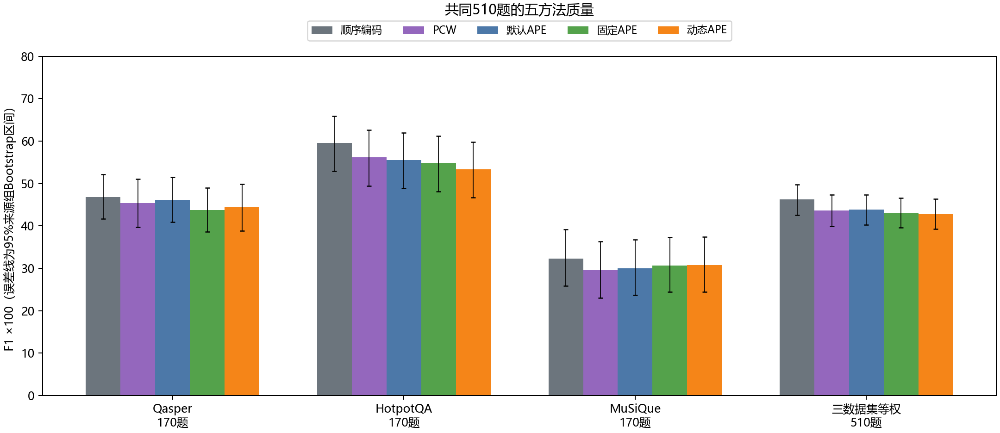
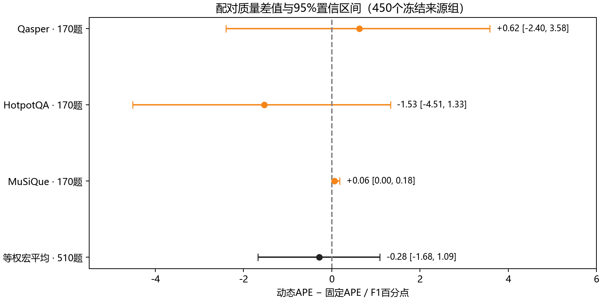
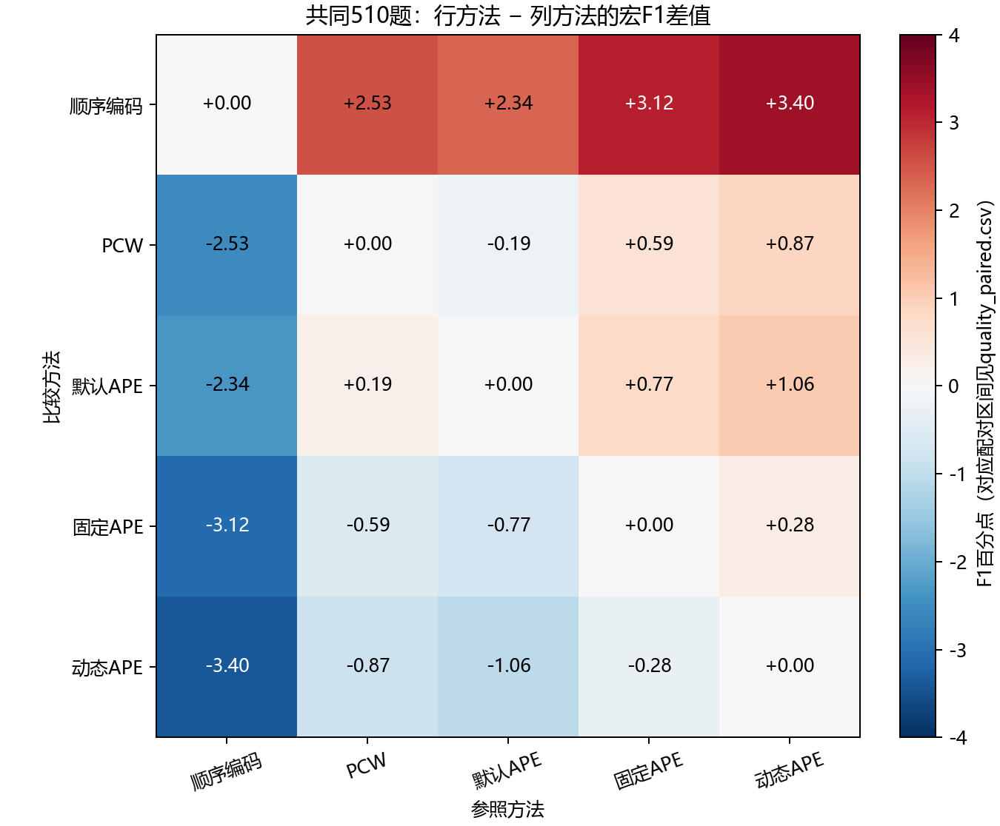
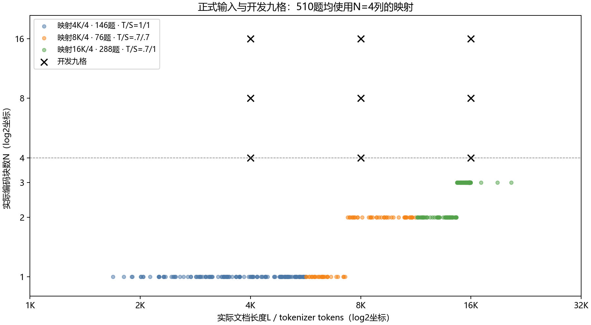
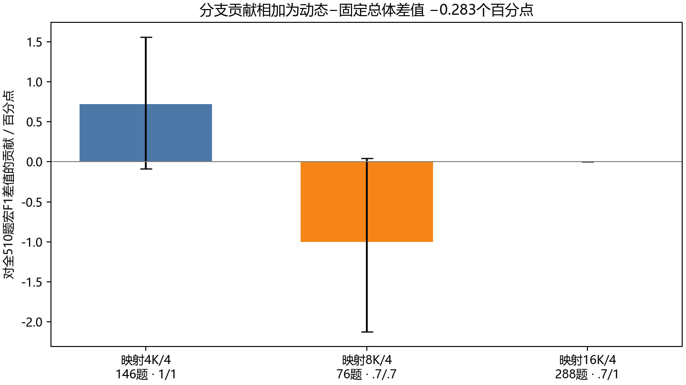
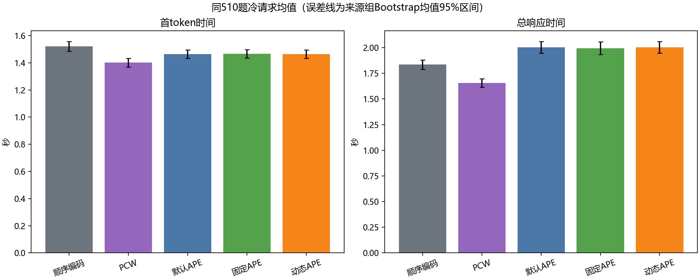
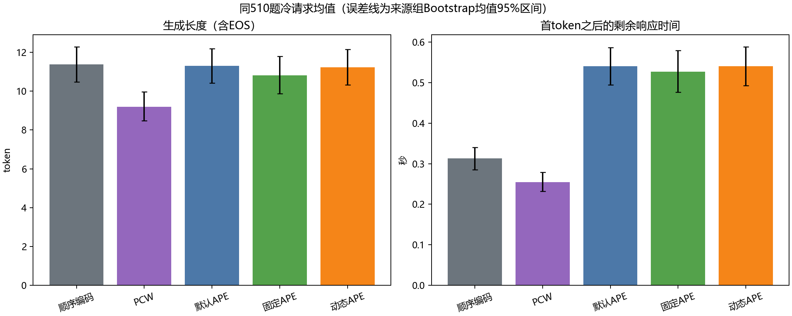
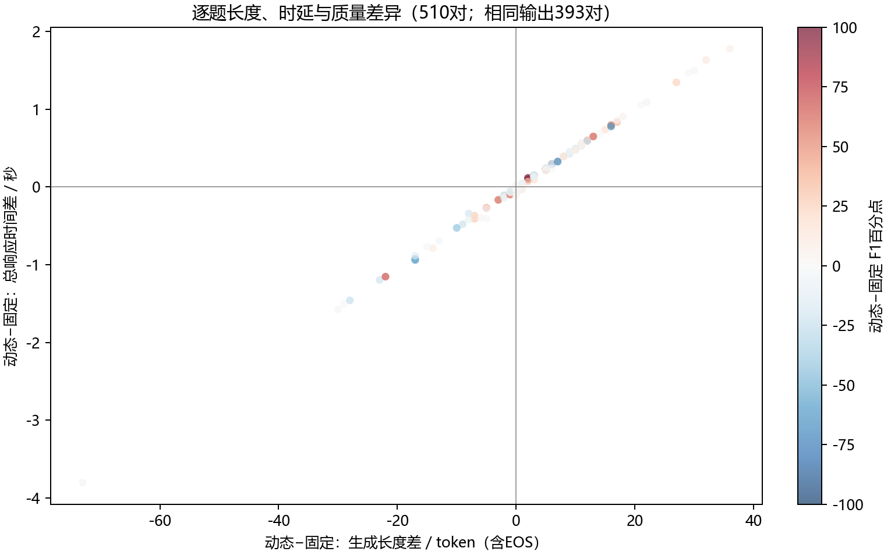

# 实验第六阶段：LongBench五方法正式比较

## 摘要

我们在MAIN80冻结测试集上比较顺序编码、PCW、默认APE、调优固定APE和动态APE。Qasper、HotpotQA、MuSiQue各170题，共510题和2550条冷请求生成；三方法基线复用同ID的1530条记录，固定与动态APE来自正式阶段1020条记录。我们引用已审核的逐题F1，以数据集等权汇总，采用5000次配对来源组Bootstrap计算区间。五方法宏F1依次为46.21、43.67、43.86、43.09和42.81。动态相对固定下降0.28个百分点，95%区间为[-1.68,1.09]，胜平负47/415/48。实际编码块数均为1–3，全部映射至开发九格N=4列；4K分支贡献+0.72个百分点，8K分支贡献-1.00个百分点，16K分支同参且答案持平。动态平均TTFT缩短2.33毫秒，总响应增加10.90毫秒，输出长度由10.82增至11.23 token。测试与开发共享支撑资料的29题单列，改用来源连通组件后区间相近。结果显示，本次冻结动态规则总体点估计略低于固定规则，其改善与退化集中在两个短中长度映射分支，效率需结合输出长度、缓存条件和实际逐块实现阅读。

关键词：LongBench；自适应并行编码；动态参数；配对统计；冷请求效率

## 1 研究问题与设置

我们评价五种编码方法在共同测试ID上的质量和冷请求效率，重点检查冻结动态规则相对固定T/S=0.7/1.0的变化及来源。默认APE为0.9/0.9，动态按文档长度L、实际编码块数N查原冻结九格。测试分数仅用于本阶段评价，参数和回退规则保留实验第三阶段冻结结果。

模型为Llama-3.1-8B-Instruct，执行物理GPU0、bfloat16、batch1、greedy生成，生成种子配置42。服务器记录Python3.10.20、PyTorch2.6.0+cu124、Transformers4.44.2、FlashAttention2.7.4.post1。方案登记RTX4090 48GB；本campaign缺GPU型号、总显存、驱动及功率遥测，具体登记见server_environment.csv。当前结果来自单模型、单campaign。

五方法共用冻结完整公开文档、问题、参考和聊天模板。自然分块最大7500 tokenizer tokens，逐块长度与五方法结果一致。顺序编码先处理prefix+全部文档；PCW各窗以一个BOS独立编码，合并时保留唯一BOS，并将prefix去BOS后移至请求；APE先编码共享prefix，再按块编码文档并合并KV。PCW/APE在本实现中通过Python循环逐块调用GPU forward。最终请求位置和模板适配按实际代码登记。

全部2550条为cold miss，各请求重新构建资料KV，计时关闭注意力观察器。TTFT从请求开始计，包含prepare分词/构造、选参、缓存查询/编码和首token；总响应继续覆盖完整生成及文本解码。模型加载独立记录。质量使用LongBench英文token F1：规范化后计算token重叠，多参考取最高值；原score为0–1，展示乘100。评分实现及官方来源沿用[前置审核](../../01_audit/reports/AUDIT.md)，本阶段评分重算0次。

## 2 样本连接、冻结顺序与统计

1020条longbench_final记录加上同ID的1530条baseline记录，严格形成510题五方法配对，每数据集170题。全部成功且attempt=1，重复成功、失败、空答案、缺参考及非法数值均为0。源任务键N为null时，实际N由自然分块产生；选参使用结果N与methods.prepare实际块数。membership.csv及per_request_records.csv保存原键、实际参数、逻辑标签和源行。

| 三方法 | 完整600题基线宏F1 | 共同510题宏F1 |
|---|---|---|
| 顺序编码 | 45.43 | 46.21 |
| PCW | 43.34 | 43.67 |
| 默认APE | 43.33 | 43.86 |

完整600题基线由[实验第一阶段](../../01_longbench_baseline/reports/BASELINE_REPORT.md)交付。当前510题为冻结测试划分，每个方法按同ID比较；600与510的分母和样本构成分别保留。

主区间按数据集内原论文/完整证据组重采样，Qasper116、HotpotQA170、MuSiQue164组，共450组；每次有放回抽取同数来源组，保留组内所有题和五方法。组大小变化时按该次抽到的题数归一，三个数据集F1再等权平均。seed20261116，5000次，取2.5%与97.5%分位数。每个区间对应一个指定对比。效率汇总保留原数据集请求比例；分支及N子组的CI仅反映该子组内来源构成变化。

另把同冻结组或共享任一支撑资料的测试题连通，得到116/169/128、合计413个来源组件，在同510题及同冻结规则下作敏感性。区间反映所选问题和资料来源的样本变动；本campaign每方法各有一个连续worker时段，重复执行的时延变化尚缺观测。全部组成员及随机种子子序列见bootstrap_membership.csv、bootstrap_diagnostics.csv。

规则冻结时间为北京时间2026-11-14T14:17:49+08:00，固定/动态正式worker分别于2026-11-14T14:22:08+08:00、2026-11-14T14:39:24+08:00启动。三方法基线先于规则冻结生成；候选及验证选择的输入范围由实验第三阶段审核，正式阶段参数与rule.json逐题吻合。

## 3 五方法质量

| 方法 | Qasper/170 | HotpotQA/170 | MuSiQue/170 | 等权宏F1/510 | 宏F1的95%区间 |
|---|---|---|---|---|---|
| 顺序编码 | 46.82 | 59.53 | 32.27 | 46.21 | [42.55, 49.72] |
| PCW | 45.33 | 56.12 | 29.57 | 43.67 | [39.95, 47.28] |
| 默认APE | 46.18 | 55.46 | 29.95 | 43.86 | [40.28, 47.37] |
| 固定APE | 43.72 | 54.88 | 30.67 | 43.09 | [39.63, 46.54] |
| 动态APE | 44.34 | 53.35 | 30.73 | 42.81 | [39.31, 46.34] |

顺序编码的宏F1点估计最高，PCW与默认APE接近；调优固定和动态APE的宏F1分别低于默认APE0.77、1.06个百分点，对应区间[-2.82,1.33]、[-3.13,1.08]。动态相对顺序下降3.40个百分点，区间[-6.10,-0.66]。全部10个方法对在各数据集及宏平均上的差值、区间、胜平负见main_quality_paired.csv。

| 数据集 | 动态−固定/百分点 | 95%区间 | 胜/平/负 | 分母 |
|---|---|---|---|---|
| qasper | +0.624 | [-2.40, 3.58] | 41/89/40 | 170 |
| hotpotqa | -1.532 | [-4.51, 1.33] | 5/157/8 | 170 |
| musique | +0.059 | [0.00, 0.18] | 1/169/0 | 170 |
| 三数据集等权 | -0.283 | [-1.68, 1.09] | 47/415/48 | 510 |

Qasper点估计略升，HotpotQA下降，MuSiQue只有1题分数提高、169题持平。全体宏F1下降0.283个百分点，区间包含两种方向的变动。改用413个来源连通组件，差值点估计相同、区间为[-1.66, 1.10]个百分点。

## 4 实际L/N、网格映射与分支贡献

| 数据集 | N=1 | N=2 | N=3 | 长度范围/token |
|---|---|---|---|---|
| qasper | 155 | 11 | 4 | 1846–21110 |
| hotpotqa | 20 | 73 | 77 | 1726–16322 |
| musique | 2 | 20 | 148 | 6482–16335 |
| 合计 | 177 | 104 | 229 | 1726–21110 |

开发网格为L=4K/8K/16K、N=4/8/16，正式510题的N均低于开发范围。L低于4K的74题、高于16K的3题，合计77/510（15.10%）；低端Qasper69、HotpotQA5，高端3题均Qasper。规则按log₂(L)、log₂(actual_N)欧氏距离取最近格，所有输入落到N=4列。

| 映射格 | 动态T/S | 题数 Q/H/M | 分支内动态−固定/百分点 | 分支内95%区间 | 对总体差值贡献/百分点 |
|---|---|---|---|---|---|
| 4096/4 | 1.0/1.0 | 146 (132/14/0) | +2.517 | [-0.38,5.33] | +0.720 |
| 8192/4 | 0.7/0.7 | 76 (34/35/7) | -6.735 | [-13.90,0.46] | -1.004 |
| 16384/4 | 0.7/1.0 | 288 (4/121/163) | +0.000 | [0.00,0.00] | +0.000 |

分支内结果按该分支实际题目混合汇总；4K分支仅含Qasper和HotpotQA。总体贡献把其他分支差值置零，沿用全510题三数据集等权分母，三项相加为-0.283。4K分支贡献+0.720，8K分支贡献-1.004；16K分支的288题采用固定参数0.7/1.0，答案token完全相同。

按实际N汇总，N=1的177题动态−固定为+1.505个百分点，N=2的104题为-3.950，N=3的229题为0；各数据集组成与单独差值保存在quality.csv。三种APE同时生成相同token序列290/510；固定/动态相同393/510，其中288题同参、105题改参后输出仍相同。分数持平415题还包含22题token不同但F1相同。

## 5 开发资料重合与独立来源敏感性

测试与探索/验证集在规范化问题和完整证据组上无重合；单篇输入资料重合影响59个测试ID，单篇支撑资料重合24篇、影响29个测试ID，全部为MuSiQue。原始构造来源、资料ID交集及受影响样本清单保存在development_overlap_affected_ids.csv，并与前置审核清单逐ID吻合。

| MuSiQue方法 | 支撑重合29题F1 | 无支撑重合141题F1 |
|---|---|---|
| 顺序编码 | 5.96 | 37.69 |
| PCW | 7.19 | 34.17 |
| 默认APE | 3.20 | 35.45 |
| 固定APE | 8.15 | 35.30 |
| 动态APE | 8.15 | 35.37 |

重合29题的绝对F1低于其余141题，五方法均呈该样本构成下的表现。重合29题动态与固定全部持平；非重合141题动态提高0.071个百分点，只有1题分数上升。保留全部510题主表，来源聚类敏感性及资料分层分别给出，冻结规则保持原值。

## 6 冷请求效率、缓存与显存

以下每方法均为共同510题，时间单位秒，输出长度含EOS。均值的95%区间及所有指标中位数/P90见main_efficiency.csv。

| 方法 | TTFT均值 | TTFT中位数/P90 | 总响应均值 | 总响应中位数/P90 | 输出token均值 |
|---|---|---|---|---|---|
| 顺序编码 | 1.5222 | 1.9265/2.2671 | 1.8351 | 2.1135/2.4349 | 11.376 |
| PCW | 1.4008 | 1.7646/2.0294 | 1.6554 | 1.9420/2.2582 | 9.182 |
| 默认APE | 1.4640 | 1.8333/2.0984 | 2.0038 | 2.1568/2.8077 | 11.290 |
| 固定APE | 1.4672 | 1.8378/2.1023 | 1.9939 | 2.1643/2.7380 | 10.816 |
| 动态APE | 1.4648 | 1.8334/2.1005 | 2.0048 | 2.1643/2.7642 | 11.229 |

| 动态相对固定指标 | 动态−固定/毫秒 | 95%配对区间/毫秒 | 逐题加速比均值/中位数 | 均值耗时之比 |
|---|---|---|---|---|
| ttft_seconds | -2.332 | [-2.680,-1.983] | 1.00237/1.00163 | 1.00159 |
| total_seconds | +10.902 | [-19.545,41.586] | 1.01112/1.00193 | 0.99456 |

逐题加速比为参照耗时÷比较耗时，先逐题求比再平均；均值耗时比为两方法平均耗时相除。动态相对固定的两种总响应比值分别为1.01112和0.99456，按同一批请求的两种定义保留。PCW相对顺序的总响应均值缩短0.1797秒、均值耗时比1.1086；动态相对顺序总响应增加0.1697秒，区间[0.1373,0.2025]秒。

| 方法 | 缓存构建均值/秒 | 缓存获取均值/微秒 | 参数分支均值/微秒 | allocated均值/GiB | reserved均值/GiB |
|---|---|---|---|---|---|
| 顺序编码 | 1.4622 | 0.287 | 0.771 | 19.104 | 26.775 |
| PCW | 1.3373 | 0.303 | 0.802 | 19.097 | 30.945 |
| 默认APE | 1.3801 | 0.270 | 1.173 | 19.285 | 25.377 |
| 固定APE | 1.3807 | 0.297 | 1.806 | 19.286 | 25.587 |
| 动态APE | 1.3800 | 0.309 | 24.005 | 19.286 | 25.587 |

动态选参均值24.005微秒，固定参数分支1.806微秒。两方法TTFT均值相差-2.332毫秒，同参同输出请求仍存在计时差；这批记录每方法来自一个连续worker时段，需交错重复测时分解参数开销与执行时序的影响。缓存构建是完整逐块资料编码，缓存获取为cold条件下的查询开销。显存GiB=bytes/2³⁰，请求开始重置峰值统计，覆盖模型、开始时存活缓存及本次请求；reserved还保留worker内分配器历史。

五方法worker的模型加载依次为4.900、4.470、4.474、4.170、4.547秒，单列于model_load_workers.csv，排除于请求时延。三个基线worker早于参数搜索，两个正式worker在冻结后顺序执行；完整起止时间按UTC保留。

## 7 输出长度、生成上限及质量/时延关系

| 分组 | 配对数 | 固定/动态token均值 | 动态−固定总响应/毫秒 | 动态−固定F1/百分点 |
|---|---|---|---|---|
| all510 | 510 | 10.816/11.229 | +10.90 | -0.283 |
| same_tokens | 393 | 7.718/7.718 | -6.10 | +0.000 |
| different_tokens | 117 | 21.222/23.026 | +68.02 | -1.234 |
| dynamic_longer | 67 | 19.015/28.552 | +464.79 | -0.601 |
| dynamic_shorter | 40 | 25.700/15.000 | -574.79 | -2.103 |
| equal_length_different_tokens | 10 | 18.100/18.100 | -19.08 | -2.005 |

上述为实际请求混合的描述性分组。393题输出相同，平均总响应差-6.10毫秒；117题输出不同，动态平均多1.803 token、总响应多68.02毫秒。更长67题与更短40题共同决定全体平均多0.414 token、总响应多10.90毫秒；两类的F1点估计均下降。

| 数据集 | 顺序编码 上限命中/170 | PCW 上限命中/170 | 默认APE 上限命中/170 | 固定APE 上限命中/170 | 动态APE 上限命中/170 |
|---|---|---|---|---|---|
| qasper | 0/170 | 0/170 | 0/170 | 0/170 | 0/170 |
| hotpotqa | 3/170 | 1/170 | 2/170 | 1/170 | 1/170 |
| musique | 8/170 | 8/170 | 6/170 | 5/170 | 6/170 |

生成上限为Qasper128、HotpotQA/MuSiQue32 token。共同测试2550条中41条达到上限（1.61%），2509条以EOS结束，EOS恰在上限为0。MuSiQue每方法有5–8条达到32 token；原始答案、分数、token及源行号在generation_cap_records.csv。

以MuSiQue动态APE为例，达到上限的6题平均F1=8.83、总响应3.697秒；其余164题为31.53、2.369秒。分组由实际生成长度决定，保留题目、质量及耗时共同阅读，后续成对提高上限时继续使用同题比较。

## 8 统一规则选择的案例

按动态−固定F1最大正差、最大负差及零差最小sample_id选全局案例；并列按ID字典序。逐数据集相同规则的案例同时保存。

### 8.1 改善：hotpotqa:8bcda9c521bb7cb5dcd9a8d4987bd5bcf4ec455a84c62f81

输入L=8747、实际N=2，映射8192/4；固定T/S=0.7/1.0，动态=0.7/0.7。F1原值0.0→1.0，差+100.000个百分点。源文件attempts.jsonl第9836/10346行。

- 问题：Which is farther north, Steel Venom or Wicked Twister?
- 固定原答案：Steel Venom
- 动态原答案：Wicked Twister
- 参考答案：["Wicked Twister"]

### 8.2 退化：hotpotqa:1a71b5a73ffb21cb52d41e09b1f861748b60f1e59273a080

输入L=11289、实际N=2，映射8192/4；固定T/S=0.7/1.0，动态=0.7/0.7。F1原值1.0→0.0，差-100.000个百分点。源文件attempts.jsonl第9807/10317行。

- 问题：Arnold Richards was the former chair of what organization that is a member of the Center for Jewish History?
- 固定原答案：YIVO
- 动态原答案：American Psychoanalytic Association
- 参考答案：["YIVO"]

### 8.3 持平：hotpotqa:0118217cf85bd94f6a5f65952212eb05e7176fd3b18c694a

输入L=15541、实际N=3，映射16384/4；固定T/S=0.7/1.0，动态=0.7/1.0。F1原值0.6666666666666666→0.6666666666666666，差+0.000个百分点。源文件attempts.jsonl第9907/10417行。

- 问题：The arena where the Lewiston Maineiacs played their home games can seat how many people?
- 固定原答案：3,677
- 动态原答案：3,677
- 参考答案：["3,677 seated"]

## 9 审核、讨论与补实验事项

保存summary.json的longbench_test_by_method与longbench_five_method_paired中30项F1均值及全部对应ID、分母与本次复算吻合，浮点差小于10⁻¹²；本次新增配对区间、来源敏感性、规则贡献及效率分层。正式任务数与任务工厂和冻结测试划分一致。

| 具体问题 | 证据及范围 | 本阶段处理 | 所需补充 |
|---|---|---|---|
| 开发与正式实际N分布不同 | 开发N4/8/16; 测试N1/2/3=177/104/229; 510/510网格外 | 冻结最近格映射; 单列实际N、原资料数和三个使用分支 | 在开发数据用自然分块N1–3搜索/验证后重新冻结, 用新增独立测试评价 |
| 正式动态仅使用三个分支 | 4K/4=146;8K/4=76;16K/4=288; 同参288条答案一致 | 按分支和实际N统计; 对全510的贡献逐项保存 | 针对8K/4的退化在证据完整开发集复核; 当前保持原规则 |
| 开发/测试单篇支撑资料重合 | 24篇支撑资料,29个MuSiQue测试ID; 单篇输入资料涉及59测试ID | 保留冻结510主表; 支撑重合29/不重合141的MuSiQue分层;450组与413连通组件CI | 新增按单篇支撑资料隔离的独立测试 |
| 毫秒级计时差存在于连续worker运行 | 五方法各一个worker时段; 同参/同token288题也有计时差 | 报告时间差、输出长度、选参µs和worker顺序; CI反映样本来源变化 | 同参同输出请求随机交错重复测时, 分离选参及执行时序影响 |
| 短回答任务达到生成上限 | 41/2550; MuSiQue5–8/170/方法; Qasper0 | 保留原分数; EOS/cap分组; 保存全部41条原答案与来源 | 在开发集对相同问题成对增加生成上限, 检查截断与重复输出 |
| 硬件登记缺少campaign遥测 | 方案RTX4090 48GB; 记录物理GPU0/BF16/batch1及软件版本; manifest无GPU型号遥测 | 分别列方案登记与实际执行配置, 保留单campaign效率 | 未来实验保存实际GPU型号/显存/驱动运行元数据 |

开发构造证据缺失的具体ID及配置已在前置审核和实验2/3报告登记；它影响参数候选和验证选择的输入。本次正式测试使用完整公开文档，按原冻结规则评价。后续重建开发构造、补自然N=1–3网格并重新冻结时，需配套新增独立测试。当前保留全部原始记录和参数。

## 10 结论与复现

在本次共同510题中，顺序编码宏F1最高，PCW总响应均值最短。调优固定APE和动态APE均低于默认APE的宏F1点估计；动态相对固定小幅下降0.283个百分点，95%配对区间[-1.676,1.092]，主要由4K映射收益与8K映射损失相抵后形成。16K分支同参，288题答案完全持平。正式自然块数全部位于开发N范围之外，动态实际只使用N=4列的三个分支。

动态相对固定平均TTFT缩短2.332毫秒，总响应增加10.902毫秒，输出长度均值增加0.414 token；这批冷请求上的总响应变化与生成长度共同报告。按共享单篇支撑资料连接来源后，质量差区间保持相近。材料保留单模型、单campaign、模板适配、逐块执行、worker时段及缺少硬件遥测的实际设置。

实际分析提交227116e4a004153272640cfe31087a033861b8e9，相对参考提交无变化；依赖版本、seed20261116、5000次重采样及各scope随机子序列见environment.json。全部脚本、CSV、PNG/SVG及运行命令见本阶段README；关键字段与来源见provenance.csv。原始证据只读，未安装依赖、运行模型或改动冻结规则。研究状态保留SUBMITTED，执行停止在第六阶段。
