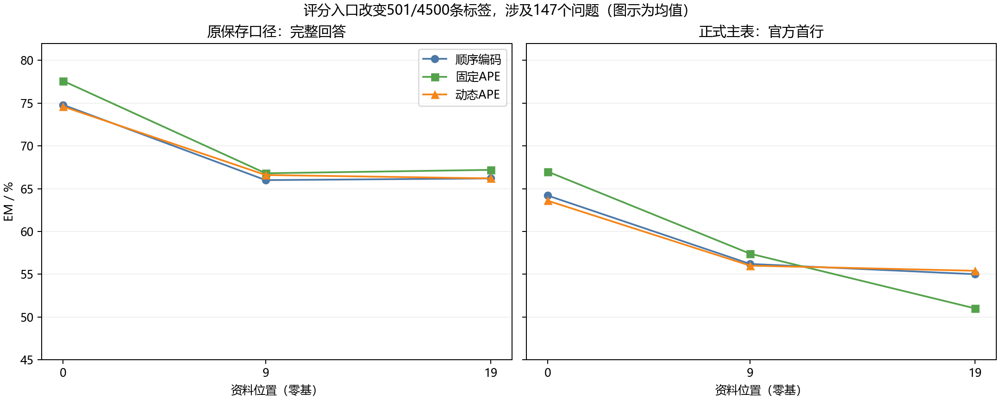
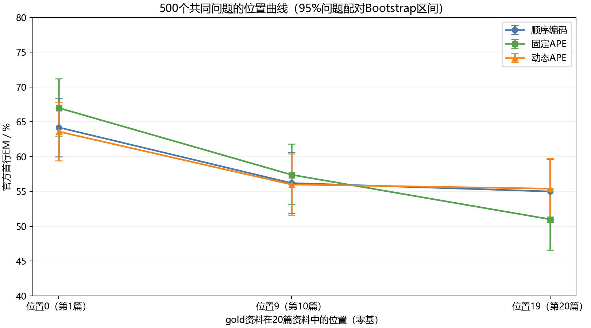
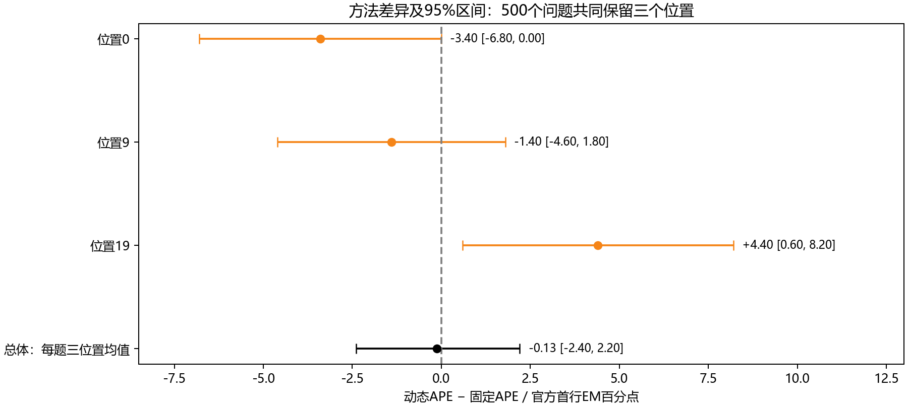
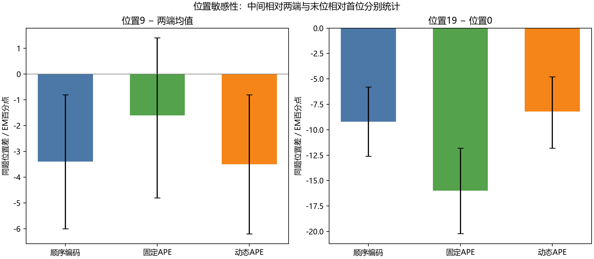
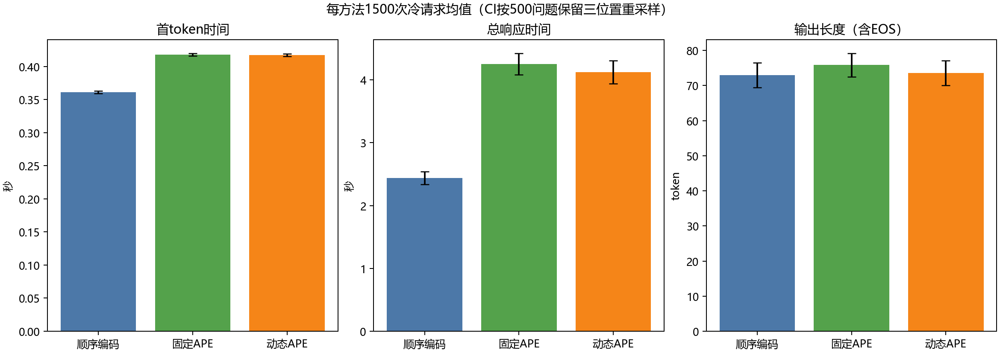
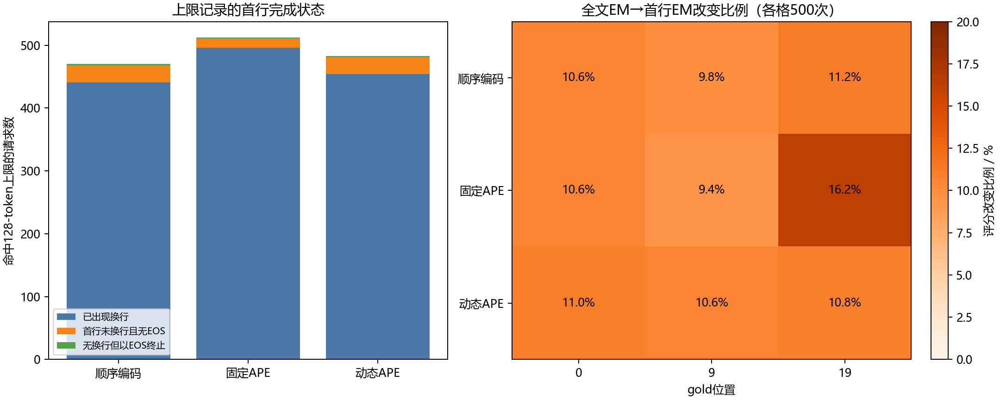
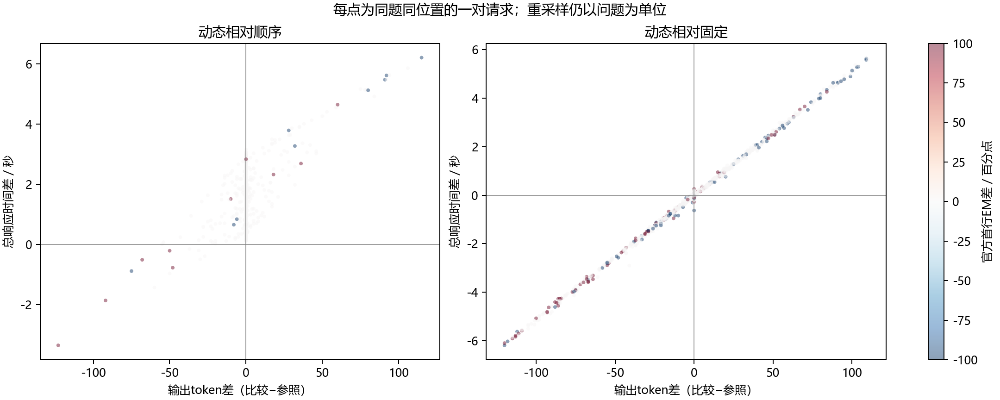
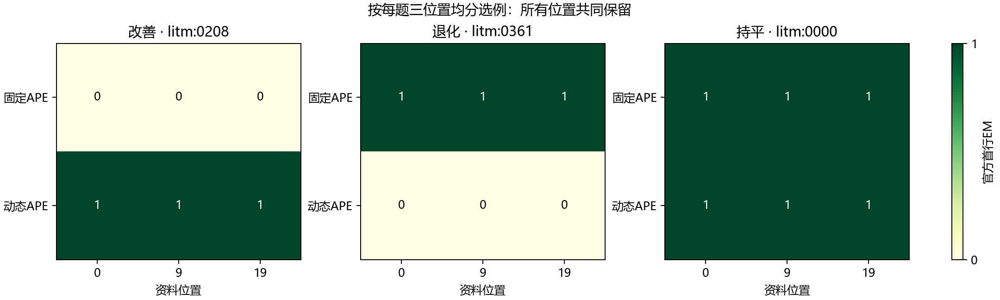

# 实验第七阶段：Lost in the Middle位置实验

## 摘要

我们在Lost in the Middle原作者20篇资料版本上，比较顺序编码、固定APE和冻结动态APE。500个问题分别将同一gold资料置于位置0、9、19，共4500条冷请求生成。我们核对文档多重集合、唯一gold、干扰资料相对顺序和参考答案，复用前置审核的501条官方首行评分修正，并以问题为单位保留三位置、三方法作5000次Bootstrap。三方法总体首行EM为58.47%、58.47%、58.33%；动态相对固定差-0.13个百分点，95%区间[-2.40,2.20]。动态在末位提高4.40个百分点，在开头和中间分别下降3.40、1.40个百分点。三条曲线最低点均在末位；固定的末位相对开头下降16.0个百分点，动态下降8.2个百分点。20篇资料实际均编码为一块，动态规则全部映射为1/1。动态平均总响应4.122秒，较固定缩短0.129秒，较顺序增加1.681秒；生成上限命中32.56%，其中大部分已生成完整首行。结果呈现位置间收益转移及单块执行开销，整体质量接近持平。

关键词：Lost in the Middle；证据位置；官方首行EM；动态参数；配对重采样

## 1 研究问题、材料与实际设置

我们评价证据资料在开头、中间和末端时的问答质量，检查固定和动态APE对位置差异及效率的影响。输入取原作者nq-open-20_total_documents_gold_at_0/9/19三个版本，各500个相同问题；位置为零基，对应第1、10、20篇。固定参数0.7/1.0，动态使用实验第三阶段已冻结规则。

每份冻结输入保留完整20篇资料，不裁剪或填充，gold资料全文和19篇干扰资料相同；删除gold后，500题的干扰ID序列在三个位置完全一致。标题/正文多重集合、唯一gold及其位置、问题、参考和共同模板由前置1500条检查逐项核对，本阶段再次连接输入及实际记录。公开gold记录ID为None，其他19篇ID非空且无重复；生成source字段为null，来源通过冻结question/position连接原始位置文件。

实际文档长度L=2532–3573 tokenizer tokens，全部低于自然分块7500-token阈值，实际N=1。20篇检索资料在一个编码块内移动，三个方法的prefix/request长度和query起始位置逐输入相同。动态全映射至开发九格4K/4，实际参数为1.0/1.0；固定为0.7/1.0。输入L与N均低于开发网格下界。

模型为Llama-3.1-8B-Instruct，物理GPU0、bfloat16、batch1、greedy，生成配置seed42，统一max_new_tokens=128，停止规则为EOS或上限，关闭注意力观察器。软件版本及硬件登记沿用server_environment.csv：PyTorch2.6.0+cu124、Transformers4.44.2、FlashAttention2.7.4.post1；方案登记RTX4090 48GB，本campaign缺GPU型号/总显存/驱动遥测。所有结果来自同一模型和campaign。

## 2 官方评分入口与原保存口径

作者[评测入口](https://github.com/nelson-liu/lost-in-the-middle/blob/main/scripts/evaluate_qa_responses.py)先取回答的首个换行前内容并去首尾空白；[best_subspan_em](https://github.com/nelson-liu/lost-in-the-middle/blob/main/src/lost_in_the_middle/metrics.py)将回答和参考转小写、删除ASCII标点与英文冠词、合并空白，再检验任一规范化参考是否为规范化回答的子串。主指标为EM原值0–1，以下乘100展示。

原campaign把完整回答传入同一指标。前置审核已逐条核对4500条，得到501条由1改为0的首行标签，涉及147题。本阶段按sample_id/method/position连接这些标签，并核对源行、attempt、L/N和保存分数；其余3999条沿用已审核分数。另取9个原答案实例验证全文与首行函数结果，共18次函数调用。原始score保留，未重新给4500条生成评分。

| 方法 | 原全文总体EM/% | 官方首行总体EM/% | 差/百分点 | 修正条数/1500 |
|---|---|---|---|---|
| 顺序编码 | 69.00 | 58.47 | -10.53 | 158 |
| 固定APE | 70.53 | 58.47 | -12.07 | 181 |
| 动态APE | 69.13 | 58.33 | -10.80 | 162 |

原summary.json按全文口径汇总的12个位置/总体均值与本次一致；首行修正改变方法对比。末位动态−固定从全文-1.0个百分点变为官方首行+4.4个百分点；总体从-1.4变为-0.133个百分点。末位固定APE有81/500条从全文命中改为首行未命中，动态为54条、顺序为56条；固定与动态修正条数相差27条，对应末位方法差变化5.4个百分点。完整差异和原答案保存在scoring_changed_records.csv、method_pair_scoring_scope_shift.csv。

以litm:0003的动态APE、位置19为例，参考为“October 27, 1904”或“1904”；首行叙述1932与1844，后续段落出现1904，全文得1而首行得0。该最小实例的完整答案、首行、参考与源行在official_entrypoint_fixtures.csv保留。

## 3 统计与分母

4500条记录均成功、attempt=1、cold miss，各条件500条，无重复成功、失败、空答案、缺参考或非法值；首行为空及规范化空参考均为0。Bootstrap单位为500个问题，固定seed20261116，进行5000次有放回抽样；每次抽500个问题，完整保留该题三位置及三方法。区间取2.5%与97.5%分位数，反映这批问题样本构成的变动。

总体EM先对每题三位置等权平均，再对500题平均；总体方法差及胜/平/负也按题均值计算，分母500。每位置胜/平/负按该位置的500题计算。效率均值对应每方法1500次实际冷请求，中位数/P90在这1500条上计算；均值CI仍按500问题共同保留三位置抽样。每个区间对应一个指定差值或位置对比。

## 4 官方首行质量与方法配对

| 方法 | 位置0 EM/% | 位置9 EM/% | 位置19 EM/% | 总体EM/% | 总体95%区间 |
|---|---|---|---|---|---|
| 顺序编码 | 64.20 | 56.20 | 55.00 | 58.47 | [54.47, 62.33] |
| 固定APE | 67.00 | 57.40 | 51.00 | 58.47 | [54.87, 62.13] |
| 动态APE | 63.60 | 56.00 | 55.40 | 58.33 | [54.40, 62.20] |

| 动态−固定 | 差/EM百分点 | 95%区间 | 胜/平/负 | 统计分母 |
|---|---|---|---|---|
| 0 | -3.400 | [-6.80, 0.00] | 28/427/45 | 500问题 |
| 9 | -1.400 | [-4.60, 1.80] | 29/435/36 | 500问题 |
| 19 | +4.400 | [0.60, 8.20] | 60/402/38 | 500问题 |
| 每题三位置均值 | -0.133 | [-2.40, 2.20] | 81/336/83 | 500问题 |

动态在末位提高4.4个百分点，区间[0.6,8.2]；开头下降3.4，中间下降1.4。总体成功的题目×位置条件数为固定877/1500、动态875/1500，按问题聚合后差-0.133个百分点，区间[-2.4,2.2]。顺序与固定总体点估计相同，动态与顺序的总体差同为-0.133个百分点，完整三方法对比见main_quality_paired.csv。

## 5 中间相对两端与末位下降

定义中间缺口G=EM₉−(EM₀+EM₁₉)/2，末首差D=EM₁₉−EM₀，均在同一问题内计算后汇总。负值分别表示中间低于两端均值、末位低于首位。

| 方法 | G/百分点 | G的95%区间 | D/百分点 | D的95%区间 |
|---|---|---|---|---|
| 顺序编码 | -3.40 | [-6.00, -0.80] | -9.20 | [-12.60, -5.80] |
| 固定APE | -1.60 | [-4.80, 1.40] | -16.00 | [-20.20, -11.80] |
| 动态APE | -3.50 | [-6.20, -0.80] | -8.20 | [-11.80, -4.80] |

三条曲线最低点均在位置19。固定APE开头67.0%、末位51.0%，末首差-16.0个百分点；动态开头63.6%、末位55.4%，末首差-8.2。动态相对固定的末首差改善+7.8个百分点，区间[3.20, 12.40]；动态相对顺序为+1.0个百分点，区间[-0.80, 2.80]。

中间缺口按另一组分母比较：动态G=-3.5、固定G=-1.6，动态−固定为-1.9个百分点，区间[-5.50, 1.80]。末位恢复抬高了动态的两端均值，同时中间EM降低1.4个百分点，形成该G差。固定相对顺序的G点估计改善1.8个百分点，既包含中间提高1.2，也包含两端均值降低0.6。两个位置指标分别呈现开头、末端和中间的变化来源。

## 6 冷请求效率与同输出比较

以下每方法1500请求、500问题；模型加载单列，不含注意力采集。TTFT覆盖prepare、参数分支、资料编码和首token；总响应继续覆盖完整生成与文本解码。

| 方法 | TTFT均值/秒 | TTFT中位数/P90 | 总响应均值/秒 | 总响应中位数/P90 | 输出token均值 |
|---|---|---|---|---|---|
| 顺序编码 | 0.3608 | 0.3586/0.3822 | 2.4409 | 2.1879/4.0388 | 72.962 |
| 固定APE | 0.4176 | 0.4165/0.4410 | 4.2516 | 3.6653/6.9579 | 75.841 |
| 动态APE | 0.4172 | 0.4163/0.4395 | 4.1223 | 3.6575/6.9350 | 73.541 |

| 比较−参照 | 总响应差/秒 | 95%区间/秒 | 逐题加速比均值/中位数 | 均值耗时比 |
|---|---|---|---|---|
| 固定APE−顺序编码 | +1.8107 | [1.7066, 1.9147] | 0.6422/0.5857 | 0.5741 |
| 动态APE−顺序编码 | +1.6815 | [1.6008, 1.7618] | 0.6186/0.6030 | 0.5921 |
| 动态APE−固定APE | -0.1293 | [-0.2327, -0.0297] | 1.2194/1.0052 | 1.0314 |

加速比为参照耗时÷比较耗时，逐请求比值平均与两方法均值之比分别保存。动态相对固定总响应缩短0.1293秒，区间[-0.2327,-0.0297]，平均输出少2.299 token；TTFT缩短0.475毫秒，区间[-0.719,-0.240]毫秒。动态与固定的同token输出只有189/1500对；该组总响应平均差-0.0008秒。

顺序与动态有1044/1500对输出token完全相同，占69.6%；该同输出组动态总响应仍平均增加1.4058秒，输出均值相同为61.90 token。源码中APE仍执行共享prefix和context阶段、query时文档/其他两分支注意力及混合；本批N=1输入保留该执行路径。整体动态总响应为顺序的1.689倍，增加1.6815秒，区间[1.6008,1.7618]。

| 方法 | 缓存构建均值/秒 | 缓存获取均值/微秒 | 选参分支均值/微秒 | allocated均值/GiB | reserved均值/GiB |
|---|---|---|---|---|---|
| 顺序编码 | 0.3214 | 0.335 | 0.851 | 16.068 | 17.810 |
| 固定APE | 0.3538 | 0.324 | 1.575 | 16.122 | 17.802 |
| 动态APE | 0.3536 | 0.335 | 22.310 | 16.121 | 17.802 |

显存GiB=bytes/2³⁰，峰值包含模型、请求开始时存活缓存及本次请求，reserved保留worker分配器历史。全部时间、长度和显存的均值/中位数/P90及均值95%区间见efficiency_descriptive.csv，各位置分别保留。三worker的模型加载分别为4.541、4.675、4.726秒。

三个方法依次运行，起止为顺序编码: 2026-11-14T14:56:52+08:00 至 2026-11-14T15:58:30+08:00；固定APE: 2026-11-14T15:58:31+08:00 至 2026-11-14T17:45:24+08:00；动态APE: 2026-11-14T17:45:25+08:00 至 2026-11-14T19:29:04+08:00。时间CI反映问题构成变化；交错重复运行的测时变动需后续保存。

## 7 生成上限、首行完成状态与时延

| 方法 | 达到128上限/1500 | EOS终止 | EOS恰在上限 | 上限时已换行 | 首行未结束/无EOS |
|---|---|---|---|---|---|
| 顺序编码 | 470 | 1034 | 4 | 441 | 27 |
| 固定APE | 512 | 991 | 3 | 496 | 15 |
| 动态APE | 483 | 1021 | 4 | 454 | 27 |

合计1465/4500达到上限（32.56%），3046条以EOS结束，其中11条EOS恰在上限。1465条上限记录中1391条已出现换行（94.95%），69条无EOS且未换行，余5条无换行但以EOS恰在上限终止。官方EM只读取首行，已换行后的继续生成仍计入实际总响应。501条评分修正中393条位于上限组。

| 方法/上限组 | 请求数 | 官方首行EM/% | 原全文EM/% | 平均总响应/秒 | 平均输出token |
|---|---|---|---|---|---|
| 顺序编码 未达上限 | 1030 | 71.17 | 74.37 | 1.718 | 47.85 |
| 顺序编码 达上限 | 470 | 30.64 | 57.23 | 4.025 | 128.00 |
| 固定APE 未达上限 | 988 | 71.96 | 76.32 | 2.866 | 48.81 |
| 固定APE 达上限 | 512 | 32.42 | 59.38 | 6.925 | 128.00 |
| 动态APE 未达上限 | 1017 | 71.58 | 74.73 | 2.802 | 47.68 |
| 动态APE 达上限 | 483 | 30.43 | 57.35 | 6.902 | 128.00 |

上述为按实际生成长度形成的描述性分组。上限组的首行/全文差与总响应一同保留，原答案和EOS条件可追溯到generation_cap_records.csv。现有记录缺少首个换行时刻或逐token时标；首行停止规则的实际耗时需要补测。对于69条未完成首行的条件，可成对提高上限并继续用官方首行EM检查答案完成情况。

## 8 统一选例

以动态−固定的每题三位置平均官方EM选择最大改善、最大退化及零差案例，并列按sample_id排序；所有位置及两方法完整原答案均保留在selected_case_positions.csv。总体持平按三位置均值定义，逐位置是否完全相同另列。

### 8.1 改善：litm:0208

问题：what makes a mini bike a mini bike。参考：["a miniature motorcycle"]。三位置平均EM差+100.00个百分点；逐位置分数全部相同=False。固定0.7/1.0，动态1/1。

| 位置 | 固定首行EM | 动态首行EM | 固定/动态输出token | 源行 固定/动态 |
|---|---|---|---|---|
| 0 | 0.0 | 1.0 | 128/128 | 12741/14241 |
| 9 | 0.0 | 1.0 | 128/128 | 12742/14242 |
| 19 | 0.0 | 1.0 | 128/128 | 12743/14243 |

### 8.2 退化：litm:0361

问题：who was the head of the spanish inquisition。参考：["Grand Inquisitor", "Tomás de Torquemada", "Dominican Tomás de Torquemada"]。三位置平均EM差-100.00个百分点；逐位置分数全部相同=False。固定0.7/1.0，动态1/1。

| 位置 | 固定首行EM | 动态首行EM | 固定/动态输出token | 源行 固定/动态 |
|---|---|---|---|---|
| 0 | 1.0 | 0.0 | 128/128 | 13200/14700 |
| 9 | 1.0 | 0.0 | 128/128 | 13201/14701 |
| 19 | 1.0 | 0.0 | 68/128 | 13202/14702 |

### 8.3 持平：litm:0000

问题：who was the killer in the movie i know what you did last summer。参考：["Ben Willis"]。三位置平均EM差+0.00个百分点；逐位置分数全部相同=True。固定0.7/1.0，动态1/1。

| 位置 | 固定首行EM | 动态首行EM | 固定/动态输出token | 源行 固定/动态 |
|---|---|---|---|---|
| 0 | 1.0 | 1.0 | 89/73 | 12117/13617 |
| 9 | 1.0 | 1.0 | 80/69 | 12118/13618 |
| 19 | 1.0 | 1.0 | 86/70 | 12119/13619 |

## 9 审核、讨论与补实验

| 现象 | 证据/范围 | 本阶段处理 | 建议补充 |
|---|---|---|---|
| 原保存评分采用全文,官方入口采用首行 | 501/4500标签由1变0,涉及147问题;末位动态−固定由全文-1.0变为首行+4.4pp | 复用前置501条修正;9原答案实例复核;全文分数另表保留 | 未来生成与评分入口统一使用作者首行约定 |
| 全部输入为单编码块且低于开发长度下界 | 原20篇;L2532–3573,N1;全部映4K/4,动态1/1 | 明确资料位置在一个编码块内变化;固定.7/1与动态1/1实际参数另列 | 同20篇完整资料控制实际N=1/4/8/16,分开研究资料位置与编码块位置 |
| 当前最低点在末位 | 三方法位置19均低于位置9;末−首为-9.2/-16.0/-8.2pp | 同时报告中间−两端和末−首;保留三点原曲线 | 扩展预先冻结的位置点,检查位置曲线形状 |
| 高比例达到生成上限,多数首行已完成 | 1465/4500达到128;1391已换行;69无EOS且首行未换行;393次评分修正在cap组 | 保留全部原始生成,将EOS、上限、首行状态和质量一并统计 | 统一比较EOS/128与首个换行停止;对69类未完成首行条件成对提高上限 |
| 缺逐token时标 | 仅保存TTFT和总响应;首行换行时刻缺失 | 按已有完整生成计时报告;输出状态单列 | 补首个换行时刻或逐token时标,实测停止规则的时延 |
| 单块APE同输出路径耗时较高 | 顺序/动态1044对token相同,动态平均总响应仍多1.406秒 | 单列同输出组;记录APE两分支query及完整冷请求实现 | 同输入同输出随机交错重复测时,拆分prefill/query与后续decode |

当前位置实验的20篇资料均在一个编码块内，动态规则只取1/1分支；其总体质量接近顺序编码，1044对生成token相同。固定参数改变了开头和末位间的得分分布；动态恢复末位分数，同时开头分数降低，总体几乎抵消。开发N=4/8/16与本批实际N=1的条件差异需要在后续受控块数实验中检验。

后续实验建议按同题同资料设计：控制实际编码块数并保留三位置；统一比较首个换行停止与现行EOS/128停止；对未完成首行条件增加输出上限；保存换行/逐token时标并进行随机交错的重复计时。本轮只登记这些建议，保持原始记录和冻结规则。

## 10 结论与复现

官方首行EM下，顺序、固定和动态APE总体为58.47%、58.47%、58.33%。动态相对固定总体差-0.133个百分点，95%区间[-2.40,2.20]；末位提高4.4个百分点、开头下降3.4个百分点。三曲线最低点均为末位。动态使末首落差从固定的16.0缩至8.2个百分点，中间相对两端缺口则从1.6增至3.5个百分点，两个位置指标对应不同的变化来源。

动态平均总响应较固定缩短0.129秒，较顺序增加1.681秒。实际N=1、长输出和128-token上限共同构成这批效率条件；上限记录中1391条已完成首行，后续段落的生成耗时保留在当前测量中。官方入口修正改变501条标签，主表采用首行评分，全文结果用于审核对照。

分析提交227116e4a004153272640cfe31087a033861b8e9，与参考提交相同。CPU使用已有Python、NumPy、Matplotlib和regex；具体版本及seed20261116、5000次抽样方法见environment.json。三个本阶段脚本及运行命令见README，关键字段、筛选、分母和公式见provenance.csv。研究状态保持SUBMITTED，执行停止在实验第七阶段。
