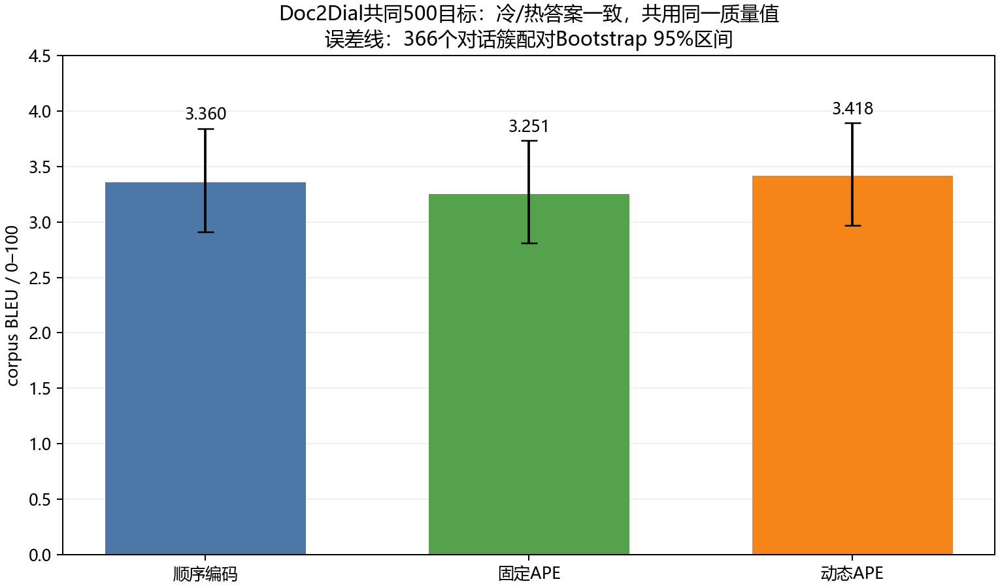
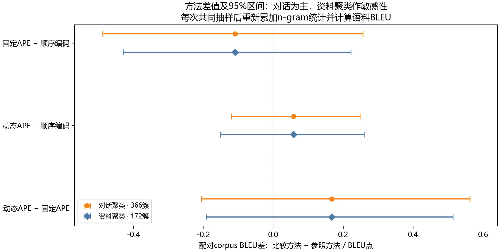
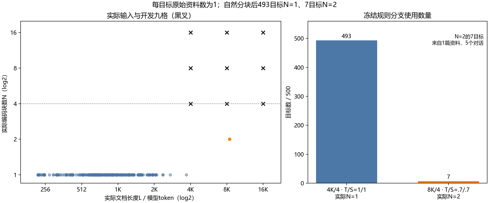
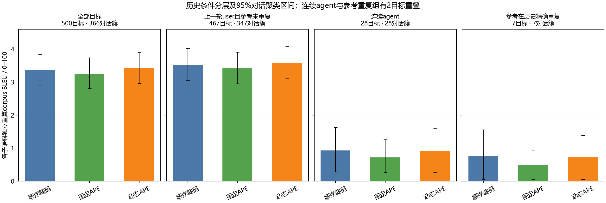
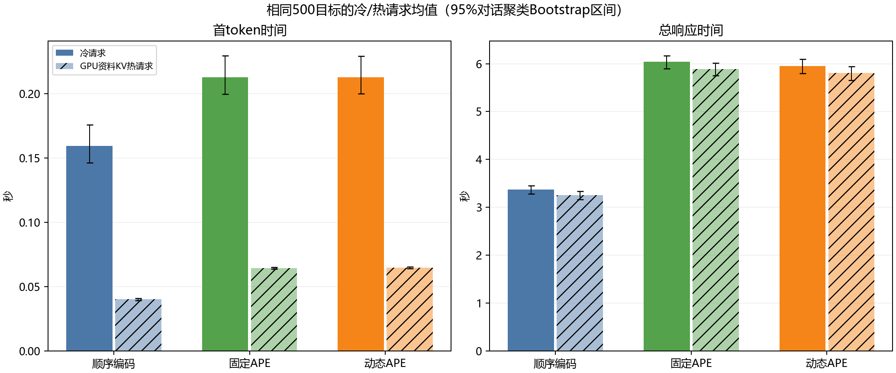
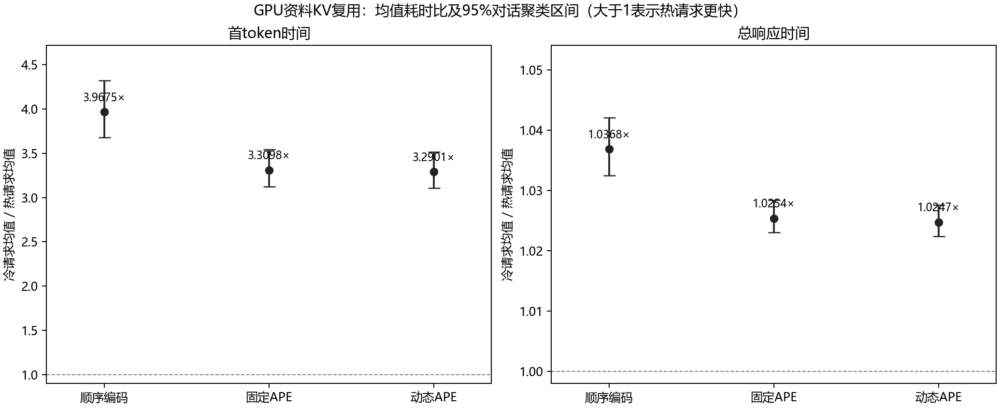
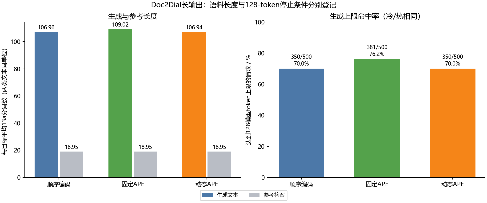
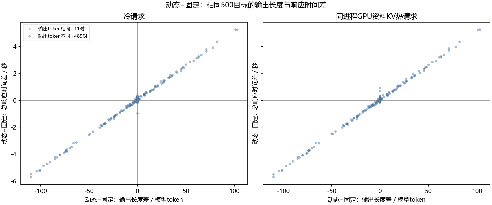

# 实验第八阶段：Doc2Dial多轮问答与资料KV复用

## 摘要

我们使用Doc2Dial的500个grounded agent目标轮次,比较顺序编码、固定APE与冻结动态APE,分别观测冷请求和同进程GPU资料KV热请求,共3000条生成。目标来自366个对话和172篇资料,完整保留历史并按原始agent轮次ID连接参考。我们复算语料级BLEU,按对话进行5000次配对聚类Bootstrap,资料聚类作为敏感性。顺序、固定和动态BLEU为3.360、3.251、3.418,冷热完全相同；动态相对固定提高0.167分,95%区间[-0.205,0.562],资料敏感性区间[-0.192,0.514]。1500次热请求均命中资料KV并重新生成答案,平均TTFT从0.159/0.213/0.213秒降至0.040/0.064/0.065秒,总响应分别节省0.120/0.149/0.144秒。493目标实际N=1,7目标N=2且共用一篇资料；生成上限命中率70%–76.2%,生成文本为参考长度约5.6倍。我们保留连续agent、历史参考重复及1条语言差异参考的原始目标,另列分层与敏感性。结果为质量点估计小幅改善、冷热质量持平,KV复用收益主要体现在首token时间。

关键词：Doc2Dial；语料BLEU；GPU KV复用；动态APE；多轮历史

## 1 研究问题、目标与输入

我们评价动态选参在公共服务多轮问答中的质量变化,并测量资料GPU KV复用对TTFT及总响应的作用。材料来自MAIN80冻结500个目标,领域分布为va154、dmv125、ssa123、studentaid98。每个目标包含完整原始资料、此前全部历史、目标agent轮次和一条参考回答,三方法各生成cold/hot两次。

参考ID为dial_id与target_agent_turn−1拼接。这里的后缀取紧邻上一轮ID；28个目标的上一轮角色为agent,其最新user问题位于更早历史。我们分别保存last_turn与latest_user_utterance。完整历史为1–15轮,实际请求为24–443个模型token。500项原始输入/历史/资料/参考/模板核对及500项六条件配对全部通过。

共同模板沿用作者[标签与倒序历史规则](https://github.com/doc2dial/sharedtask-dialdoc2021/blob/master/scripts/subtask2/seq2seq_utils.py),将完整资料前置到title/doc_context之后,再提交last_turn和逆序完整历史,外层为同一Llama聊天封套。last_turn发言同时出现在完整历史中。资料前置使资料KV可在后续请求中复用,三方法采用同一适配。代码保留未grounding历史,本批该类历史轮次为0。

模型为Llama-3.1-8B-Instruct,物理GPU0、bfloat16、batch1、greedy、seed42、统一128新token上限,EOS或上限终止,关闭注意力观察器。运行记录PyTorch2.6.0+cu124、Transformers4.44.2、FlashAttention2.7.4.post1；方案登记RTX4090 48GB,本campaign缺GPU型号/总显存/驱动遥测。配置和来源登记保存在server_environment.csv。当前结果来自同一模型、同一campaign及共同模板。

## 2 缓存内容与热请求重新生成

每个目标先cold后hot,两次请求的历史、last_turn及参数相同。每方法由一个worker处理,hot复用其进程中的匹配资料KV。

| 内容 | 冷请求 | 热请求 |
|---|---|---|
| 标题/方法前缀及完整资料 | 重新编码并构建GPU KV | 匹配同一资料/配置的GPU KV |
| 完整历史、当前last_turn | prepare后进入query forward | 再次prepare并进入query forward |
| 答案 | 执行greedy生成循环 | 重新执行greedy生成循环 |
| 缓存构建/恢复 | 记录实际构建时间 | 1500次构建0、恢复重建0 |

1500个同目标/方法冷热对全部命中核对：独立request_started/ended事件完整、cold在hot之前、cold miss/hot hit、实际配置一致、输出token和参考完全相同。APE热请求的prefix/context调用为0、query调用等于本次输出token数；顺序方法使用普通forward路径,其APE-only计数器为0。相关事件行、原记录行和调用数保存在hot_generation_evidence.csv及cold_hot_pairs.csv。资料文件加载、GPU资料KV、历史请求和答案生成分别按以上实际路径说明。

## 3 评分与统计口径

质量按[DialDoc21评分入口](https://github.com/doc2dial/sharedtask-dialdoc2021/blob/master/scripts/sharedtask_utils.py)使用完整回答和严格ID连接的agent参考,复算corpus BLEU。SacreBLEU设置对照[2.4.3实现](https://github.com/mjpost/sacrebleu/blob/v2.4.3/sacrebleu/metrics/bleu.py)：13a、mixed case、1–4gram、exp平滑、effective_order=False、一条参考。服务器签名为`nrefs:1|case:mixed|eff:no|tok:13a|smooth:exp|version:2.4.3`。

本地未安装SacreBLEU；我们复用前置审核的标准库充分统计实现,用NumPy批量重算Bootstrap语料分数。六组服务器BLEU及系统/参考长度、各阶匹配数和总数逐项吻合,另通过5个零匹配、缺4gram及平滑边界实例。本阶段未安装依赖。单目标保存score用于选例；主表先累计所有目标的ngram计数/长度,再计算精度几何均值和长度惩罚。每次Bootstrap也重新累计后计分。

按用户规划,主CI以366个对话聚类,资料172簇作敏感性。每次有放回抽取与原来同数的簇,保留簇内全部目标及六个方法/缓存条件。原冻结group字段对应资料,主对话簇另用domain/doc_id/dial_id。最大对话簇4目标、最大资料簇13目标。seed20261116,5000次,取2.5%和97.5%分位数；各对比区间单独计算。效率均值除以本次抽到的目标数,中位数/P90取实际每条件500请求。

区间反映目标及其对话/资料来源的样本构成变化,参数和模板在重采样中固定。六条件配对共同保留,冷热相同答案在每次抽样中的语料分数仍一致。N=2子组只有1篇资料,资料间变动缺少第二篇观察,其资料CI留空；5个对话的CI对应这一篇资料内的对话变化。源簇成员、抽到的目标数量范围和随机子序列见membership.csv、bootstrap_diagnostics.csv。

## 4 语料级BLEU与方法差

BLEU以原0–100值展示,每条件500个目标。

| 方法 | 冷BLEU | 热BLEU | 对话聚类95%区间 | 资料聚类95%区间 |
|---|---|---|---|---|
| 顺序编码 | 3.360 | 3.360 | [2.912, 3.840] | [2.957, 3.766] |
| 固定APE | 3.251 | 3.251 | [2.808, 3.732] | [2.888, 3.663] |
| 动态APE | 3.418 | 3.418 | [2.967, 3.891] | [3.018, 3.835] |

| 比较−参照 | BLEU差 | 对话CI | 资料CI |
|---|---|---|---|
| 固定APE−顺序编码 | -0.109 | [-0.488, 0.257] | [-0.430, 0.222] |
| 动态APE−顺序编码 | +0.058 | [-0.120, 0.248] | [-0.151, 0.260] |
| 动态APE−固定APE | +0.167 | [-0.205, 0.562] | [-0.192, 0.514] |

动态相对固定的点估计提高0.167 BLEU,对话区间[-0.205,0.562]、资料区间[-0.192,0.514]；动态相对顺序提高0.058,两种区间也跨0。冷热答案逐token相同,各方法冷热BLEU差及其配对区间均为0。主表保持全部500个原始目标。

生成长度与精度分解如下,单位均为13a分词数或百分精度。BP在三方法主语料均为1。

| 方法 | 生成/参考13a分词数 | 长度比 | 1/2/3/4gram精度% |
|---|---|---|---|
| 顺序编码 | 53481/9475 | 5.644 | 9.250/3.696/2.302/1.620 |
| 固定APE | 54508/9475 | 5.753 | 9.149/3.570/2.187/1.564 |
| 动态APE | 53468/9475 | 5.643 | 9.234/3.723/2.356/1.686 |

参考共9475个13a token,均值18.95；生成约106.94–109.02个13a token/目标。完整输出比参考长约5.6倍且高阶ngram匹配比例低,形成表中约3.3–3.4的语料BLEU。模型输出token均值另表记录,与13a分词单位分别标注。

## 5 实际编码块数、规则映射及历史条件

| 实际N | 目标数 | 对话/资料数 | L范围/token | 映射格 | 动态T/S | 顺序/固定/动态子语料BLEU |
|---|---|---|---|---|---|---|
| 1 | 493 | 361/171 | 223–3771 | 4096/4 | 1.0/1.0 | 3.317/3.236/3.446 |
| 2 | 7 | 5/1 | 8611–8611 | 8192/4 | 0.7/0.7 | 6.056/4.152/1.029 |

493目标取1/1,7目标取0.7/0.7,固定均为0.7/1.0。全部实际N低于开发网格最小N=4；N2的7目标均来自同一篇studentaid资料、5个对话。N1动态−固定+0.210 BLEU,区间[-0.160,0.584]；N2为-3.123,同资料内对话CI[-5.018,0.240],资料间CI留空。总体由子组ngram计数相加后求BLEU,分组分数按各自子语料计算。

| 上一轮agent | 参考历史重复 | 目标数 | 六条件生成数 |
|---|---|---|---|
| False | False | 467 | 2802 |
| False | True | 5 | 30 |
| True | False | 26 | 156 |
| True | True | 2 | 12 |

28个连续agent目标与7个历史参考重复目标相交2个,合计33目标、198条生成。467目标的上一轮为user且参考未在历史精确重复。500目标的完整历史保留,分层按原始输入条件定义。

| 原始条件 | 目标数 | 顺序BLEU | 固定BLEU | 动态BLEU | 动态−固定及对话CI |
|---|---|---|---|---|---|
| 上一轮user且无历史参考重复 | 467 | 3.509 | 3.411 | 3.575 | +0.164 [-0.235, 0.549] |
| 上一轮agent | 28 | 0.931 | 0.719 | 0.911 | +0.191 [-0.041, 0.429] |
| 参考历史精确重复 | 7 | 0.764 | 0.493 | 0.729 | +0.236 [-0.010, 0.655] |
| 两标记的并集 | 33 | 0.957 | 0.698 | 0.930 | +0.232 [0.001, 0.452] |

例如22198e14bb6cd2a93ec1f6540101934b_2的目标与前一个agent文本均为gh,最近user文本为hg。该目标按官方agent轮次ID连接,原始片段及匹配历史轮次在history_condition_evidence.csv保存。

## 6 冷热效率与缓存收益

每行500个目标请求,均值/中位数/P90单位为秒,输出token含EOS。

| 方法/条件 | TTFT均值 | TTFT中位数/P90 | 总响应均值 | 总响应中位数/P90 | 输出token均值 |
|---|---|---|---|---|---|
| 顺序编码/冷请求 | 0.1592 | 0.1352/0.2121 | 3.3714 | 3.7470/3.8643 | 112.922 |
| 顺序编码/热请求 | 0.0401 | 0.0379/0.0530 | 3.2516 | 3.6591/3.7146 | 112.922 |
| 固定APE/冷请求 | 0.2128 | 0.1883/0.2647 | 6.0380 | 6.6257/6.7480 | 115.524 |
| 固定APE/热请求 | 0.0643 | 0.0618/0.0770 | 5.8887 | 6.5032/6.5767 | 115.524 |
| 动态APE/冷请求 | 0.2128 | 0.1908/0.2659 | 5.9492 | 6.6408/6.7986 | 113.204 |
| 动态APE/热请求 | 0.0647 | 0.0624/0.0771 | 5.8056 | 6.5193/6.6325 | 113.204 |

| 方法/指标 | 热−冷/毫秒 | 对话CI/毫秒 | 逐对加速比均值/中位数 | 均值耗时比及CI |
|---|---|---|---|---|
| 顺序编码/ttft_seconds | -119.11 | [-135.16,-106.58] | 3.857/3.437 | 3.968 [3.680, 4.323]  |
| 顺序编码/total_seconds | -119.81 | [-136.95,-105.89] | 1.040/1.030 | 1.037 [1.032, 1.042]  |
| 固定APE/ttft_seconds | -148.51 | [-164.68,-135.85] | 3.256/2.939 | 3.310 [3.122, 3.542]  |
| 固定APE/total_seconds | -149.30 | [-166.99,-135.54] | 1.028/1.021 | 1.025 [1.023, 1.028]  |
| 动态APE/ttft_seconds | -148.10 | [-163.95,-135.72] | 3.238/2.943 | 3.290 [3.108, 3.515]  |
| 动态APE/total_seconds | -143.58 | [-159.62,-130.09] | 1.027/1.021 | 1.025 [1.022, 1.028]  |

加速比定义为cold时间÷hot时间；逐对比值均值与均值时间比按各自公式保留。平均TTFT的冷/热均值比分别为3.968、3.310、3.290,总响应均值比分别为1.037、1.025、1.025。热请求主要节省资料编码,输出生成仍完整执行。动态热请求首token后剩余平均5.741秒,占热总响应98.89%。

| 方法/条件 | KV构建均值/秒 | 获取均值/微秒 | 参数分支均值/微秒 | allocated均值/GiB | reserved均值/GiB |
|---|---|---|---|---|---|
| 顺序编码/冷请求 | 0.1189 | 0.271 | 0.937 | 15.428 | 18.689 |
| 顺序编码/热请求 | 0.0000 | 11.090 | 0.908 | 15.419 | 18.689 |
| 固定APE/冷请求 | 0.1481 | 0.278 | 1.821 | 15.453 | 19.119 |
| 固定APE/热请求 | 0.0000 | 11.376 | 1.816 | 15.445 | 19.119 |
| 动态APE/冷请求 | 0.1478 | 0.292 | 21.203 | 15.452 | 19.119 |
| 动态APE/热请求 | 0.0000 | 11.721 | 21.177 | 15.444 | 19.119 |

峰值按请求开始重置,覆盖模型、开始时存活资料KV及本次请求,GiB=bytes/2³⁰,reserved含worker内分配器历史。每个指标的完整中位数/P90/均值CI和资料敏感性见efficiency_descriptive.csv。

| 动态−固定 | 总响应差/秒 | 对话CI/秒 | TTFT差/毫秒 | TTFT对话CI/毫秒 |
|---|---|---|---|---|
| 冷请求 | -0.0888 | [-0.1941, 0.0169] | -0.041 | [-1.516,0.786] |
| 热请求 | -0.0831 | [-0.1880, 0.0244] | +0.373 | [0.147,0.613] |

动态相对固定平均少2.320个输出token,冷总响应缩短0.0888秒、热缩短0.0831秒,两种总响应差区间均跨0。顺序与动态有296/500目标输出token相同,该组动态冷/热总响应仍分别平均多2.479/2.452秒。源码中APE query继续执行文档/其他两分支注意力和混合,资料循环逐块forward；单块占493/500的这批输入保留该执行路径。

三方法worker按顺序执行,模型加载为4.796、4.805、5.380秒,排除于请求时延。起止为顺序编码: 2026-11-14T19:29:12+08:00 至 2026-11-14T20:24:52+08:00；固定APE: 2026-11-14T20:24:54+08:00 至 2026-11-14T22:04:46+08:00；动态APE: 2026-11-14T22:04:47+08:00 至 2026-11-14T23:43:11+08:00。完整metadata见model_load_workers.csv。

## 7 输出长度、EOS与上限

| 方法（每种缓存500） | 命中128/500 | 比例 | EOS终止 | EOS恰在上限 |
|---|---|---|---|---|
| 顺序编码 | 350 | 70.0% | 151 | 1 |
| 固定APE | 381 | 76.2% | 119 | 0 |
| 动态APE | 350 | 70.0% | 150 | 0 |

冷热token相同,上表计数在两种缓存条件分别相同。全部3000条中2162条达到上限（72.07%）,840条以EOS结束,其中2条EOS恰在上限。每个方法的输出中位数和P90均为128 token。

| 方法/冷请求分组 | 目标数 | 子语料BLEU | 总响应均值/秒 | 输出token均值 | 13a长度比 |
|---|---|---|---|---|---|
| 顺序编码 未达上限 | 150 | 4.594 | 2.326 | 77.74 | 3.778 |
| 顺序编码 达上限 | 350 | 3.045 | 3.819 | 128.00 | 6.466 |
| 固定APE 未达上限 | 119 | 5.179 | 3.981 | 75.58 | 3.537 |
| 固定APE 达上限 | 381 | 2.898 | 6.680 | 128.00 | 6.496 |
| 动态APE 未达上限 | 150 | 4.569 | 4.157 | 78.68 | 3.867 |
| 动态APE 达上限 | 350 | 3.120 | 6.717 | 128.00 | 6.411 |

按实际输出长度形成的子语料分别累计ngram计数。动态达到上限的350目标平均冷响应6.717秒、BLEU3.120；其余150目标为4.157秒、BLEU4.569。原生成、参考、结束条件和源行在generation_cap_records.csv保留。完整生成长度及相同/不同输出分组用于解释耗时,不调整本次生成或评分。

## 8 案例与原始语言问题

案例按动态−固定的保存单目标默认corpus BLEU选择最大正差、最大负差和零差,并列按sample_id排序。该辅助分数用于选例；总体统计始终使用语料级BLEU。冷热答案相同,四条源行均保留于selected_cases.csv。

### 8.1 改善：4b3bb867f442586694d2824e9d26ed8b_10

last_turn：Alright. So I happen to have a drivers license in another state. Can I get some sort of permit to drive in NY?

参考：Yes, you can receive a conditional driving privilege or a restricted driving privilege to drive in NY State. The conditions or the restrictions are the same as the conditions or restrictions for a driver with a NY State driver license.

固定T/S=0.7/1.0,动态=1.0/1.0；单目标辅助BLEU 5.543→36.604,差+31.061。输出token 128→55。原始记录行：固定冷/热16527/16528,动态冷/热17527/17528。

动态答案直接回应纽约驾驶许可问题,与参考共享较长的条件/限制表述；固定答案以对话复述展开并达到生成上限。两份原答案在案例CSV完整并列。

### 8.2 退化：8e491749cbdbf0dfb902f91299a9e330_1

last_turn：How much will my service member pay for dependent coverage?

参考：Nothing.s We provide dependent coverage at no cost until the child is 18 years old , or sometimes longer if the child meets one of the requirements listed below

固定T/S=0.7/1.0,动态=1.0/1.0；单目标辅助BLEU 53.791→22.385,差-31.406。输出token 48→119。原始记录行：固定冷/热16645/16646,动态冷/热17645/17646。

两份生成均回答dependent coverage免费,动态继续补充列表和扩展条件,与参考的ngram精度下降且回答变长。参考原文包含Nothing.s拼写,按原始目标保留。

### 8.3 持平：1085067334266d41636126e5b9ee9519_5

last_turn：I want to know about the DEA Educational Assistance Program for Survivors and Dependents.?

参考：puede obtener ayuda para pagar la escuela o la capacitación laboral

固定T/S=0.7/1.0,动态=1.0/1.0；单目标辅助BLEU 0.000→0.000,差+0.000。输出token 128→128。原始记录行：固定冷/热16981/16982,动态冷/热17981/17982。

该例请求和两份输出为英文,参考为西语,两份单目标词面得分均为0。原始target第6轮的西语文本与冻结参考匹配,仅去首尾空白；连接正确。原始target、历史及来源span证据保存在sources/reference_language_evidence.json。

对500参考按明确西语词及重音字符作定向候选检索并人工确认,得到这一条西语参考。主表保留全部500目标；移除该条的499目标敏感性为顺序3.367、固定3.258、动态3.426,动态−固定+0.168分,与主表+0.167接近。候选检索规则和实际文本在reference_language_candidates.csv,原始资料不改写。

## 9 审核、补实验与复现

| 具体问题 | 证据和范围 | 本阶段处理 | 建议补充 |
|---|---|---|---|
| 历史相关性与目标角色 | 500目标来自366对话/172资料;28上一轮为agent,7参考历史重复,交集2 | 500主表保留;467普通条件/33标记条件分层;对话主CI/资料敏感性 | 原始角色条件分别复核,新增规范user→agent目标对照 |
| 热请求为相同目标再次提交 | 1500热请求同worker GPU KV命中,build/rebuild0,答案token全同 | 资料KV与历史/请求/答案重新计算分开解释;保留事件行和阶段调用 | 增加同资料下不同目标轮次的连续应用热测 |
| N2仅一篇资料 | 493目标N1取1/1;7目标N2来自5对话/同一studentaid资料,取.7/.7 | 子语料单独累计计分;N2资料CI留空,5对话CI注明同资料内变化 | 增加独立N2及更大N资料的开发/验证/冻结后测试 |
| 高生成上限命中率且输出较参考长 | 每法70%/76.2%/70%;13a系统长度为参考约5.64/5.75/5.64倍 | 记录cap/EOS,按实际长度分组,原始答案/参考保留 | 统一简洁模板及输出长度控制对照,保存结束原因/逐token时标 |
| 英文请求/西语参考 | 确认1085067334266d41636126e5b9ee9519_5原target6为西语,连接正确 | 原500保留;原始target/历史存最小证据;499目标敏感性另列 | 原标注人工语言核对后,另版本定义语言匹配的参考条件 |
| 毫秒差与连续worker顺序 | 每方法一个worker,cold后立即hot;模型加载与请求分开 | 报告源簇CI、顺序、输出长度、两种加速比及显存口径 | 同资料生命周期内交错重复测时,分解prefill/query/decode |

本次计分与服务器六组语料分数、充分统计及配置签名一致。所有3000条均成功、attempt=1,无重复成功、空答案、缺参考或非法值。目标ID、完整资料、历史、模板和参考连接通过前置检查与本阶段字段连接。源证据、冻结规则和主样本范围保留,发现的角色/历史/语言条件单列处理。

建议后续对同资料不同目标轮次做连续热测,增加独立N2及更大N资料,统一比较简洁回答模板与生成长度控制,保存逐token/结束事件并交错重复测时。语言修订和参考规范化另定义数据版本。以上均登记为补实验事项,本轮只完成本地CPU复算。

## 10 结论

在共同500目标上,动态BLEU3.418较固定3.251高0.167,主对话CI[-0.205,0.562],资料CI[-0.192,0.514]；相对顺序3.360高0.058。冷热答案和质量完全相同。动态的总体点估计小幅提高,子语料N2的7目标明显下降,该子组来源仅一篇资料。

热GPU资料KV使平均TTFT降至0.040–0.065秒,冷/热TTFT均值比3.29–3.97；总响应平均节省0.120–0.149秒,均值比1.025–1.037。平均113–116个模型token的生成占据主要响应时间,70%–76.2%的上限命中率与长于参考的文本共同影响效率和BLEU精度。实际模板、资料/历史缓存区分、同题热复用、源簇相关性及单模型/单campaign设置随结果保留。

实际分析提交227116e4a004153272640cfe31087a033861b8e9,与参考提交相同。环境版本、独立评分引擎、seed20261116、5000次重采样及随机子序列在environment.json；数据字段、筛选、分母、公式和来源在provenance.csv。研究状态保持SUBMITTED,执行停止在第八阶段,后续综合报告待用户审阅规划后进行。
